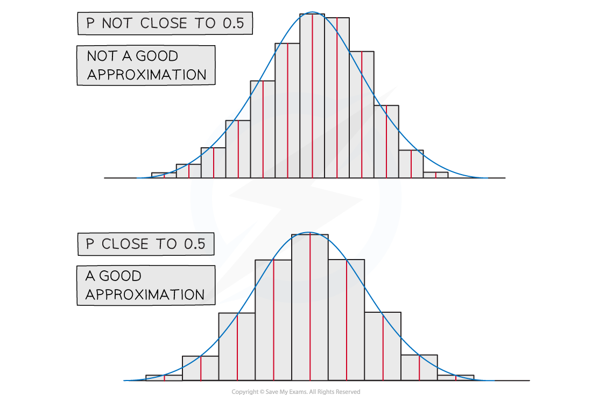

# Normal Approximation of a Binomial Distribution

## Normal Approximation of Binomial

> **Spec point** — `spcpt_BxG2b7KqnDXhkGcJ`

## Normal Approximation of Binomial

#### When can I use a normal distribution to approximate a binomial distribution?

- A binomial distribution `begin mathsize 16px style X tilde straight B left parenthesis n comma p right parenthesis end style` can be **approximated** by a normal distribution `X subscript N tilde straight N left parenthesis mu comma sigma squared right parenthesis`  provided

  - ***n***** is large**
  - ***p***** is close to 0.5**
  
    - $np>5$
    - $nq>5whereq=1-p$
- The mean and variance of a binomial distribution can be calculated by:

  - $μ=np$
  - $σ^{2}=np(1-p)$

#### Why do we use approximations?

- If there are a large number of values for a binomial distribution there could be a lot of calculations involved and it is inefficient to work with the binomial distribution

  - These days calculators can calculate binomial probabilities so approximations are no longer necessary
  - However it is **easier** to work with a normal distribution
  
    - You can calculate the probability of a range of values quickly
    - You can use the inverse normal distribution function (most calculators don't have an inverse binomial distribution function)
- In your exam you must use the formula and not a calculator to find binomial probabilities so you are limited to small values of *n*

#### What are continuity corrections?

- The **binomial distribution is discrete** and the **normal distribution is continuous**
- A **continuity correction** takes this into account when using a normal approximation
- The probability being found will need to be changed from a discrete variable, *X*,   to a continuous variable, *X**N*

  - For example, *X* = 4 for binomial can be thought of as $3.5\leqX_{N}<4.5$ for normal as every number within this interval rounds to 4
  - Remember that for a normal distribution the probability of a single value is zero so $P(3.5\leqX_{N}<4.5)=P(3.5<X_{N}<4.5)$

#### How do I apply continuity corrections?

- Think about what is **largest/smallest integer** that can be included in the inequality for the discrete distribution and then find its **upper/lower bound**
- $P(X=k)\approxP(k-0.5<X_{N}<k+0.5)$
- $P(X\leqk)\approxP(X_{N}<k+0.5)$

  - You add 0.5 as you want to include *k* in the inequality
- $P(X<k)\approxP(X_{N}<k-0.5)$

  - You subtract 0.5 as you don't want to include *k* in the inequality
- $P(X\geqk)\approxP(X_{N}>k-0.5)$

  - You subtract 0.5 as you want to include *k* in the inequality
- $P(X>k)\approxP(X_{N}>k+0.5)$

  - You add 0.5 as you don't want to include *k*  in the inequality
- For a closed inequality such as $P(a<X\leqb)$

  - Think about each inequality separately and use above
  - $P(X>a)\approxP(X_{N}>a+0.5)$
  - $P(X\leqb)\approxP(X_{N}<b+0.5)$
  - Combine to give
  - $P(a+0.5<X_{N}<b+0.5)$

#### How do I approximate a probability?

- **STEP 1**: Find the **mean** and **variance** of the approximating distribution

  - $μ=np$
  - $σ^{2}=np(1-p)$
- **STEP 2**: Apply **continuity corrections** to the inequality
- **STEP 3**: Find the **probability** of the new corrected inequality

  - Find the standard normal probability and use the **table of the normal distribution**
- The probability will not be exact as it is an approximate but provided n is large and p is close to 0.5 then it will be a close approximation

  - To decide if** n is large enough **and if ***p***** is close enough to 0.5 **check that:
  
    - $np>5$
    - $np>5$** where **$q=1-p$

> **Worked Example**
> The random variable `X tilde B left parenthesis 1250 comma space 0.4 right parenthesis.`
> 
> Use a suitable approximating distribution to approximate $P(485\leqX\leq530)$.
> 
> **Answer:**
> 
> 

> **Exam Hint**
> - In the exam, the question will often tell you to use a normal approximation but sometimes you will have to recognise that you should do so for yourself. Look for the conditions mentioned in this revision note, *n *is large, *p *is close to 0.5, *np > 5 *and *nq > 5.*
