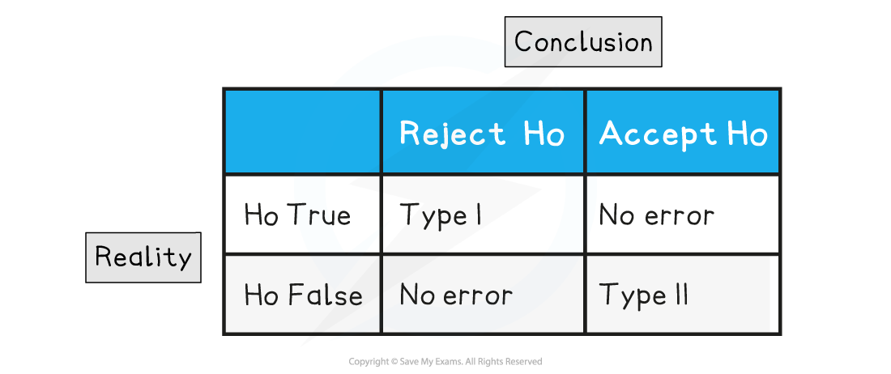

# Type I & Type II Errors

## Type I & Type II Errors

> **Spec point** — `spcpt_KCFcWTMfnmj3W3yc`

## Type I & Type II Errors

Any hypothesis test will only provide evidence about whether a parameter has changed or not. A conclusion can not claim with certainty whether to accept or reject the null hypothesis as the test is based on probability, and therefore errors are possible.

#### What is a Type I error?

- A Type I error occurs when the **null hypothesis is rejected incorrectly**

  - In order for a Type I error to happen, the null hypothesis **must have been rejected**
- If a Type I error has been made, the hypothesis test has provided evidence that there is a change when in fact there is **not a change**

  - Think about the impact of this in some scenarios
  
    - For example a test saying that a student had cheated in an exam when in fact they had not
- The probability of a Type I error occurring in any hypothesis test is the same as the probability of **rejecting a true null hypothesis**

  - This is the probability of the observed value being at least as extreme as the critical value(s)
  - It is the same or a little bit less than **the significance level**
- In a true hypothesis test you would not need to calculate the probability of a Type I error as it would be the same as the ***actual significance level***

#### What is a Type II error?

- A Type II error occurs when the **null hypothesis is accepted incorrectly**

  - In order for a Type II error to happen, the null hypothesis **must not **have been rejected
- If a Type II error has been made, the hypothesis test has provided evidence that there is no change when in fact there **was** a change

  - Think about the impact of this in some scenarios
  
    - For example a test saying that a car’s brakes have not worn down, when in fact they have
- To find probability of a Type II error occurring in any hypothesis test you would need to be given the true value of the population parameter being tested

  - For example, you would be given the true probability of the event occurring or the true population mean
  - The probability of a Type II error would be the probability of the observed value being **outside of the rejection** **region**, given the true value of the population parameter

#### Can the probabilities of making the errors be manipulated?

- It is possible to reduce the probability of making a Type I error by reducing the significance level before carrying out the test

  - However, this would decrease the size of the rejection region and therefore could increase the probability of a Type II error
- It is possible to reduce the probability of making a Type II error by increasing the significance level before carrying out the test

  - This would increase the size of the rejection region, making it easier to reject the null hypothesis
  - As the probability of rejecting the null hypothesis has increased, this would increase the probability of making a Type I error
- Before setting the significance level a researcher could consider which error they would want to reduce the likelihood of

  - For example, if the test is for a company advertising that their product works 90% of the time, but customers believe it may be less than this:
  
    - the company would want to reduce the probability of a Type I error (incorrectly declaring a change)
    - the customers would want to reduce the probability of a Type II error (incorrectly declaring no change)

> **Worked Example**
> In the following scenarios, decide whether a Type I error or Type II error could have occurred
> 
> (i) A farmer is testing for a change in crop growth after trying a new fertiliser. The test concludes that there is no evidence of change at the 5% significance level.
> 
> (ii) A dentist’s receptionist believes that the waiting times have been reduced due to a new scheduling system. They conduct a hypothesis test and will reject the null hypothesis if no more than two customers wait more than ten minutes. Exactly two customers have to wait more than ten minutes.
> 
> **Answer:**
> 
> 

> **Exam Hint**
> - Here are two tips if you cannot remember which error is which but are asked to calculate one on the exam:
> 
>   - Look to see if you are given a new population parameter, this will be a Type II error.
>   - Check the number of marks, a Type I error is normally only 1 mark whilst a Type II error needs to be calculated and so will be more.
