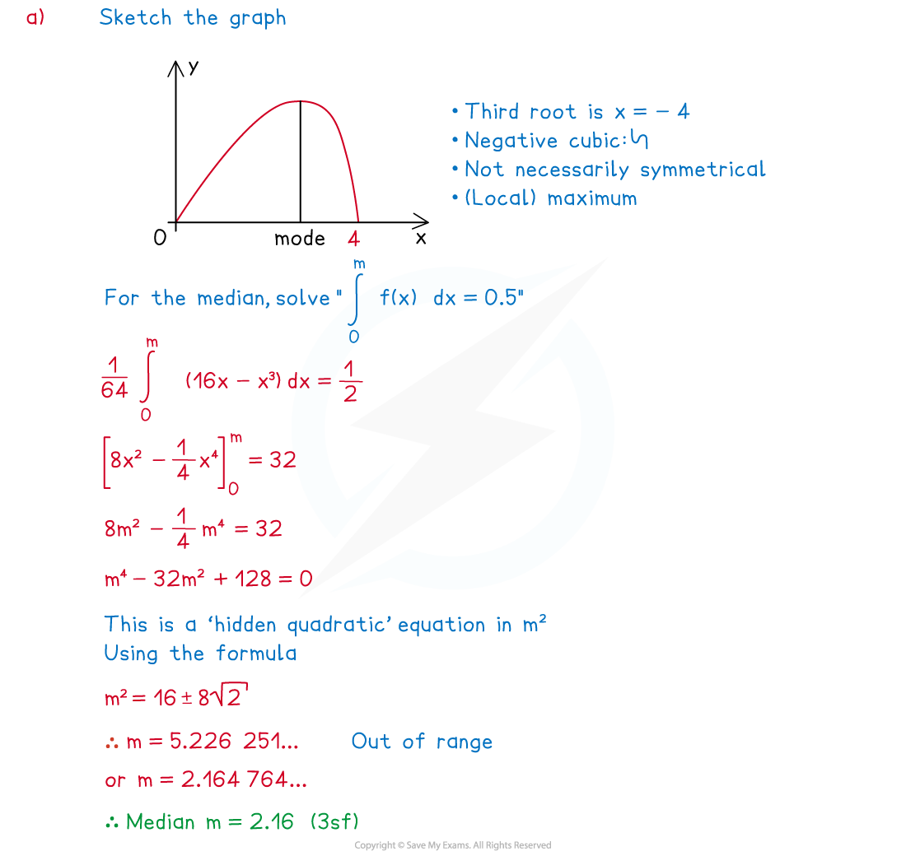
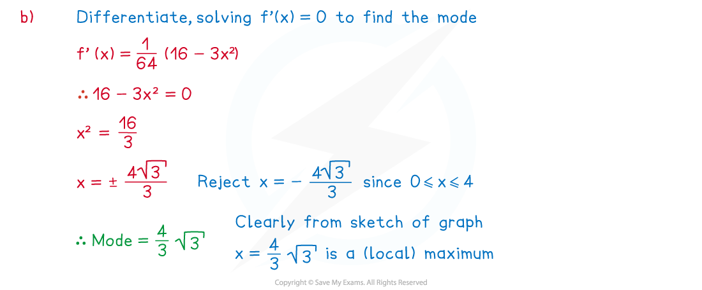

# Probability Density Function

## Calculating Probabilities using PDF

> **Spec point** — `spcpt_v7Mj9nd2MKFtYff7`

## Calculating Probabilities using PDF

#### What is a probability density function (p.d.f.)?

- For a ***continuous random variable*** , it is often possible to model probabilities using a function

  - This function is called a **probability density function (p.d.f.)**
  - For the continuous random variable,X , it would usually be denoted as a function of $x$  (such as f($x$)  or g($x$) )
- The distribution (or **density**) of probabilities can be illustrated by the graph of f($x$)
- The graph does not need to start and end on the x-axis

- For f($x$) to **represent** a p.d.f. the following conditions must apply

  - $f(x)\geq0$ for **all** values of $x$
  
    - This is the equivalent to $P(X=x)\geq0$  for a discrete random variable
  - The **area under the graph** must total 1

$integral_{ - } \text{infinity} ^{infinity} \mathrm{f} ( x ) dx = 1$

- This is equivalent to $Σ$ $P(X=x)=1$ for a discrete random variable

#### How do I find probabilities using a probability density function (p.d.f.)?

- The probability that the continuous random variable $X$ lies in the interval
$a\leqX\leqb$, where $X$ has the probability density function f($x$) , is given by

$\mathrm{P} ( a \text{less} \text{or} \text{equal} \text{than} X \text{less} \text{or} \text{equal} \text{than} b ) = \int_{a}^{b} \mathrm{f} ( \mathrm{x} ) \text{dx}$

- As with the **normal** **distribution **$P(a\leqX\leqb)=P(a<X<b)$

  - for any continuous random variable, $P(X=n)=0$  for all values of n
  - One way to think of this is that $a=b$ in the integral above

#### How do I solve problems using the PDF?

- Some questions may ask for justification of the use of a given function for a probability density function

  - In such cases check that the function meets the two conditions $f(x)\geq0$ for all values of $x$ and the total area under the graph is 1

- If asked to find a probability

  - STEP 1
  Identify the **probability** **density** **function**, f($x$), this may be given as a **graph**, an **equation** or as a **piecewise** **function**

e.g.  $\mathrm{f} ( \mathrm{x} ) = \{ \begin{gathered} 0.02 x 0 \text{less} \text{or} \text{equal} \text{than} x \text{less} \text{or} \text{equal} \text{than} 10 \\ 0 \text{otherwise} \end{gathered} )$

- STEP 2
Identify the **range** of $X$ for a particular problem

Remember that $P(a\leqX\leqb)=P(a<X<b)$

Question: Can you explain why this is so?
                            (Answer is at end of this section)

- STEP 3
**Sketching** the **graph** of y = f($x$) if **simple** may help to find the probability

  - Look for **basic** **shapes** such as **triangles** or **rectangles**; finding **areas** of these is easy and avoids integration
  - Look for **symmetry** in the graph that may make the problem easier
  - **Integrate f(**$x$**)** and evaluate it between the two limits for the **required** probability
- Trickier problems may involve finding a limit of the integral given its value

  - i.e. one of the values in the range of *X*, given the probability
  e.g.        Find the value of $a$ given $P(0\leqX\leqa)=0.09$
- Answer to question in STEP 2:
Since $P(X=a)=P(X=b)=0,P(a\leqX\leqb)=P(a<X<b)$

> **Worked Example**
> The continuous random variable, $X$, has probability density function
> 
> `f ( x ) = { | 0.08 x | 0 <= x <= 5 | | 0 otherwise | close`
> 
> (a) Show that $f(x)$ can represent a probability density function
> 
> **Answer:**
> 
> 
> 
> (b) Find
> 
> (i) $P(0\leqX\leq2)$
> 
> (ii) $P(X=3.2)$
> 
> (iii) $P(X>4)$
> 
> **Answer:**
> 
> 

> **Exam Hint**
> - If the graph is easy to draw, then a sketch of f(x) is helpful
> 
>   - This can highlight useful features such as the graph (and so probabilities) being **symmetrical**
>   - Some p.d.f. graphs lead to common shapes such as **triangles** or **rectangles** whose areas are easy to find, avoiding the need for integration

## Median and Mode of a CRV

> **Spec point** — `spcpt_VdGVXD7z4VX9BsBs`

## Median and Mode of a CRV

#### What is meant by the median of a continuous random variable?

- The **median**, ***m***, of a continuous random variable, *X* , with **probability** **density** **function f(x)** is defined as the value of the **continuous** **random** **variable** *X*, such that

$P(X<m)=P(X>m)=0.5$

- ** **Since $P(X=m)=0$ this can also be written as $P(X\leqm)=P(X\geqm)=0.5$
- If the p.d.f. is **symmetrical** (i.e. the graph of y = f(x) is symmetrical) then the median will be halfway between the lower and upper limits of x

  - In such cases the graph of y=f(x) has axis of symmetry in the line x = m

#### How do I find the median of a continuous random variable?

- By solving one of the equations to find *m*

$\int_{- \infty}^{m} \mathrm{f} ( x ) \text{dx} = 0.5$

and

$integral_{m}^{infinity} \mathrm{f} ( \mathrm{x} ) dx = 0.5$

- The equation that should be used will depend on the information in the question
- If the graph of $y=f(x)$ is **symmetrical**, symmetry may be used to deduce the median

#### How do I find quartiles (or percentiles) of a continuous random variable?

- In a similar way, to find the median

  - The lower quartile will be the value *L* such that P(*X* ≤ *L*) = 0.25 or
  P(*X* ≥ *L*) = 0.75
  - The upper quartile will be the value *U* such that P(*X* ≤ *U*) = 0.75 or
  P(*X* ≥ *U*) = 0.25
- Percentiles can be found in the same way

  - The 15th percentile will be the value *k* such that P(*X* ≤ *k*) = 0.15 or
  P(*X* ≥ *k*) = 0.85

#### What is meant by the mode of a continuous random variable?

- The **mode** of a continuous random variable, *X*  , with **probability** **density** **function f(x)** is the value of x that produces the greatest value of f(x) .

#### How do I find the mode of a PDF?

- This will depend on the type of function f(x); the easiest way to find the mode is by considering the shape of the graph of f(x)
- If the graph is a curve with a (local) **maximum** **point**, the mode can be found by **differentiating** and solving the equation f'(x) = 0

  - If there is more than one solution to f'(x) =  0 , further work may be needed to deduce which answer is the mode
  
    - Look for valid values of from the **definition** of the p.d.f.
    - Use the **second** **derivative** (f'' (x) ) to deduce the nature of each **stationary** **point**
    - You may need to check the values of f(x) at the **endpoints** too

> **Worked Example**
> The continuous random variable $X$  has probability density function $f(x)$ defined as
> 
> $\mathrm{f} ( x ) = \frac{1}{64} x ( 16 - x^{2} ) 0 \text{less} \text{or} \text{equal} \text{than} x \text{less} \text{or} \text{equal} \text{than} 4$
> 
> (a) Find the median of *X*, giving your answer to three significant figures
> 
> (b) Find the *exact* value of the mode of *X*

(a) Find the median of *X*, giving your answer to three significant figures

**Answer:**

(b) Find the *exact* value of the mode of *X*

**Answer:**

> **Exam Hint**
> - Avoid spending too long sketching the graph of  y = f(x), only do this if the graph is straightforward as finding the median and mode by other means can be just as quick
