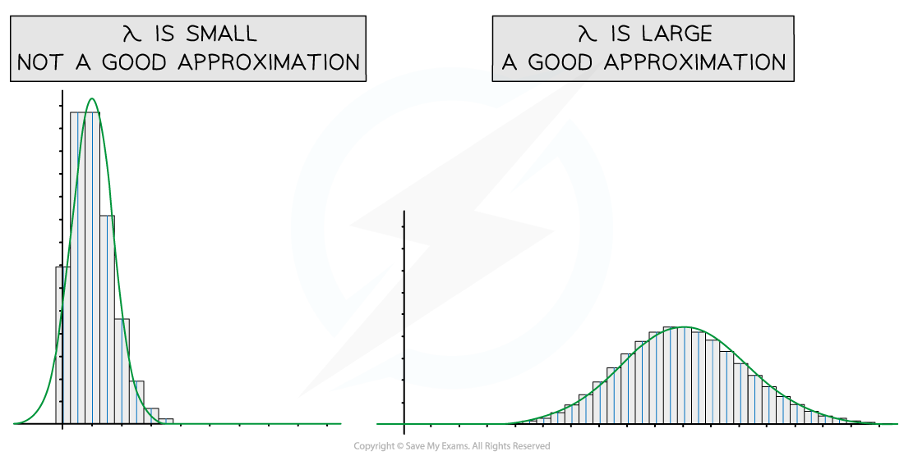
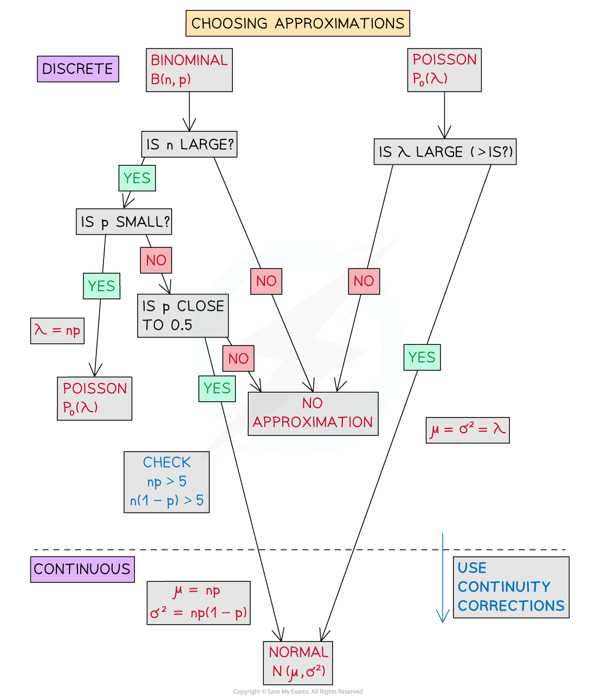

# Approximations of Distributions

## Normal Approximation of Poisson

> **Spec point** — `spcpt_H5hw3Xwrd5q3tMVf`

## Normal Approximation of Poisson

#### When can I use a normal distribution to approximate a Poisson distribution?

- A Poisson distribution $X \sim P o ( \lambda )$  can be **approximated** by a normal distribution $X_ N \sim N ( μ , σ ² )$  provided

  - $λ$** is sufficiently large **( > 15)
- Remember that the mean and variance of a Poisson distribution are approximately equal, therefore the parameters of the approximating distribution will be:

  - $μ=λ$
  - $σ^{2}=λ$
  - $σ=\sqrt{λ}$
- The greater the value of *λ* in a Poisson distribution, the more symmetrical the distribution becomes and the closer it resembles the bell-shaped curve of a normal distribution

#### What are continuity corrections?

- The **Poisson distribution is discrete** and the **normal distribution is continuous**
- A **continuity correction** takes this into account when using a normal approximation
- The probability being found will need to be changed from a discrete variable, X to a continuous variable, *X**N*

  - For example, *X* = 4 for Poisson can be thought of as $3.5\leqX_{N}<4.5$  for normal as every number within this interval rounds to 4
  - Remember that for a normal distribution the probability of a single value is zero so $P(3.5\leqX_{N}<4.5)=P(3.5<X_{N}<4.5)$

#### Do I need to use continuity corrections?

- Yes!
- As the Poisson distribution *X* is discrete and normal distribution XN is continuous you will need to use continuity corrections

  - $P(X=k)\approxP(k-0.5<X_{N}<k+0.5)$
  - $P(X\leqk)\approxP(X_{N}<k+0.5)$
  - $P(X<k)\approxP(X_{N}<k-0.5)$
  - $P(X\geqk)\approxP(X_{N}>k-0.5)$
  - $P(X>k)\approxP(X_{N}>k+0.5)$

#### How do I approximate a probability?

- **STEP 1**: Find the **mean** and **variance** of the approximating distribution

  - $μ=σ^{2}=λ$
- **STEP 2**: Apply **continuity corrections** to the inequality
- **STEP 3**: Find the **probability** of the new corrected inequality

  - Find the standard normal probability and use the **table of the normal distribution**
- The probability will not be exact as it is an approximation but provided *λ* is large enough (approximately > 15) then it will be a close approximation

> **Worked Example**
> The number of hits on a revision web page per hour can be modelled by the Poisson distribution with a mean of 40.  Find the probability that there are more than 50 hits on the webpage in a given hour.
> 
> **Answer:**
> 
> 

## Poisson Approximation of Binomial

> **Spec point** — `spcpt_z3bqrJJTTNNyrnj2`

## Poisson Approximation of Binomial

#### When can I use a Poisson distribution to approximate a binomial distribution?

- A binomial distribution B(*n,p*)can be **approximated** by a Poisson distribution provided

  - ***n***** is large **( typically >  50 )
  - ***p***** is small**
  - ***np *****is approximately less than 5**
- The mean of a binomial distribution can be calculated by:

  - $λ=np$
- The Poisson distribution is derived from the binomial distribution for conditions where *n* is becoming infinitely large and *p* is becoming infinitely small

#### Do I need to use continuity corrections?

- No!
- As both the binomial distribution and Poisson distribution are discrete there is no need for continuity corrections

> **Worked Example**
> It is known that one person in a thousand who checks a revision website will choose to subscribe. Given that the website received 3000 hits yesterday, find the probability that more than 5 people subscribed.
> 
> **Answer:**
> 
> 

## Choosing the Approximation

> **Spec point** — `spcpt_yJjTB6XVN77V49nJ`

## Choosing the Approximation

#### How will I choose which approximation to use?

- When deciding what approximating distribution to use first make sure you know the reason why you cannot find the probability using the original distribution

  - Is the value of *n* or *λ* too large?
  - Will it take too long to carry out the calculations?
- Make sure you know what distribution you are approximating **from**

  - If your distribution is a binomial distribution, you could either use a Poisson or a normal approximation
  - If your distribution is a Poisson distribution, you will use a normal approximation
- Use the conditions for approximations to decide which approximation is appropriate
- Calculate the parameters for the approximating distribution

> **Exam Hint**
> - If you are unsure, use the normal distribution to approximate the Poisson and the Poisson distribution to approximate the binomial as these are the two you will be examined on in Statistics 2. However, you should make sure you know the conditions for the normal approximation to the binomial as this may be tested.
