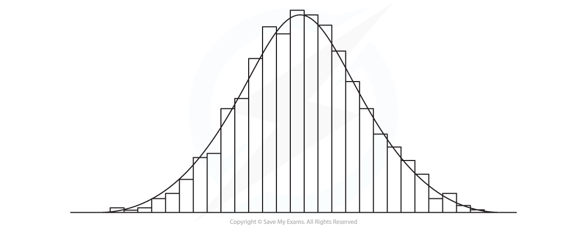

# Choosing Distributions

## Choosing Distributions

> **Spec point** — `spcpt_JctJy4spgKD9pRHB`

## Choosing Distributions

#### When should I use a Poisson distribution?

- A random variable that follows a **Poisson distribution** is a **discrete random variable**
- A Poisson distribution is used when the random variable **counts something**

  - The number of occurrences of an event in a given interval of time or space
- There are **three conditions** that must fulfil to follow a Poisson distribution

  - The **mean **number of occurrences is **known **and** finite *****(λ)***
  - The events occur at **random**
  - The events occur **singly **and **independently**

#### When should I use a normal distribution?

- A random variable that follows a **normal distribution** is a **continuous random variable**
- A normal distribution is used when the random variable **measures something** and the distribution is:

  - **Symmetrical**
  - **Bell-shaped**
- A normal distribution can be used to model real-life data provided the **histogram** for this data is **roughly symmetrical and bell-shaped**

  - If the variable is normally distributed then as more data is collected the outline of the histogram should get smoother and resemble a normal distribution curve

#### Will I still be expected to use the binomial and geometric distribution

- Knowledge of using the binomial and geometric distribution is expected for Statistics 2
- Remember the **three conditions** for both distributions

  - The trials are **independent**
  - There are **exactly two outcomes** of each trial (**success or failure**)
  - The **probability of success(p) ** **is constant**
- You will be expected to recognise when a random variable follows a **binomial** or **geometric** distribution and use their properties

  - A **binomial distribution **will** **have a **fixed finite number of trials(n)**
  - A **geometric distribution **will** **continue the trials until the **first success**

> **Exam Hint**
> - Always state what your variables and parameters represent.  Make sure you know the conditions for when each distribution is (or is not) a suitable model.
