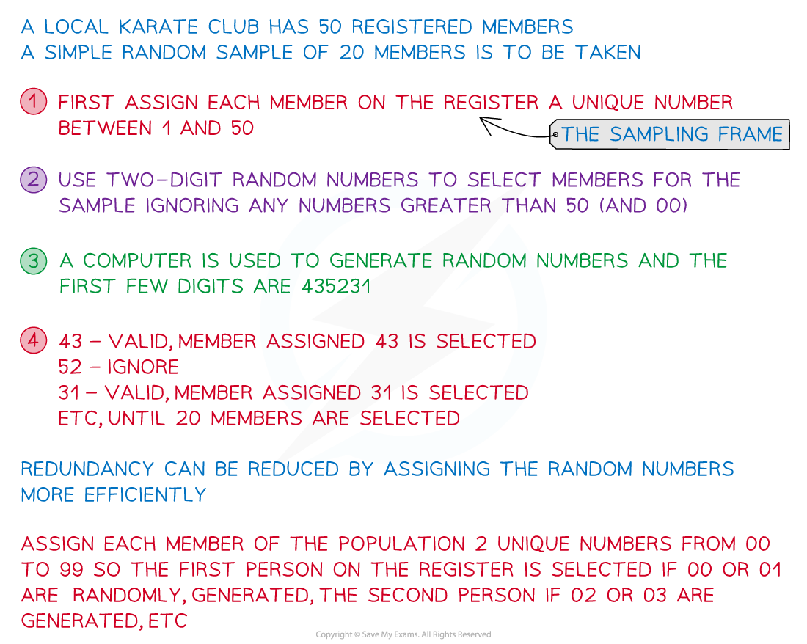

# Sampling & Data Collection

## Sampling Techniques

> **Spec point** — `spcpt_ww33xZDjskWFJSKC`

## Sampling Techniques

#### What is a population, a sample and the difference between them?

- The **population** refers to the **whole set** of things which you are interested in

  - e.g. if a vet wanted to know how long a typical French bulldog slept for in a day then the population would be all the French bulldogs in the world
- A **sample** refers to a **subset** of the **population** which is used to collect data from

  - e.g. the vet might take a sample of French bulldogs from different cities and record how long they sleep in a day
- A **sampling frame** is a **list** of all members of the **population**

  - For example: a list of employees’ names within a company
- The ***sampling fraction***** **is the **size** of the **sample** **divided** by the **size** of the **population**
- A **population parameter** is a **numerical value** which describes a **characteristic of the population**

  - These are usually unknown
  - For example: the mean height of all 16-year-olds in the UK
- A **sample statistic** is a **value** computed using **data from the sample**

  - These are used to estimate population parameters
  - For example: the mean height of 200 16-year-olds from randomly selected cities in the UK
- A **census** collects data about **all** the members of a **population**

  - For example: the Government in England does a national census every 10 years to collect data about every person living in England at the time

#### Why and how would I use a sample?

- A **sample** is used when it is **impractical** to use the **population**

  - e.g. It is impractical to test the lifetime of every lightbulb a factory produces as there would be none left to sell to customers!
- A **sample** can be used to **estimate** **population** **parameters**

  - e.g. Testing the lifetime of 50 lightbulbs a factory produces to estimate the average lifetime of all lightbulbs produced
- A **sample** needs to be **representative** of the **population** in order to produce **reliable** **estimates** of **parameters** – things to consider include

  - Sample size
  
    - A sample should be large enough
    - The sample size used will depend on the size of the population and the accuracy required

e.g.    A sample size of 30 to gauge the way the public will vote in a general election is clearly not large enough

- Any **bias** in the data
e.g. To estimate the proportion of people who enjoy watching movies, asking people in a cinema would introduce ***bias***
- Accidentally influencing data by phrasing of questions or the method of data collection

e.g.   “Do you agree that … ?” in a questionnaire is suggesting to the respondent that they should be agreeing
Collecting data about the length of vehicles by only collecting data about cars parked in a multi-storey car park

#### What is (simple) random sampling?

- Familiarity with **random** **sampling** and how to generate such a sample is expected
- For **random** **sampling**, **every** member of the population has an **equal** **probability** of being selected

  - A **sampling** **frame** is essential for a **simple** **random** **sample**
  - **Simple random sampling **is one method of random sampling - this is where every possible sample of size *n* has an equal probability of being selected as the sample
- In **random** **sampling**, every member of the population has a** non-zero** **probability** of being selected

#### How do I use random numbers or tables?

STEP 1  For **simple** **random** **sampling**, each member of the population – or each** element** in the **sampling** **frame** - is assigned a **unique number**

- e.g.    The 50 members on the register of a local karate club are each allocated one of the numbers from 1 - 50

STEP 2   **Random** **numbers** – or more accurately, random digits - can be used to select elements from the sampling    frame

- e.g.    Two-digit numbers would be needed for the karate club
- Use pairs of valid digits from a list of random numbers, ignoring those that do not correspond to a member on the register
If the string of random digits was 435231 then

  - 43 would be a valid member of the club
  - 52 would be ignored
  - 31 would be valid

- **Redundancy** (the number of invalid random digits) can be reduced or eliminated by **efficiently** allocating which random numbers correspond to which member

  - e.g.   Assign the (100) numbers 00-99 to the 50 members of the karate club such that each member is represented by two possible numbers
  - So the first person on the register would be selected if 00 and 01 came up, the second person on the register would be selected if the 02 and 03 came up, and so on
- Generally, calculators produce three digit (decimal) random numbers; tables are often printed with digits in blocks of five for ease of reading

  - as each digit is generated at random, they can be used to suit whatever the purpose is

## Sampling Critique

> **Spec point** — `spcpt_d52YFcN4KDPwpSjv`

## Sampling Critique

#### Why not use a census instead of a sample?

- The main **advantage** of a **census** is that it gives fully accurate results
- The **disadvantages** of a census are:

  - It is **time** consuming and expensive to carry out
  - It can be **impractical** – for example it could **destroy** or use up all the members of a population when they are consumables (imagine a company testing every lightbulb they produce)
- **Sampling** creates a **subset of the population** from which data can be collected
- The **advantages** of **sampling** are:

  - It is **quicker** and **cheaper** than a census
  - It leads to less data needing to be analysed
- The **disadvantages** of **sampling** are:

  - It might not be **representative** of the **population**
  - It could introduce **bias**

#### What are the main criticisms of sampling techniques?

- The **sampling** **technique** will be described in a question
- Criticisms normally arise from the **amount** of **data** collected or the **manner** in which data is **collected**

  - Most sampling techniques can be improved by taking a larger sample so consider the **sampling** **fraction**
  - Sampling can introduce **bias** – so look to see if bias has been considered
  
    - A **random** **sample** helps to **minimise** bias
- A **sample** only gives information about the **selected** members

  - But the results can be used as **estimates** for the **population**
- **Different** **samples** may lead to different conclusions about the population

> **Worked Example**
> Mike is a biologist studying mice in an open enclosure.
> He has access to 200 mice, with each individual mouse being easily identified by a unique number with a list of all mice kept on his computer.
> Mike wants to use a simple random sample of 10 mice for his latest project.
> 
> (a) Describe how Mike can **efficiently** use **all** three-digit random numbers to select the mice for his sample.
> 
> **Answer:**
> 
> 
> 
> (b) Identify the sampling frame in this context.
> 
> **Answer:**
> 
> 
> 
> (c) Suggest one way in which Mike could improve his sampling method.
> 
> **Answer:**
> 
> 

> **Exam Hint**
> - Use common sense when answering questions on this topic.
> The best way to get a deeper understanding of sampling is to read real articles in the news and think about the sampling methods that have been used – you may be able to suggest some improvements!
