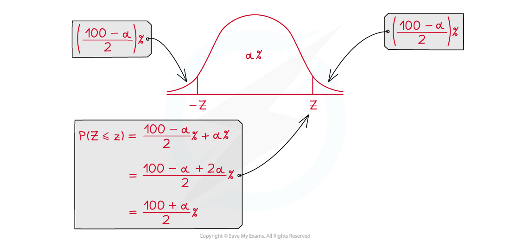
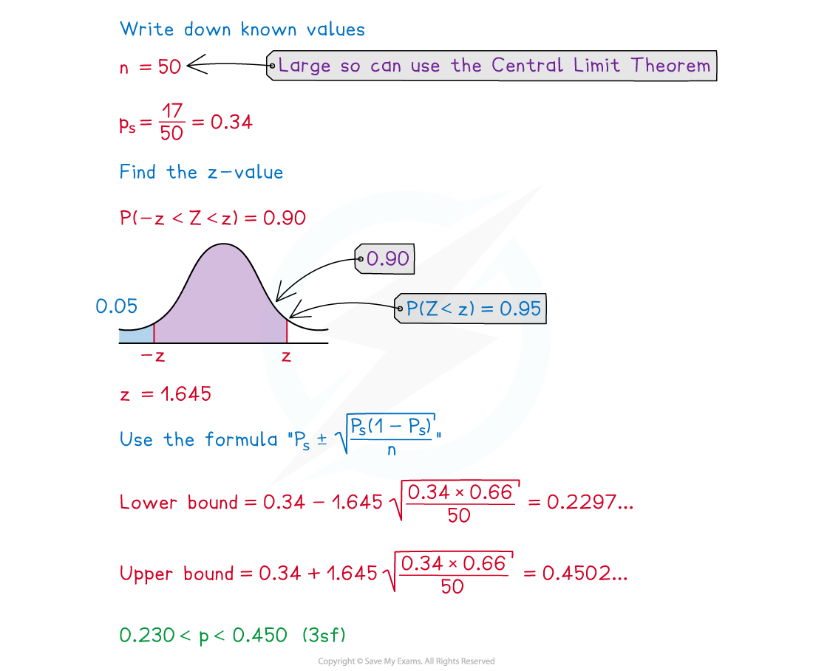

# Confidence Intervals

## Confidence Interval for μ

> **Spec point** — `spcpt_4rg88C35yg494Krw`

## Confidence Interval for μ

#### What is a confidence interval?

- It is **impossible** to find the **exact value** of a population parameter when taking a sample
- The best we can do is find an **interval** for which the exact value is likely to lie within

  - This is called a **confidence interval**
- The **confidence level** of a confidence interval is the **probability** that the **interval contains** the **population parameter**

  - Be careful with wording – the population parameter is a fixed value so it does not make sense to talk about the probability that it lies within an interval
  
    - Instead we talk about the probability an interval contains the parameter
  - Suppose samples were collected and a 95% confidence interval for a population parameter was constructed for each sample, then for every 100 intervals we would **expect on average 95** of them to contain the parameter
  
    - 95 out of 100 is **not guaranteed** – it is possible all of them could contain the parameter
    - It is possible (though **very** **unlikely**) that none of them contains the parameter

#### What affects the width of a confidence interval?

- The **width** of a confidence interval is the **range of the values** in the interval
- The **confidence level **affects the width

  - Increasing the confidence level will increase the width
  - Decreasing the confidence level will decrease the width
- The **size of the sample** affects the width

  - Increasing the sample size will decrease the width
  - Decreasing the sample size will increase the width

#### How do I calculate a confidence interval for the population mean (μ)?

- For this course we only construct **symmetrical confidence intervals** for the mean of a population when:

  - The **variance of the population** is **known**
  - The population follows a **normal distribution**
  - The population does not follow a normal distribution but the **sample size is big** enough to use the **Central Limit Theorem**
- The confidence interval can be found using the **formula**

$\overline{x}-z\times\frac{σ}{\sqrt{n}}<μ<\overline{x}+z\times\frac{σ}{\sqrt{n}}$

- *n* is the size of the sample
- σ is the standard deviation of the population
- $\overline{x}$ is the mean of the sample
- $z$ is the value such that $\mathrm{P} ( - z < Z < z ) = \\alpha \%$ where *α* is the confidence level

- The width of the confidence interval is

$2\timesz\times\frac{σ}{\sqrt{n}}$

- Note that the sample mean is the **midpoint** of the confidence interval and does not affect the width

#### How do I find the z-value for a confidence interval?

- You use the standard normal distribution $Z \sim N ( 0 , 1^{2} )$
- If the confidence level is % we find such that $P(-z<Z<z)=α$%
- To do this find $P(Z<z)$- it can be shown that this is $( \frac{\\alpha + 100}{2} )$%

- The z-values for common confidence levels are:

  - For 90%: $P(Z<z)$ = 0.95  so z = 1.645
  - For 95%: $P(Z<z)$ = 0.975 so z = 1.960
  - For 99%: $P(Z<z)$ = 0.995 so z = 2.576
  
    - z-values for most confidence intervals you will need to work with will be given in the table of critical values

#### How can I interpret a confidence interval?

- After you have calculated a confidence interval for *μ* you might be expected to comment on the possibility of *μ* being a specific value
- If the value which is claimed to be *μ* is **within** the confidence interval then there is **evidence** to **support the claim**
- If the value is **outside** the interval then there is **not enough evidence** to support the claim

> **Worked Example**
> The battery life of a certain brand of phone, $L$ hours, is known to follow a normal distribution with mean $μ$ and variance 16. Jonny takes a random sample of 20 phones and calculates the mean battery life to be 20.3 hours.
> 
> Calculate a 95% confidence interval for μ.
> 
> **Answer:**
> 
> 

> **Exam Hint**
> - Always check whether the population follows a normal distribution, if it does not then you will have to state that the Central Limit Theorem is being used (as the sample size should be big enough). Take care with the fiddly bits:
> 
>   - You need to square-root the sample size
>   - You need to use the standard deviation so you might also need to square-root the variance

## Confidence Interval for p

> **Spec point** — `spcpt_WrdZ9XXxJsS2Jrd3`

## Confidence Interval for p

#### How do I calculate a confidence interval for the proportion (p) of a population?

- If we want to find estimate the **proportion of a population** that fulfil a certain criteria we can construct a **confidence interval** based on the proportion of a sample who fulfil that criteria

  - The proportion is between 0 and 1
- For this course we only construct **symmetrical confidence intervals** for the proportion of a population provided that the **sample size is large** enough to use the **Central Limit Theorem**
- The confidence interval can be found using the formula

$\hat{p} - z \times \sqrt{ \frac{ \hat{p} ( 1 - \hat{p} )}{n} } < p < \hat{p} + z \times \sqrt{ \frac{ \hat{p} ( 1 - \hat{p} )}{n} }$

- *n* is the size of the sample
- $\hat{p}$ (or ps) is the proportion of the sample
- z is the value such that $\mathrm{P} ( - z < Z < z ) = \\alpha \%$ where $α$ is the confidence level

- In the **formula booklet** you are given the **distribution of the sample proportion** which might help you remember the formula for the confidence interval

$N ( p , \frac{p ( 1 - p )}{n} )$

- The **width** of the confidence interval is

$2 \times z \times \sqrt{ \frac{ \hat{p} ( 1 - \hat{p} )}{n} }$

- Note that the sample proportion is the midpoint of the confidence interval but it **also affects** the width

#### How can I interpret a confidence interval?

- Interpreting a confidence interval for p works in the same way as a confidence interval for *μ*
- The only additional part is that you might get asked to see whether an experiment is fair

  - Find the probability of the outcome as though it were fair
  
    - For example – a fair coin will have a 0.5 chance of landing on each side
  - Use a sample to calculate a confidence interval
  - See if the probability is in the confidence interval
  
    - If it is not then there is sufficient evidence to suggest that the experiment is not fair

> **Worked Example**
> Misty selects 50 fish at random from a lake. 17 of the 50 fish are trout.
> 
> Calculate a 90% confidence interval for the proportion of the fish in the lake that are trout.

**Answer:**

> **Exam Hint**
> - Remember that the confidence interval is not guaranteed to contain the true population proportion. When interpreting your answers use phrases like “there is evidence to support...”.
