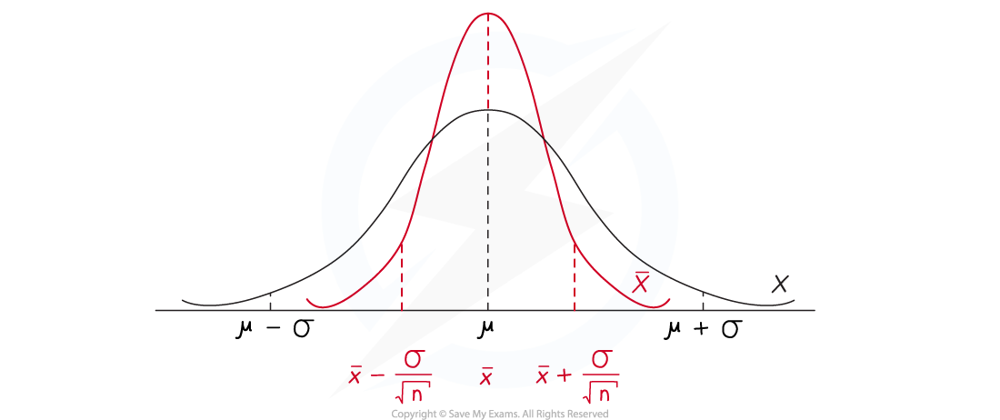

# Distribution of Sample Means

## Sample Mean Distribution

> **Spec point** — `spcpt_c4NPrDp59NSdW45n`

## Sample Mean Distribution

#### What is the distribution of the sample means?

- For any given population it can often be difficult or impractical to find the true value of the **population mean, *****µ***

  - The population could be too large to collect data using a census or
  - Collecting the data could compromise the individual data values and therefore taking a census could destroy the population
  - Instead, the population mean can be estimated by taking the mean from a sample from within the population
- If a sample of size $n$  is taken from a population, $X$, and the mean of the sample, $\overline{x}$ is calculated then the distribution of the sample means, $\overline{X}$ , is the distribution of all values that the sample mean could take
- If the population, $X$*,*  has a normal distribution with mean, *µ* , and variance, *σ**2** * , then the mean expected value of the distribution of the sample means, `top enclose X` would still be *µ* but the variance would be reduced

  - Taking a mean of a sample will reduce the effect of any extreme values
  - The greater the sample size, the less varied the distribution of the sample means would be
- The distribution of the means of the samples of size taken from the population, will have a normal distribution with:

  - Mean, $\overline{x}$ = *µ*
  - Variance $\frac{σ^{2}}{n}$
  - Standard deviation $\frac{σ}{\sqrt{n}}$
- For a random variable `X tilde straight N left parenthesis mu comma sigma squared right parenthesis` the distribution of the sample mean would be `stack X space with bar on top tilde N open parentheses mu comma sigma squared over n close parentheses`
- The standard deviation of the distribution of the sample means depends on the sample size, $n$

  - It is inversely proportional to the square root of the sample size
  - This means that the greater the sample size, the smaller the value of the standard deviation and the narrower the distribution of the sample means

> **Worked Example**
> A random sample of 10 observations is taken from the population of the random variable `X tilde N space left parenthesis 30 space comma space 25 right parenthesis` and the sample mean is calculated as $\overline{x}$ .  Write down the distribution of the sample mean, $\overline{X}$
> 
> **Answer:**
> 
> 

> **Exam Hint**
> - Look carefully at the distribution given to determine whether the variance or the standard deviation has been given.

## Central Limit Theorem

> **Spec point** — `spcpt_9GfWnqSpBjXwDKVj`

## Central Limit Theorem

#### Does the distribution of the sample means always follow a normal distribution?

- If the variable $X$ for the **population follows **a **normal distribution** then the **sample mean** distribution $\overline{X}$  also **follows a normal distribution**
- If the variable $X$ for the population does not follow a normal distribution then the sample mean distribution $\overline{X}$ does not necessarily follow a normal distribution

  - If the sample size is **small** then $\overline{X}$ can **not be assumed** to follow a normal distribution
  - If the sample size is **big enough** then we can use the **Central Limit Theorem** to approximate $\overline{X}$ using a normal distribution

#### What is the central limit theorem?

- If a **random sample** of **size n** is taken from a population with **mean ***µ*** ** and **variance **$σ^{2}$  then the **Central Limit Theorem** states that $\overline{X}$ can be **approximated** by the **normal distribution** `straight N open parentheses mu comma sigma squared over n close parentheses` provided **n is large** enough

  - Notice the variance is still divided by the size of the sample
- We usually say n is large enough if it is **at least 30**
- This is a powerful theorem as it allows us to use the normal distribution for even when the population itself does not follow a normal distribution
- If the population follows a normal distribution then the Central Limit Theorem is not needed as $\overline{X}$ will be normal automatically

  - This is important as you might be asked whether the Central Limit Theorem was needed

> **Worked Example**
> The integers 1 to 29 are written on counters and placed in a bag. The expected value when one is picked at random is 15 and the variance is 70. Susie randomly picks 40 integers, returning the counter after each selection.
> 
> Find the probability that the mean of Susie’s 40 numbers is less than 13. Explain whether it was necessary to use the Central Limit Theorem in your calculation.
> 
> **Answer:**
> 
> 

> **Exam Hint**
> - If asked to explain whether it was necessary to use the Central Limit Theorem, check whether the population follows a normal distribution, if it does not then check the size of the sample. If your answer is yes comment on both of these things.
