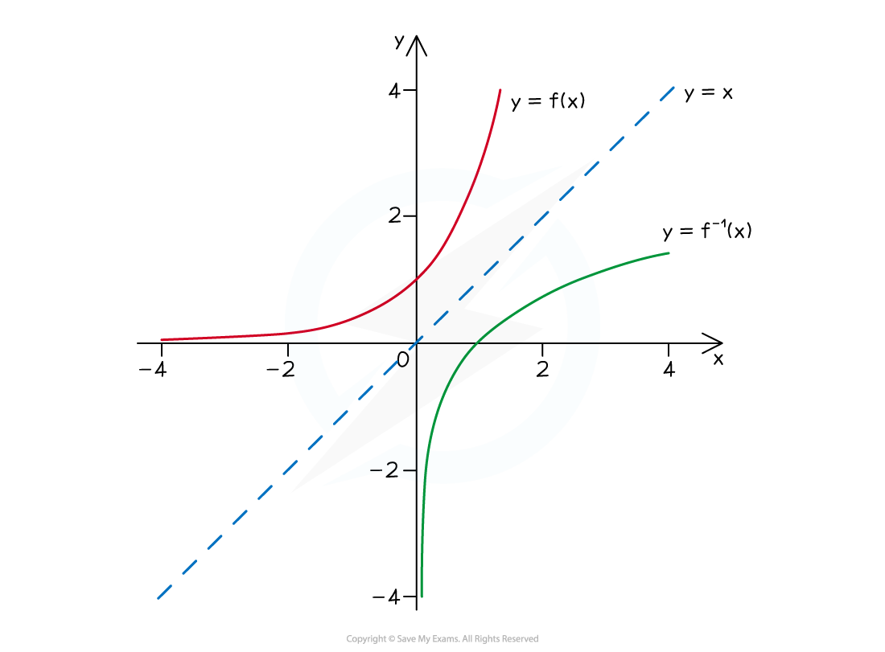
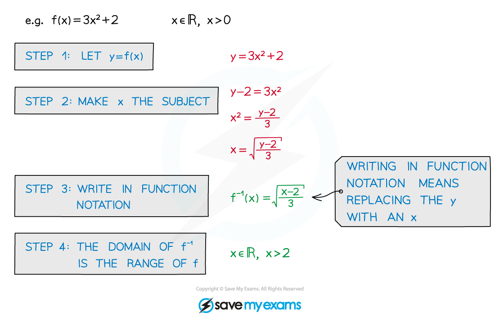
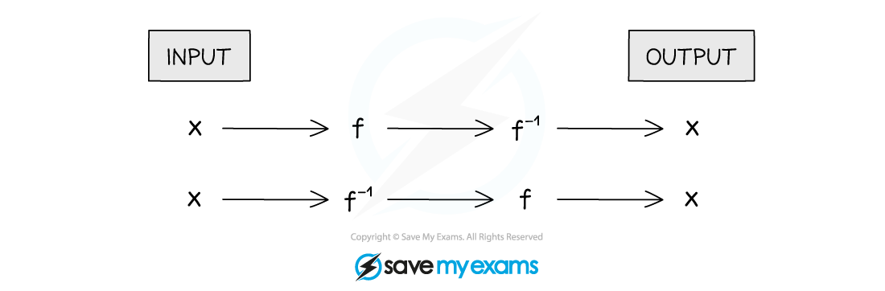

# Inverse Functions

## Inverse Functions

> **Spec point** — `spcpt_BDJMvyt2SwNGyFPd`

## Inverse functions

### What are inverse functions?

- An **inverse** **function** is the **opposite** to the original function
- It is denoted by **f****-1****(x)**
- An inverse only exists for **one**-to-**one** functions

** **

### How do I sketch inverse functions?

- The graphs of a function and its inverse are reflections in the line** y = x**

### What are the domain and range of inverse functions?

- The range of a function will be the domain of its inverse function
- The domain of a function will be the range of its inverse function

### How do I use algebra to find an inverse function?

- Set **y = f(x)** and make **x** the subject
- Then rewrite in function notation
- Domain is needed to fully define a function
- The range of **f** is the domain of **f****-1** (and vice versa)

** **

### How are inverse functions and composite functions related?

- A function (**f**) followed by its inverse (**f****-1**) will return the input (**x**)
- **ff****-1****(x) = f****-1****f(x) = x **(for all values of x)

** **

> **Worked Example**
> 
