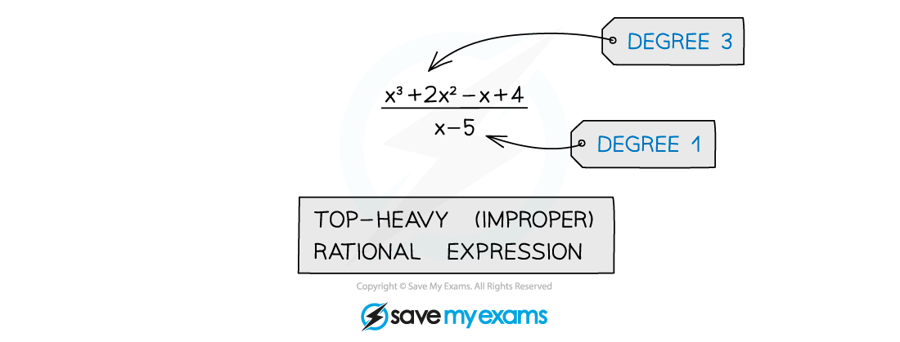
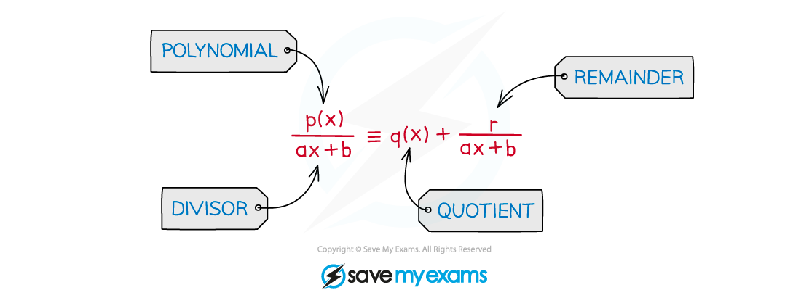
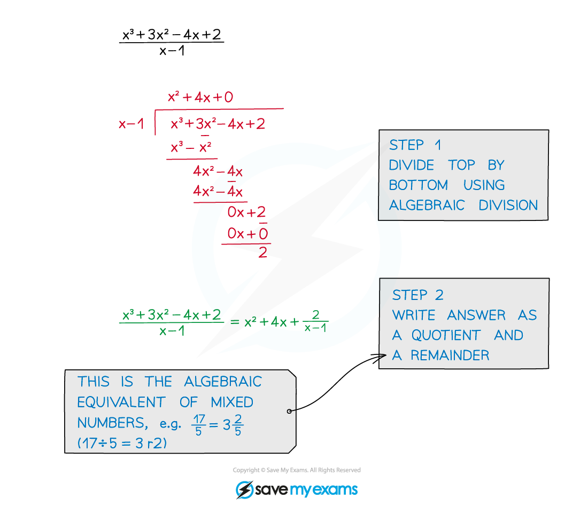

# Improper Algebraic Fractions

## Top Heavy Rational Expressions

> **Spec point** — `spcpt_yh53SXJHw2svRkJ8`

## Improper algebraic fractions

### What are improper algebraic fractions?

- The **degree** of the numerator is **greater than** or **equal** to the degree of the denominator

### How do I simplify improper algebraic fractions?

- Write as a **quotient** and a **remainder**
- The algebraic equivalent of changing a top-heavy fraction to a mixed number

> **Exam Hint**
> Remember that simple cases are sometimes the hardest to spot!
> 
> 

> **Worked Example**
> 
