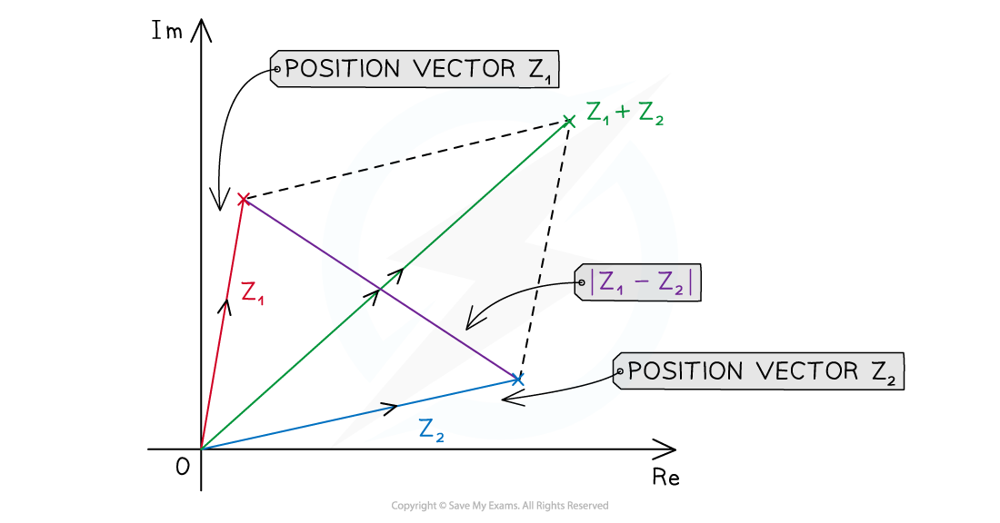

# Argand Diagrams

## Argand Diagrams - Basics

> **Spec point** — `spcpt_Wy5kPRWSq9zfrrrc`

## Argand diagrams

### What is an Argand diagram?

- An Argand diagram is a **geometrical** way to represent complex numbers as either a **point** or a **vector** in two-dimensional space

  - We can represent the complex number $x+yi$ by the **point** with **cartesian coordinate **$(x,y)$
- The **real** component is represented by points on the **x-axis**, called the **real axis**, Re
- The **imaginary** component is represented by points on the **y-axis**, called the **imaginary axis**, Im

- You may be asked to show **roots** of an equation in an Argand diagram

  - First **solve** the equation
  - Draw a quick sketch, only adding essential information to the axes
  - Plot the points and label clearly

### How do I sketch |z1 + z2| and |z1 - z2|?

- Plot two complex numbers *z*1 and *z*2
- Draw a line from the origin to each complex number
- Form a parallelogram using the two lines as two adjacent sides
- The modulus of their sum **|*****z*****1 ****+ *****z*****2****| **will be the length of the diagonal of the parallelogram starting at the origin
- The modulus of their difference **|*****z*****1 ****- *****z*****2****| **will be the length of the diagonal between the two complex numbers

> **Worked Example**
> 

> **Exam Hint**
> - When setting up an Argand diagram you do not need to draw a fully scaled axes, you only need the essential information for the points you want to show, this will save a lot of time.
