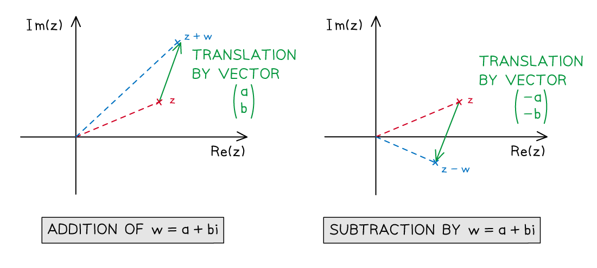
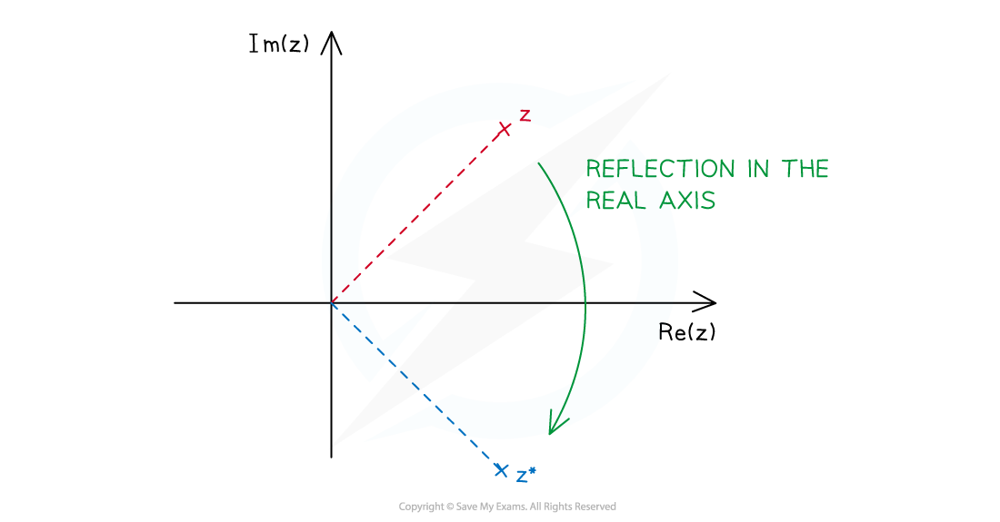

# Geometry of Complex Addition, Subtraction & Conjugation

## Geometry of Complex Addition, Subtraction & Conjugation

> **Spec point** — `spcpt_NXpDX6ztHhmdcPbD`

## Geometry of complex addition, subtraction & conjugation

### How do I sketch complex addition on an Argand diagram?

- The **addition** of complex numbers can be shown by the addition of **corresponding column vectors**

  - If $z_{1}=a+bi$and $z_{2}=c+di$, then  $z_{1} + z_{2} = ( a + b \mathrm{i} ) + ( c + d \mathrm{i} )$
  - This can be written as

$( \frac{a}{b} ) + ( \frac{c}{d} ) = ( \frac{a + c}{b + d} )$

- An alternative is to write $( a + b \mathrm{i} ) + ( c + d \mathrm{i} )$ as $( a + c ) + ( b + d ) \mathrm{i}$, adding the respective real and imaginary parts separately

- A complex number $x+yi$ can be represented by the **position vector **$( \frac{x}{y} )$

### How do I sketch complex subtraction on an Argand diagram?

- As with addition we can use knowledge of vectors to represent **subtraction** of complex numbers

  - If $z_{1}=a+bi$ and $z_{2}=c+di$, then $z_{1} - z_{2} = ( a + b \mathrm{i} ) - ( c + d \mathrm{i} )$
  - This can be written as

$( \frac{a}{b} ) - ( \frac{c}{d} ) = ( \frac{a - c}{b - d} )$

- An alternative is to write $( a + b \mathrm{i} ) - ( c + d \mathrm{i} )$ as $( a - c ) + ( b - d ) \mathrm{i}$, subtracting the respective real and imaginary parts separately

### Which geometric transformations represent complex addition and subtraction?

- Let *w* be a given complex number with **real part *****a**** *and **imaginary part *****b***

  - $w=a+bi$
- Let *z* be any complex number represented on an Argand diagram
- **Adding *****w *****to *****z*** results in *z* being **translated** by vector $( \begin{gathered} a \\ b \end{gathered} )$
- **Subtracting *****w *****from *****z*** results in *z* being **translated** by vector $( \begin{gathered} - a \\ - b \end{gathered} )$

### What geometric transformation represents complex conjugation?

- If we plot **complex conjugate** pairs on an Argand diagram, we notice the points are **reflections** of each other in the **real axis**
- Let *z* be any complex number represented on an Argand diagram
- **Complex conjugating *****z*** results in *z* being **reflected **in the real axis

> **Worked Example**
> 
> 
> 

> **Exam Hint**
> Read questions carefully; is it asking to plot the complex number as a point or as a vector?
> 
> Be extra careful when representing subtraction geometrically, remember that the solution will be a translation of the shorter diagonal of the parallelogram made up by the two vectors.
