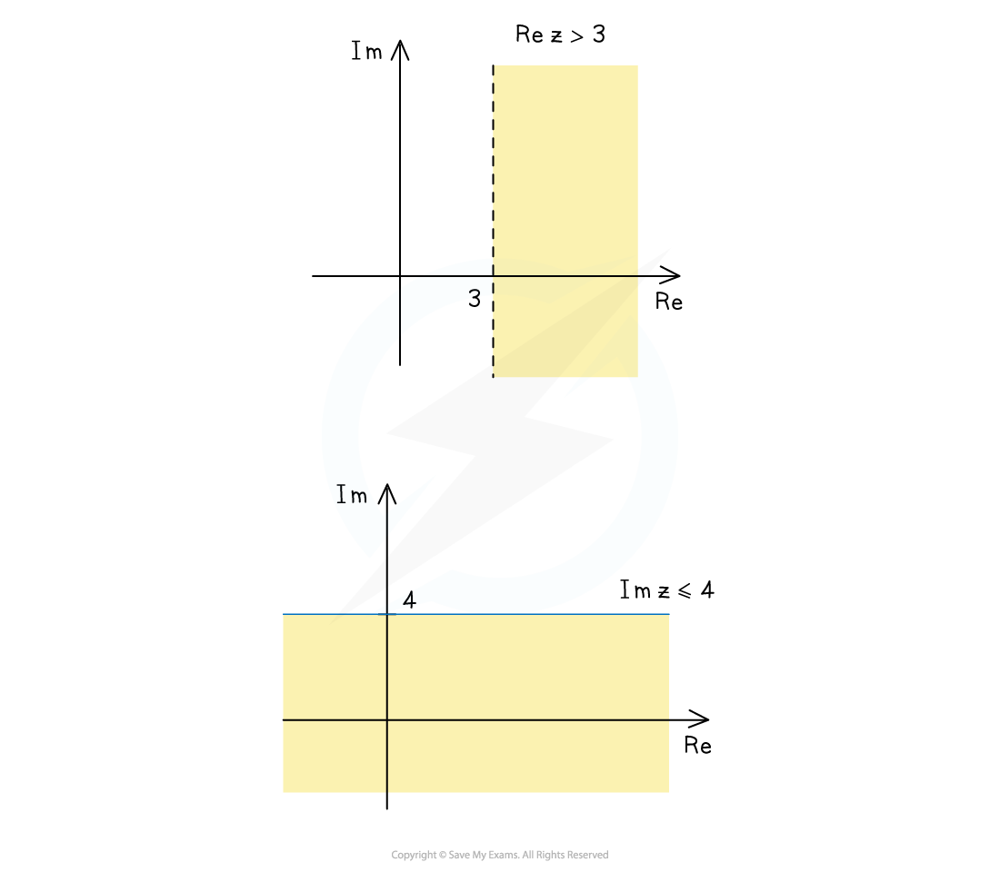
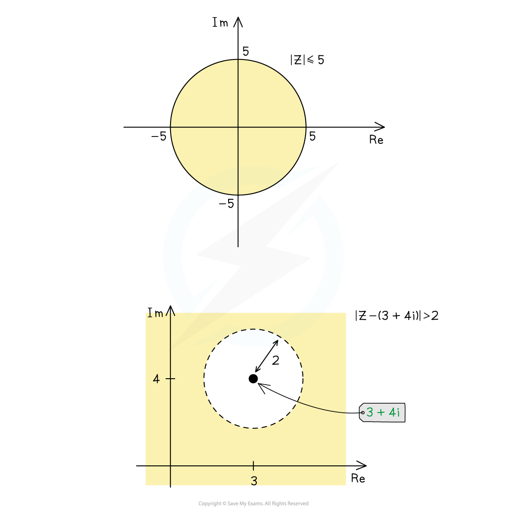
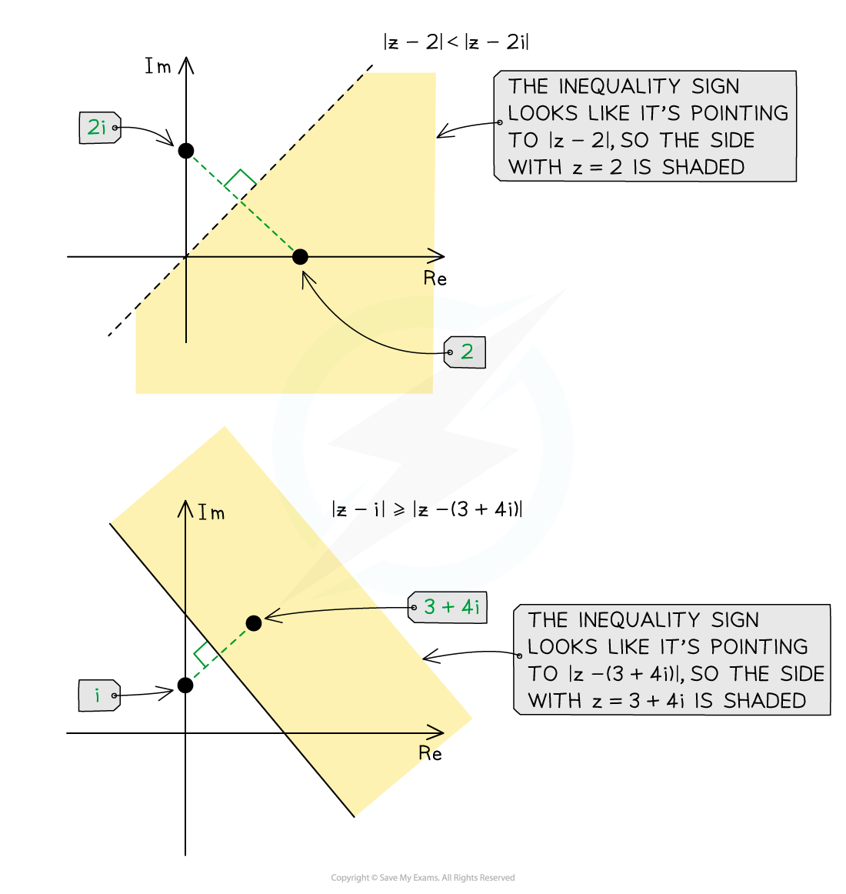
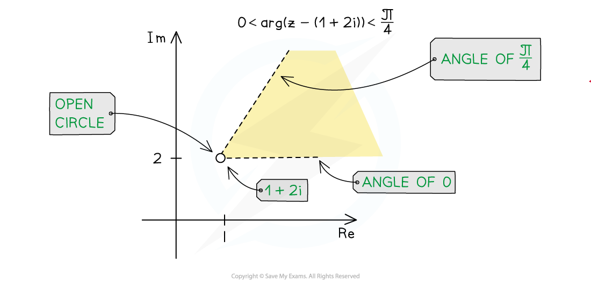
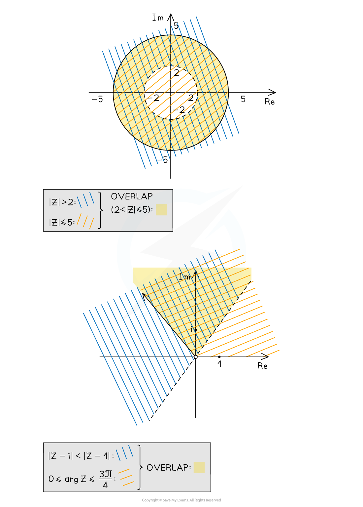
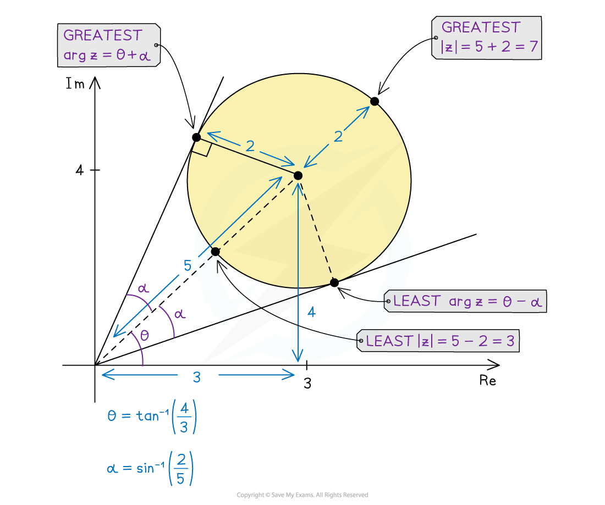

# Inequalities & Regions in Argand Diagrams

## Inequalities & Regions in Argand Diagrams

> **Spec point** — `spcpt_SZhrbTbBnFTFmWpV`

## Inequalities & regions in Argand diagrams

### How do I sketch $\mathrm{Re}z<k$  or $\mathrm{Im}z<k$ on an Argand diagram?

- The inequality $\mathrm{Re}z<2$ is satisfied by all complex numbers, $z=x+iy$, with a real part less than 2

  - On an Argand diagram, this would be the **region **to the left of the vertical line $x=2$
  - The vertical line itself, $x=2$, should be drawn dotted to show that points on this line are not permitted due to the strict inequality (<)
- In general, **dotted **lines are used with **strict **inequalities ( < or > ) and **solid **lines are used with inequalities that **can be equal** ( ≤ or ≥ )
- Here is how to represent the following inequalities as regions on an Argand diagram…

  - $\mathrm{Re}z<k$: **shade** the region to the **left **of the **dotted **vertical line (or **solid **vertical** **line for ≤)
  - $\mathrm{Re}z>k$: **shade** the region to the **right **of the **dotted **vertical line (or **solid** vertical line for ≥)
- Similarly, here is how to represent the following inequalities as regions on an Argand diagram…

  - $\mathrm{Im}z<k$: **shade** the region **below** the **dotted **horizontal line (or **solid** horizontal line for ≤)
  - $\mathrm{Im}z>k$: **shade** the region **above** the **dotted **horizontal line (or **solid** horizontal line for ≥)

***Sketching the inequalities ***$\mathrm{Re}z>3and\mathrm{Im}z\leq4$

### How do I sketch `open vertical bar bold italic z minus bold italic a close vertical bar less than bold italic k` on an Argand diagram?

- For a given complex number $a$, the inequality `open vertical bar z minus a close vertical bar less than k` represents all complex numbers, $z$, that lie inside the circle** **of radius $k$, centred at $a$
- Here is how to represent the following inequalities as regions on an Argand diagram…

  - `open vertical bar z minus a close vertical bar less than k`: **shade** the region **inside** the circle of radius $k$, centred at $a$
  - `open vertical bar z minus a close vertical bar greater than k`: **shade** the (unbounded) region **outside **circle of radius $k$, centred at
  - Again use a **dotted** line for strict inequalities (< and >) and a **solid **line for weak inequalities ( ≤ or ≥ )

***Sketching the inequalities ***`equation` *** and ***`equation`

### How do I sketch `equation` on an Argand diagram?

- For two given complex numbers $a$and $b$, the inequality `open vertical bar z minus a close vertical bar less than vertical line z minus b vertical line`** **represents all complex numbers, $z$, that lie closer to $a$ than to $b$
- Here is how to represent the following inequalities as regions on an Argand diagram…

  - `stretchy vertical line z minus a stretchy vertical line bold less than bold vertical line bold italic z bold minus bold italic b bold vertical line`: **shade **the **region** on the side of the perpendicular bisector of $a$ and $b$ that **includes** **the point **$a$
  - `stretchy vertical line z minus a stretchy vertical line bold greater than bold vertical line bold italic z bold minus bold italic b bold vertical line`: **shade **the **region** on the side of the **dotted** perpendicular bisector of $a$ and $b$ that **includes** **the point **$b$
- A good way to remember which side to shade is that the inequality sign points (like an arrow) to the side to be shaded

** **

***Sketching the inequalities ***`stretchy vertical line z minus 2 stretchy vertical line bold less than stretchy vertical line z minus 2 i stretchy vertical line`*** and ***`stretchy vertical line z minus i stretchy vertical line bold greater or equal than stretchy vertical line z minus open parentheses 3 plus 4 i close parentheses stretchy vertical line`

### How do I sketch `bold italic alpha bold less than bold arg bold invisible function application bold left parenthesis bold z bold minus bold a bold right parenthesis bold less than bold italic beta` on an Argand diagram?

- For a given complex number, $a$, the inequality `alpha less than arg invisible function application left parenthesis z minus a right parenthesis less than beta` represents all complex numbers, $z$, that have an **argument** between $α$ and $β$, as** measured from** the point $α$
- Here is how to represent the following inequalities as regions on an Argand diagram…

  - $α<\mathrm{arg}(z-a)<β$: **shade **the **wedge-shaped** **region** between the half-line $\mathrm{arg}(z-a)=α$ and the half-line `arg invisible function application left parenthesis z minus a right parenthesis equals beta`, with an open circle at $z=a$ to show the **exclusion** of this point (to avoid the undefined value of $\mathrm{arg}0$)

***Sketching the inequalities ***$0<\mathrm{arg}(z-(1+2i))<\frac{π}{4}$

### How do I sketch multiple inequalities on the same Argand diagram?

- To sketch a region that satisfies multiple inequalities, we need to find the **intersection** of all the regions (where all regions overlap)

  - E.g. the region satisfied by `2 less than open vertical bar z close vertical bar less or equal than 5` can be found as follows…
  
    - Using diagonal lines in the same direction, lightly shade the region `vertical line z vertical line greater than 2 space`(the outside of a circle of radius 2 about the origin)
    - Using diagonal lines in a different direction, lightly shade the region `open vertical bar z close vertical bar less or equal than 5` (the inside of a circle of radius 5 about the origin)
    - Where the diagonal lines **cross each other** highlights the region satisfying both inequalities; this should be shaded** boldly**
  - E.g. the region satisfied by `open vertical bar z minus straight i close vertical bar less than vertical line z minus 1 vertical line` and `0 less or equal than arg invisible function application z less or equal than fraction numerator 3 pi over denominator 4 end fraction` can be found as follows…
  
    - Using diagonal lines in the same direction, lightly shade the region `open vertical bar z minus straight i close vertical bar less than vertical line z minus 1 vertical line` (the side including $z=i$ from the perpendicular bisector of the points $i$ and 1)
    - Using diagonal lines in a different direction, lightly shade the region `0 less or equal than arg invisible function application z less or equal than fraction numerator 3 pi over denominator 4 end fraction` (the wedge-shaped region from 0 to $\frac{3π}{4}$ radians from the origin)
    - Where the diagonal lines **cross each other** highlights the region satisfying both inequalities; this should be shaded** boldly**

***The inequalities ***`bold 2 bold less than stretchy vertical line z stretchy vertical line bold less or equal than bold 5` *** on the left, the inequalities ***`stretchy vertical line z minus i stretchy vertical line bold less than stretchy vertical line z minus 1 stretchy vertical line` *** and  ***$0\leq\mathrm{arg}z<\frac{3π}{4}$***on the right***

### How do I find the greatest (or least) values of `stretchy vertical line z stretchy vertical line` or $\mathrm{arg}z$ in a region?

- Every complex number, $z$, that lies within a region on an Argand diagram will have its own modulus, `open vertical bar z close vertical bar`, that is measured from the origin
- For any shaped region…

  - The **least** value of `vertical line z vertical line` is the **distance **from the **origin** to the **nearest point** in the region
  - The **greatest **value of `vertical line z vertical line` is the **distance **from the **origin** to the **farthest point** in the region
  - Sometimes the least value is zero (if the origin is in the region) and/or the greatest value is infinite (if the region is unbounded)
- For circular regions that do not contain the origin…

  - Find the length from the origin to the centre of the circle…
  - then add a radius for the greatest value of `vertical line z vertical line` or subtract a radius for the least value of `vertical line z vertical line`
- Every complex number, $z$, that lies within a region on an Argand diagram will have its own argument, $\mathrm{arg}z$, as measured from the origin
- For any shaped region…

  - The **least** value of is $\mathrm{arg}z$ the **smallest angle** a line through the origin can make to a point in the region
  - The **greatest** value of $\mathrm{arg}z$ is the **largest angle** a line through the origin can make to a point in the region
- For circular regions that do not contain the origin…

  - Find $θ$, the argument of the centre…
  - Find $α$, the angle between a tangent to the circle through the origin and the line from the origin to the centre…
  
    - This can be done using trigonometry, as a radius meets a tangent at right angles
  - The greatest value of $\mathrm{arg}z$ is $θ+α$ and the least value of $\mathrm{arg}z$ is $θ-α$

***Find greatest and least values of  ***`open vertical bar z close vertical bar`*** and ***$\mathrm{arg}z$

> **Worked Example**
> 
> 
> 
> 
> 

> **Exam Hint**
> - When shading an unbounded region in the exam, make sure you extend your shading outwards, crossing any axes where necessary.
> - When shading multiple inequalities to find a common region, lots of methods are accepted; these include lightly shading individual regions to see where they overlap, or starting to shade along the boundaries of individual regions to find the common region, or marking individual regions to find the region with multiple marks, etc.
