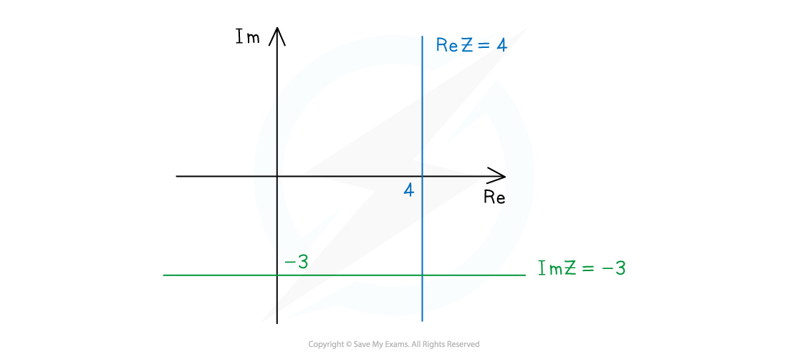
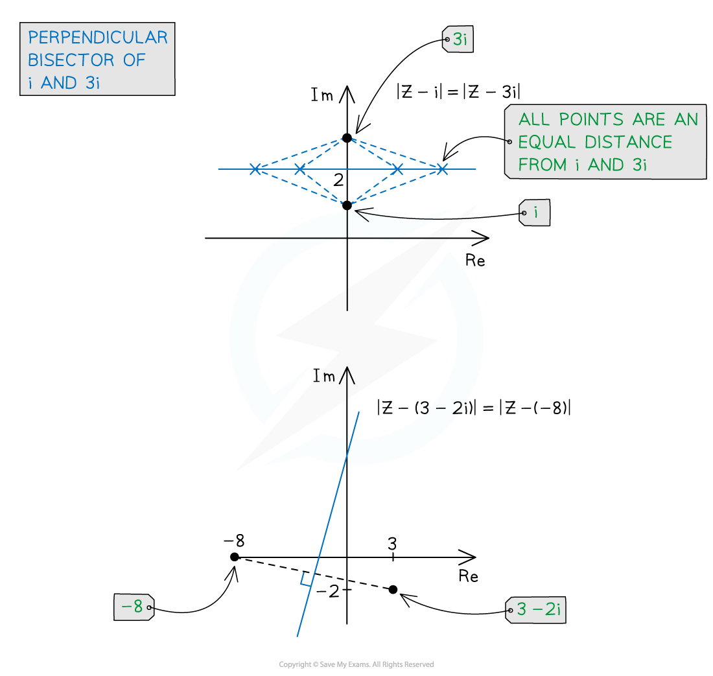
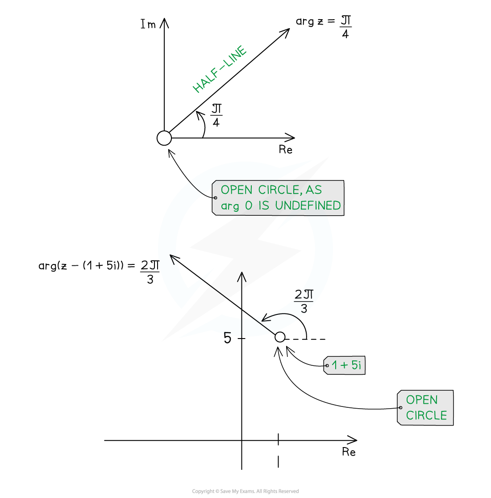

# Loci in Argand Diagrams

## Loci in Argand Diagrams

> **Spec point** — `spcpt_PX3rkYhHsTmCcGVs`

## Loci in Argand diagrams

### How do I sketch $\mathrm{Re}z=k$ or $\mathrm{Im}z=k$ on an Argand diagram?

- All complex numbers, $z=x+iy$, that satisfy the equation $\mathrm{Re}z=k$ lie on a **vertical line** with Cartesian equation $x=k$

  - Any complex number along this vertical line will have a **real part **of $k$
- All complex numbers, $z=x+iy$, that satisfy the equation $\mathrm{Im}z=k$ lie on a **horizontal line** with Cartesian equation $y=k$

  - Any complex number along this horizontal line will have an **imaginary part **of $k$
- E.g. The loci $\mathrm{Re}z=4$ and $\mathrm{Im}z=-3$ are represented by the vertical line $x=4$ and the horizontal line $y=-3$

***Sketching the loci of  ***$\mathrm{Re}z=4$*** and ***$\mathrm{Im}z=-3$

### How do I sketch `open vertical bar bold italic z minus bold italic a close vertical bar equals bold italic k` on an Argand diagram?

- All complex numbers, $z$, that satisfy the equation `open vertical bar z close vertical bar space equals space k` lie on a **circle **of **radius** $k$ about the **origin**

  - E.g. the locus of `open vertical bar z close vertical bar space equals space 10` is a circle of radius 10, centred at the origin, as every complex number on that circle has a modulus of 10
- For a given complex number, $a$, all complex numbers, $z$, that satisfy the equation `open vertical bar z space minus space a close vertical bar space equals space k` lie on a **circle** of** radius **$k$ about the **centre **$a$

  - This is because `open vertical bar z space minus space a close vertical bar` represents the distance between complex numbers $z$ and $a$
  - E.g. the locus of `open vertical bar z minus open parentheses 3 plus 4 straight i close parentheses close vertical bar equals 10` is a circle of radius 10 about $(3+4i)$
- Many equations need to be adjusted algebraically into the correct `open vertical bar z space minus space a close vertical bar` form

  - E.g. to find the centre of the circle `open vertical bar z minus 8 straight i plus 3 close vertical bar equals 12`, first rewrite it as `open vertical bar z minus open parentheses negative 3 plus 8 straight i close parentheses close vertical bar equals 12`, giving the centre as $-3+8i$
  - E.g. to find the centre of the circle `open vertical bar z plus straight i close vertical bar equals 2`, first rewrite it as `open vertical bar z minus open parentheses negative straight i close parentheses close vertical bar equals 2` , giving the centre as `open parentheses negative straight i close parentheses`
  - Note that the centre of the circle `open vertical bar z close vertical bar space equals space 5` is the origin (it can be thought of as `open vertical bar z minus 0 close vertical bar equals 5`)
- In order to sketch correctly, **check** whether the **origin** lies **outside**, **on** or **inside** the circle

  - E.g. for the locus of `open vertical bar z minus open parentheses 3 plus 4 straight i close parentheses close vertical bar equals 10 comma` the distance from the centre of the circle, $3+4i$, to the origin is 5 (by Pythagoras), which is **less **than the radius of 10; a sketch must therefore show the origin** inside** the circle
- By knowing the radius and centre of a circle, the Cartesian equation of the circle can be found

  - The circle `open vertical bar z minus open parentheses 3 plus 4 straight i close parentheses close vertical bar equals 10` has a radius of 10 and centre of $(3,4)$ in coordinates, so the equation of the circle is `open parentheses x minus 3 close parentheses squared plus open parentheses y minus 4 close parentheses squared equals 100`

***Sketching the loci of  ***`begin bold style stretchy vertical line z stretchy vertical line end style bold equals bold 10`*** and ***`begin bold style stretchy vertical line z minus open parentheses 3 plus 4 i close parentheses stretchy vertical line end style bold equals bold 10`

### How do I sketch `open vertical bar bold italic z minus bold italic a close vertical bar equals vertical line bold italic z minus bold italic b vertical line` on an Argand diagram?

- For two given complex numbers, $a$ and $b$, all complex numbers, $z$, that satisfy the equation `open vertical bar z minus a close vertical bar equals vertical line z minus b vertical line` lie on the **perpendicular bisector** of $a$ and $b$

  - This is because the distance from $z$ to $a$ must equal the distance from $z$ to $b$
  
    - a condition that is satisfied by all the complex numbers, $z$, on the perpendicular bisector of $a$ and $b$
  - E.g. the locus of `open vertical bar z minus 3 plus 2 straight i close vertical bar equals vertical line z plus 8 vertical line` can be rewritten as `open vertical bar z minus open parentheses 3 minus 2 straight i close parentheses close vertical bar equals open vertical bar z minus open parentheses negative 8 close parentheses close vertical bar` which is the perpendicular bisector of the points $3-2i$ and $-8$
- A **sketch **of the perpendicular bisector is sufficient, without finding its exact equation (though this could be found using coordinate geometry methods)

***Sketching the loci of  ***`stretchy vertical line bold italic z minus i stretchy vertical line equals open vertical bar bold italic z minus 3 i close vertical bar`***and ***`stretchy vertical line bold italic z minus open parentheses 3 minus 2 i close parentheses stretchy vertical line equals open vertical bar bold italic z minus open parentheses negative 8 close parentheses close vertical bar`

### How do I sketch $\mathrm{arg}(z-a)=α$  on an Argand diagram?

- All complex numbers, $z$, that satisfy the equation $\mathrm{arg}z=α$ lie on a **half-line **from the **origin** at an angle of $α$ to the positive real axis

  - Although the half-line starts at the origin, the origin itself ($z=0$) does not satisfy the equation $\mathrm{arg}z=α$  as $\mathrm{arg}0$ is undefined (there is no angle at the origin)
  - To show the** exclusion** of $z=0$ from the locus of $\mathrm{arg}z=α$, a small **open circle** at the origin is used
  - E.g. the locus of $\mathrm{arg}z=\frac{π}{4}$ is a half-line of angle $\frac{π}{4}$ to the positive real axis, starting from the origin, with an open circle at the origin
- For a given complex number, $a$, all complex numbers, $z$, that satisfy the equation $\mathrm{arg}(z-a)=α$ lie on a ***half-line*** from the **point** $a$ at an **angle** of $α$ to the positive real axis, with an open circle to show the **exclusion** of $z=a$

  - E.g. the locus of `arg space open parentheses z minus 1 minus 5 straight i close parentheses equals fraction numerator 2 pi over denominator 3 end fraction` can be rewritten as `arg space open parentheses z minus open parentheses 1 plus 5 straight i close parentheses close parentheses equals fraction numerator 2 pi over denominator 3 end fraction`, which is a half-line of angle $\frac{2π}{3}$measured from the point $1+5i$, with an open circle at $1+5i$ to show its exclusion
- In some cases, the **equation** of the half-line can be found using a** sketch** to help

  - E.g. the locus of $\mathrm{arg}z=\frac{π}{4}$is the half-line $y=x$ for $x>0$
  - E.g. the locus of `arg space open parentheses z minus left parenthesis 8 plus 5 straight i close parentheses equals negative pi over 4` can be thought of, in coordinate geometry, as the half-line through $(8,5)$with gradient -1, giving $y=-x+13$  for  $x>8$
  - Whilst **not examinable**, the half-line equation for a more general angle, $\mathrm{arg}z=α$, is `y equals open parentheses tan space alpha close parentheses x` for $x>0$, as the $\mathrm{gradient}=\frac{\mathrm{opposite}}{\mathrm{adjacent}}=\mathrm{tan}α$

***Sketching the loci of  ***$\mathrm{arg}z=\frac{π}{4}$***and ***$\mathrm{arg}(z-(1+5i))=\frac{2π}{3}$

> **Worked Example**
> 
> 
> 

> **Exam Hint**
> - In the exam, do not worry about making your diagrams perfect.
> - A quick sketch with all the key features is sufficient.
