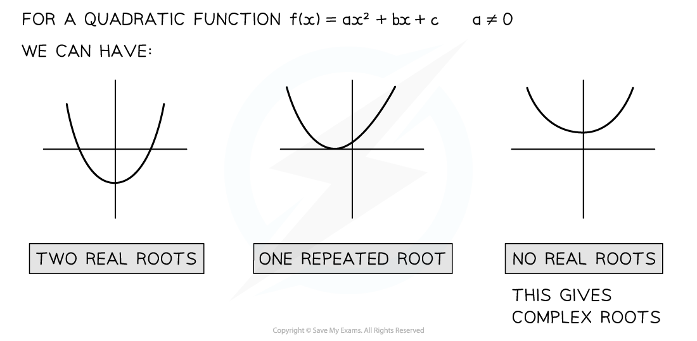
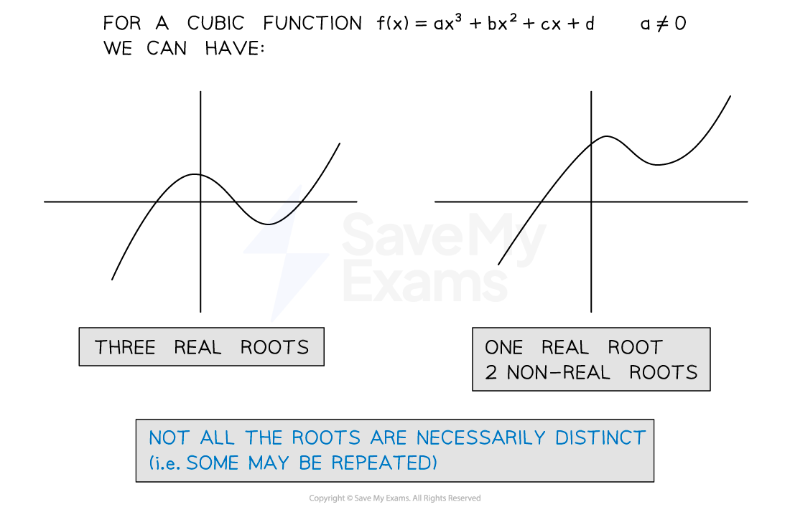
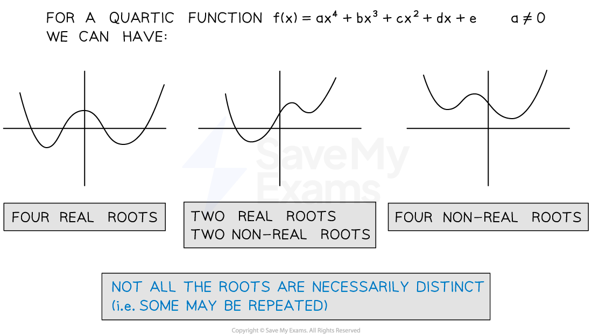

# Complex Roots of Polynomials

## Complex Roots of Quadratics

> **Spec point** — `spcpt_C9dsh9bjcbvTb78H`

## Complex roots of quadratics

### What are complex roots?

- ***Complex numbers*** provide solutions for quadratic equations which have **no real roots**

- Complex roots occur when solving a quadratic with a **negative discriminant**

  - This leads to square rooting a negative number

### How do I solve a quadratic equation with complex roots?

- We solve an equation with complex roots in the same way we solve any other quadratic equations

  - If in the form `a z squared plus b equals 0 blank open parentheses a not equal to 0 close parentheses` we can **rearrange** to solve
  - If in the form $az^{2}+bz+c=0(a\neq0)$ we can **complete the square** or use the **quadratic formula**
- We use the property $i=\sqrt{-1}$ along with a manipulation of surds

- $\sqrt{-a}=\sqrt{a\times-1}=\sqrt{a}\times\sqrt{-1}$

- When the **coefficients** of the quadratic equation are **real**, complex roots occur in ***complex conjugate***** pairs**

  - If $z=m+ni(n\neq0)$ is a root of a quadratic with real coefficients then $z^{*}=m-ni$ is also a root
- When the coefficients of the quadratic equation are **non-real**, the solutions will **not** be complex conjugates

  - To solve these use the quadratic formula

### How do I find a quadratic equation given one complex root?

- We can find the equation of the form $z^{2}+bz+c=0$ if you are given a complex root in the form $m+ni$

  - We know that the complex conjugate $m-ni$ is another root,
  - This means that `z minus open parentheses m plus n straight i close parentheses` and `z minus open parentheses m minus n straight i close parentheses`are **factors** of the quadratic equation
  - Therefore `z squared plus b z plus c equals left square bracket z minus open parentheses m plus n straight i close parentheses right square bracket left square bracket z minus open parentheses m minus n straight i close parentheses right square bracket`
  
    - Writing this as the difference of two squares - `left parenthesis open parentheses z minus m close parentheses minus n straight i right parenthesis left parenthesis open parentheses z minus m close parentheses plus n straight i right parenthesis` - will speed up expanding
  - **Expanding** and **simplifying** gives us a quadratic equation where $b$ and $c$ are **real** numbers

> **Worked Example**
> 
> 
> 

> **Exam Hint**
> - Once you have your final answers you can check your roots are correct by substituting your solutions back into the original equation.
> - You should get 0 if correct! [Note: 0 is equivalent to $0+0i$]

## Complex Roots of Cubics & Quartics

> **Spec point** — `spcpt_7SYgfKDQfsYx8Vgn`

## Complex Roots of cubics & quartics

### How many roots should a polynomial have?

- We know from previous sections that every **quadratic** equation has **two roots **(not necessarily distinct)
- This is a particular case of a more general rule:

  - **Every polynomial equation, with real coefficients, of degree *****n***** has *****n *****roots**
  - The *n* roots are not necessarily all **distinct** and therefore we need to count any **repeated** roots that may occur individually
- From the above rule we can state the following:

  - A **cubic **equation of the form $ax^{3}+bx^{2}+cx+d=0$ can have either:
  
    - 3 **real** roots
    - Or 1 **real** root and a complex **conjugate** pair

- A **quartic **equation of the form $ax^{4}+bx^{3}+cx^{2}+dx+e=0$ will have the following cases for roots:

  - 4 **real** roots
  - 2 **real** and 2 **non-real** roots(a complex conjugate pair)
  - 4 **non-real **roots (two complex conjugate pairs)

***Number of roots of a cubic function***

***Number of roots of a quartic function***

### How do I solve a cubic equation given one complex root?

- Steps to solve a cubic equation with complex roots

  - If we are told that** **$m+ni$ is a root, then we know $m-ni$ is also a root
  - This means that `left parenthesis z minus open parentheses m plus n straight i close parentheses right parenthesis` and $(z-(m-ni))$ are **factors** of the cubic equation
  - **Multiply** the above factors together gives us a quadratic factor of the form $(Az^{2}+Bz+C)$
  - We need to find the third factor $(z-α)$
  - **Multiply** the factors and **equate** to our original equation to get

`open parentheses A z squared plus B z plus C close parentheses open parentheses z minus alpha close parentheses equals a x cubed plus b x squared plus c x plus d`

- From there either

  - **Expand** and **compare coefficients** to find $α$
  - Or use **polynomial division** to find the factor `open parentheses z minus alpha close parentheses`
- Finally, write your **three roots** clearly

### How do I solve a quartic equation given one complex root?

- When asked to find the roots of a quartic equation when we are given one, we use almost the same method as we did for a cubic equation

  - State the initial root and its conjugate and write their factors as a quadratic factor (as above) we will have two unknown roots to find, write these as factors $(z-α)$ and $(z-β)$
  - The unknown factors also form a quadratic factor $(z-α)(z-β)$
  - Then continue with the steps from above, either **comparing coefficients** or using **polynomial division**
  
    - If using polynomial division, then solve the quadratic factor you get to find the roots $α$ and $β$

### How do I find unknown coefficients of cubics and quartics?

- Steps to find unknown variables in a given equation when given a root:

  - **Substitute** the given root into the equation $f(z)=0$
  - **Expand** and **group** together the **real **and **imaginary** parts (these expressions will contain our unknown values)
  - **Solve** as simultaneous equations to find the unknowns
  - **Substitute** the values into the **original** equation
  - From here continue using the previously described methods for finding other roots for either cubic/quartic equations

> **Worked Example**
> 
> 
> 

> **Exam Hint**
> - As with solving quadratic equations, we can substitute our solutions back into the original equation to check we get 0.
