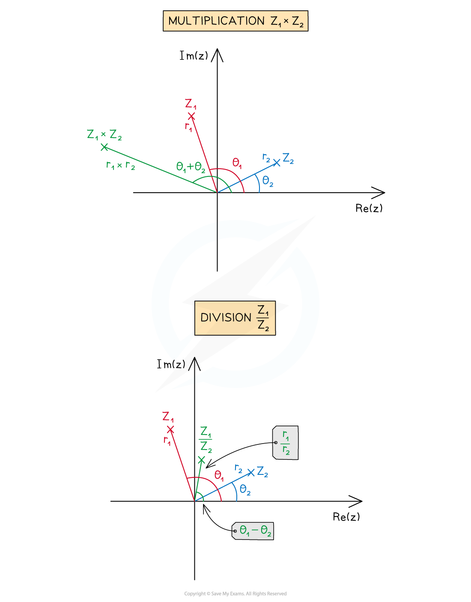
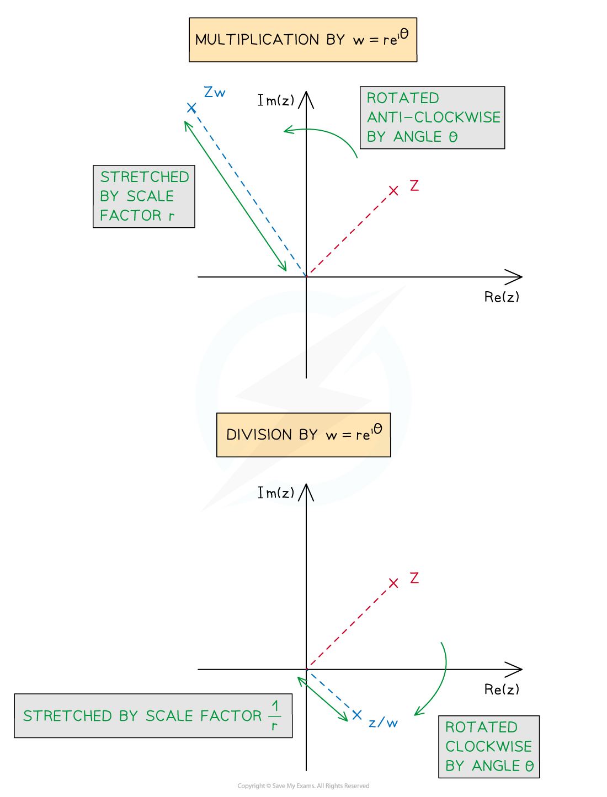

# Geometry of Complex Multiplication & Division

## Geometry of Complex Multiplication & Division

> **Spec point** — `spcpt_bmMp6HQvpM74Czgs`

## Geometry of complex multiplication & division

You now know how conjugation, addition and subtraction affect the geometry of complex numbers on an Argand diagram. Now we can look at the effects of multiplication and division.

### How do I sketch complex multiplication and division on an Argand diagram?

- Let *z*1 and *z*2 be two complex numbers

  - With moduli *r*1 and *r*2 respectively
  - And arguments θ1 and θ2 respectively
- To plot $z_{1}\timesz_{2}$ on an Argand diagram

  - The modulus will be $r_{1}\timesr_{2}$
  - The argument will be $θ_{1}+θ_{2}$
  
    - Subtract 2π from the argument if it is not in the range
  - To plot $\frac{z_{1}}{z_{2}}$ on an Argand diagram
  
    - The modulus will be $\frac{r_{1}}{r_{2}}$
    - The argument will be $θ_{1}-θ_{2}$
    
      - Add 2π to the argument if it is not in the range

### Which geometric transformations represent complex multiplication and division?

- Let *w *be a given complex number with **modulus *****r**** *and **argument θ**

  - In exponential form $w=re^{iθ}$
- Let *z *be any complex number represented on an Argand diagram
- **Multiplying *****z***** by *****w*** results in *z *being:

  - **Stretched** from the origin by a **scale factor of *****r***
  
    - If *r *> 1 then *z *will move further away from the origin
    - If 0 < *r *< 1 then *z *will move closer to the origin
    - If *r *= 1 then *z *will remain the same distance from the origin
  - **Rotated anti-clockwise** about the origin by **angle θ**
  
    - If θ < 0 then the rotation will be clockwise
- **Dividing *****z***** by *****w*** results in *z *being:

  - **Stretched** from the origin by a **scale factor of **$\frac{1}{r}$
  
    - If *r *> 1 then *z *will move closer to the origin
    - If 0 < *r *< 1 then *z *will further away from the origin
    - If *r *= 1 then *z *will remain the same distance from the origin
  - **Rotated clockwise** about the origin by **angle θ**
  
    - If θ < 0 then the rotation will be anti-clockwise

> **Worked Example**
> 

> **Exam Hint**
> - If a complex number is given in Cartesian form, first convert it to polar form or exponential form to find the modulus and argument.
