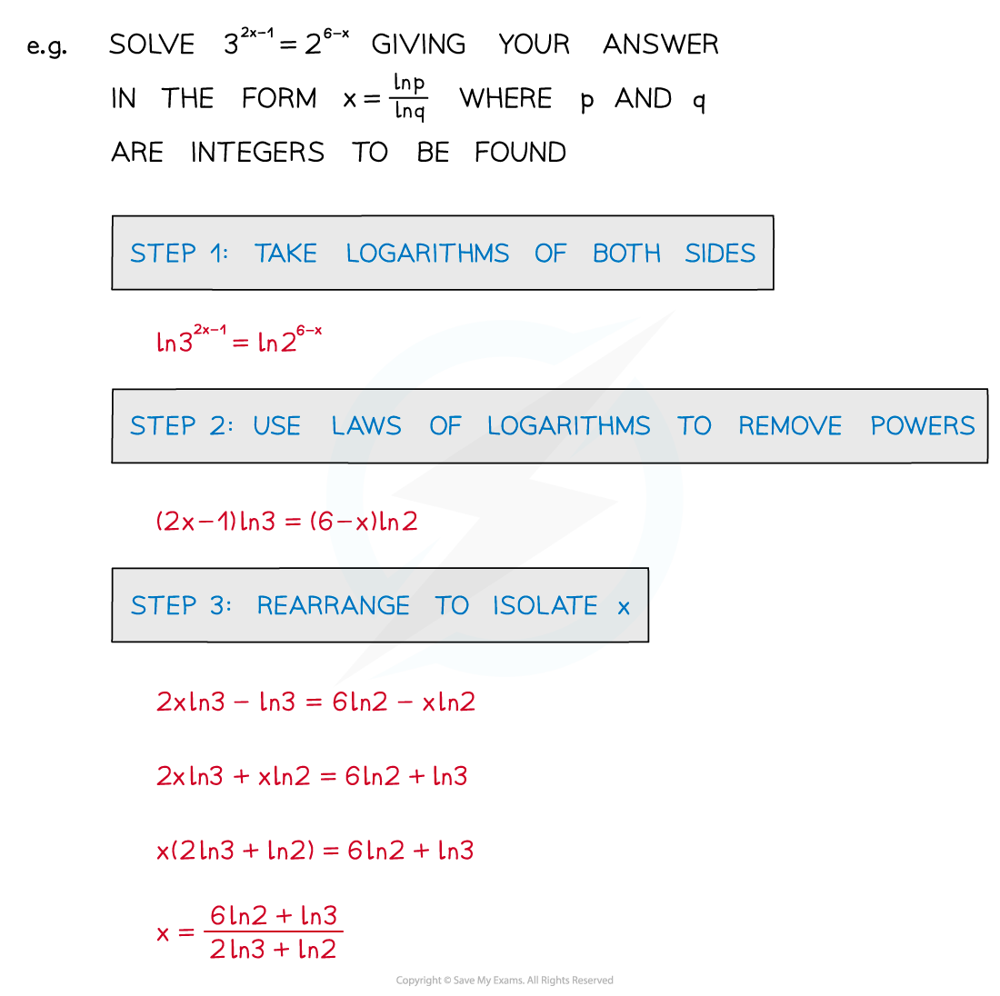
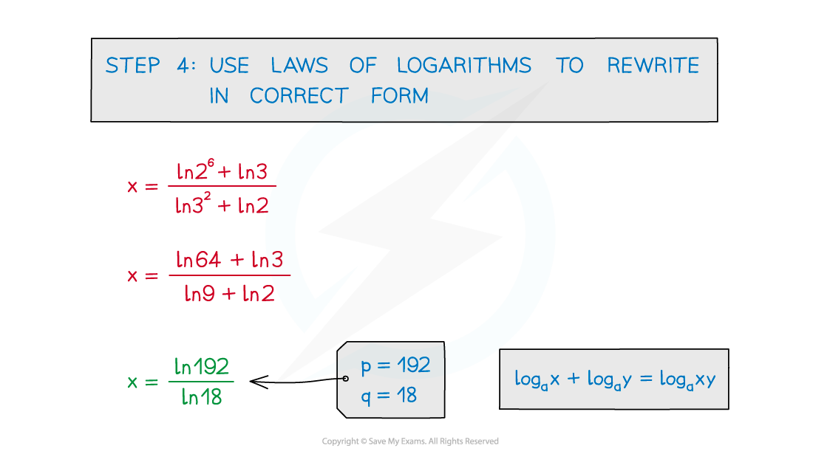
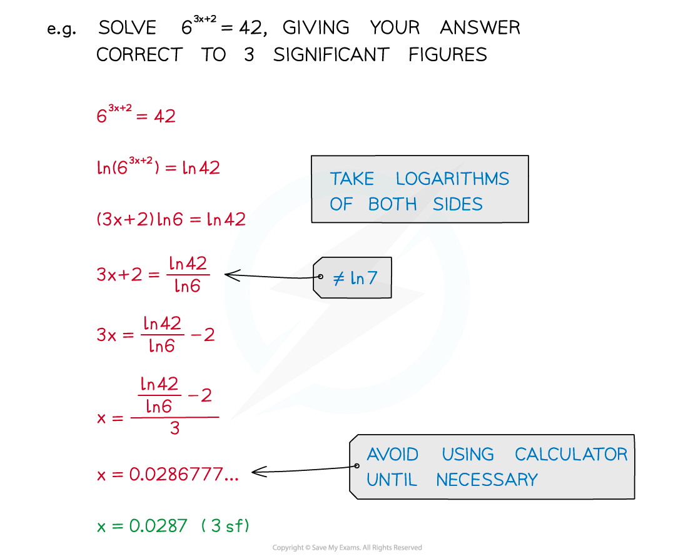
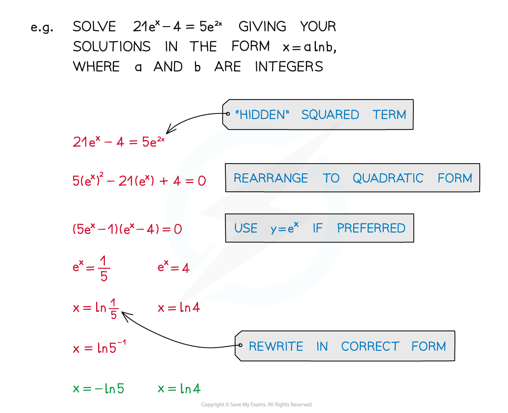

# Exponential Equations

## Exponential Equations

> **Spec point** — `spcpt_cMmmKhpspFd2qwy4`

## Exponential equations

### What are exponential equations?

- An equation where the unknown is a power
- In simple cases the solutions can be “spotted” 

### How do I solve exponential equations?

- Laws of Indices are often needed to rewrite equations
- Laws of Logarithms are used to solve exponential equations
- **ln** (**log****e**) is often used
- Answers are often written in terms of **ln**

### How do I solve hidden quadratic exponential equations?

- Look out for “hidden” squared terms, these are hidden quadratics which will need to be solved

  - **4****x**** = (2****2****)****x**** = 2****2x**** = (2****x****)****2**
  - **e****2x**** = (e****2****)****x**** = (e****x****)****2**

> **Worked Example**
> 
