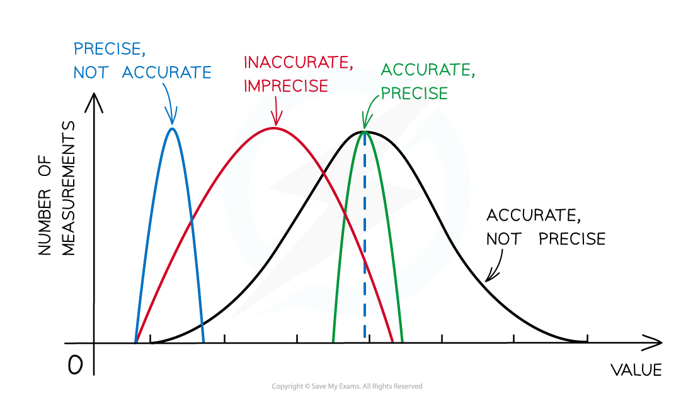
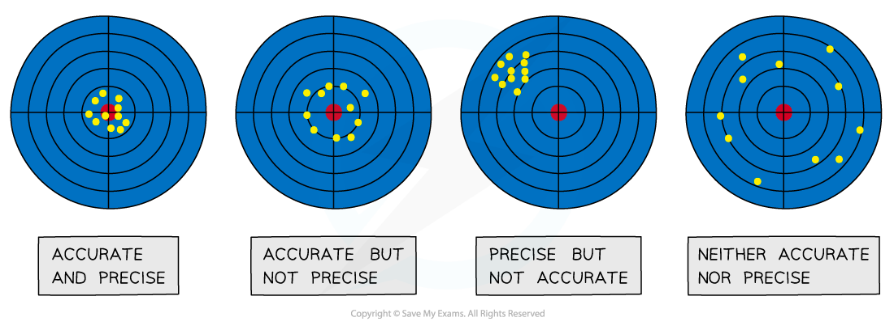

# Errors & Uncertainties

## Random & Systematic Errors

> **Spec point** — `spcpt_64rfKPPJWQ3Y5v2f`

## Random & systematic errors

- **Measurements **of quantities are made with the aim of finding the ***true value*** of that quantity
- In reality, it is impossible to obtain the true value of any quantity, there will always be a degree of **uncertainty**
- The uncertainty is an estimate of the **difference **between a measurement reading and the true value
- **Random **and **systematic **errors are two types of measurement errors which lead to uncertainty

### Random error

- **Random errors** cause **unpredictable **fluctuations in an instrument’s readings as a result of uncontrollable factors, such as environmental conditions
- This affects the **precision** of the measurements taken**,** causing a wider spread of results about the mean value
- To **reduce** random error: **repeat** measurements several times and calculate an average from them

### Systematic error

- **Systematic errors** arise from the use of faulty instruments used or from flaws in the experimental method
- This type of error is repeated every time the instrument is used or the method is followed, which affects the **accuracy** of all readings obtained
- To **reduce** systematic errors: instruments should be **recalibrated** or the technique being used should be corrected or adjusted

#### A graph showing the precision and accuracy of different sets of measurements

***Precision can only be used to describe multiple measurements - it tells us how close together those measurements are. Imprecise measurements will have a large range, as shown by the accurate but imprecise black line. ***

### Zero error

- **Zero error** is a type of **systematic **error which occurs when an instrument gives a non-zero reading when the **true reading is zero**

  - An example may be a set of mass scales showing a reading of 0.200 g when nothing is on the scales
- This introduces a **fixed **error into readings which must be accounted for when the results are recorded

## Precision & Accuracy

> **Spec point** — `spcpt_S5m5Jgb3r4MntV6Q`

## Precision & accuracy

### Precision

- The** precision **of a measurement is how **close **the measured values are to **each other**; if a measurement is repeated several times, then it can be described as precise when the values are very similar to, or the same as, each other

### Accuracy

- The** accuracy** of a measurement is how **close **a measured value is to the **true value**; the accuracy can be increased by repeating measurements and finding a mean average

#### Diagram showing the difference between accurate results and precise results

***Random errors can affect precision - the quantity is being measured accurately but each measurement is affected differently, spreading the results out. Systematic errors can lead to precise inaccurate results, by adding 0.5 to each value, for example, the precise results are moved away from the true value.***

> **Exam Hint**
> It is very common for students to confuse precision with accuracy or resolution. A single reading cannot be precise - if something is measured to a high number of decimal points, it is a measurement with high **resolution**.
