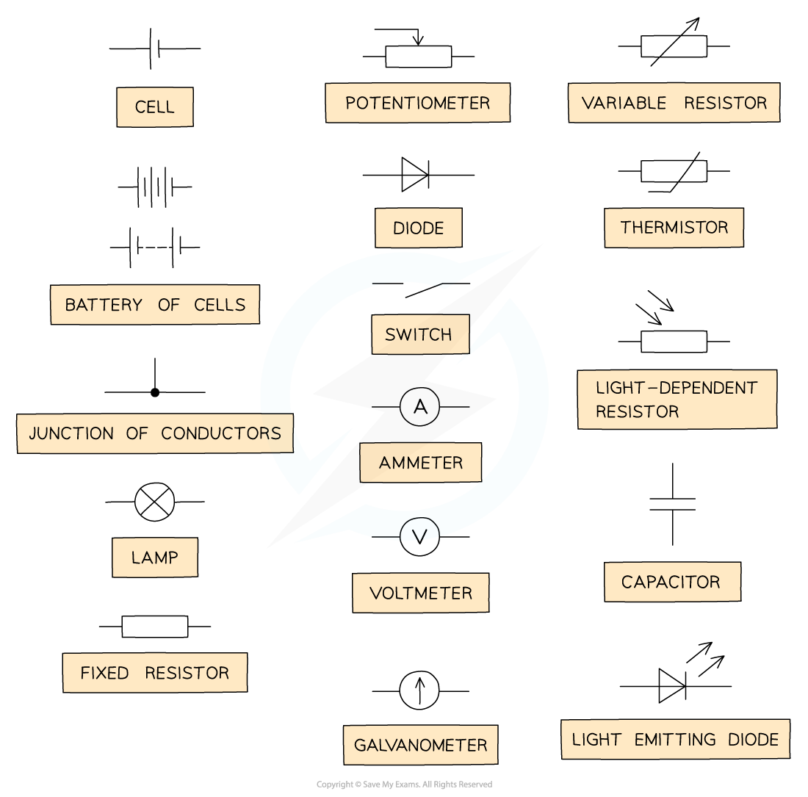
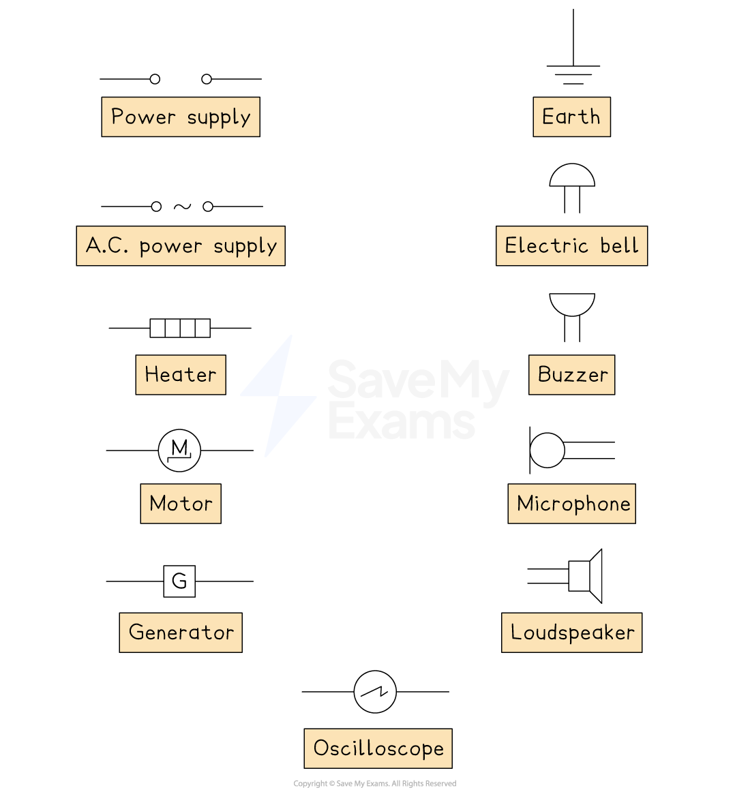

# Circuit Symbols

## Circuit Symbols

> **Spec point** — `spcpt_RgWSd4ySqM6m5vqH`

## Circuit symbols

- The diagrams below show the various circuit symbols that could be used in circuit diagrams. You will be expected to recognise and draw all of these
- The most common symbols are as follows:

#### Circuit symbols

***Common circuit symbols***

- The function of the most common components are:

  - **Switch: **Turn the circuit on (closed), or off (open)
  - **Fixed resistor:** A resistor limits the flow of current. A fixed resistor has a resistance it cannot change
  - **Variable resistor:** A resistor with a slider that can be used to change its resistance. Used often in dimmer switches and volume controls
  - **Thermistor:** The resistance of a thermistor depends on its temperature. As its temperature increases, its resistance decreases and vice versa
  - **Light-dependent resistor (LDR):** The resistance of an LDR depends on the light intensity. As the light intensity increases, its resistance decreases and vice versa
  - **Diode: **A diode allows current to flow in one direction only. They are used to convert AC to DC current
  - **Light-emitting diode (LED): **This is equivalent to a diode and emits light when a current passes through it. These are used for aviation lighting and displays (TVs, road signs)
  - **Ammeter:** Used to measure the current in a circuit. Connected in series with other component
  - **Voltmeter: **Use to measure the potential difference of an electrical component. Connected in parallel with component

- The more uncommon, yet relevant symbols, are as follows:

#### Uncommon circuit symbols

***Other circuit symbols***

> **Exam Hint**
> You must memorise all of these circuit symbols for the exam. To make it easier for you, we have separated the symbols into the most common symbols, and the symbols that don’t come up as often, however, you should be aware of all of them!

## Interpreting Circuit Diagrams

> **Spec point** — `spcpt_9nbCDjwsqMtCwxtJ`

## Interpreting circuit diagrams

- Being able to draw and interpret circuit diagrams using circuit symbols is an essential skill in Electronics

> **Worked Example**
> Which circuit diagram correctly represents a circuit with current flowing through?
> 
> 
> 
> **Answer: B**
> 
> - For a circuit to be connected, the switch must be closed
> 
>   - This is either circuit **B** or **D**
> - The other circuit symbol is a diode
> 
>   - Diodes only allow current to flow in one direction
> - Since current flow is from positive to negative, a forward-biased diode must point in this direction in order for the current to flow
> 
>   - This is seen in circuit **B**
> 
> 
