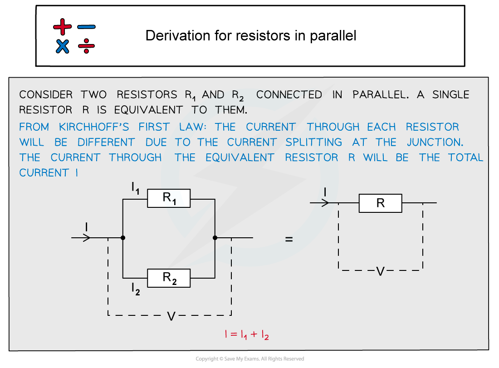
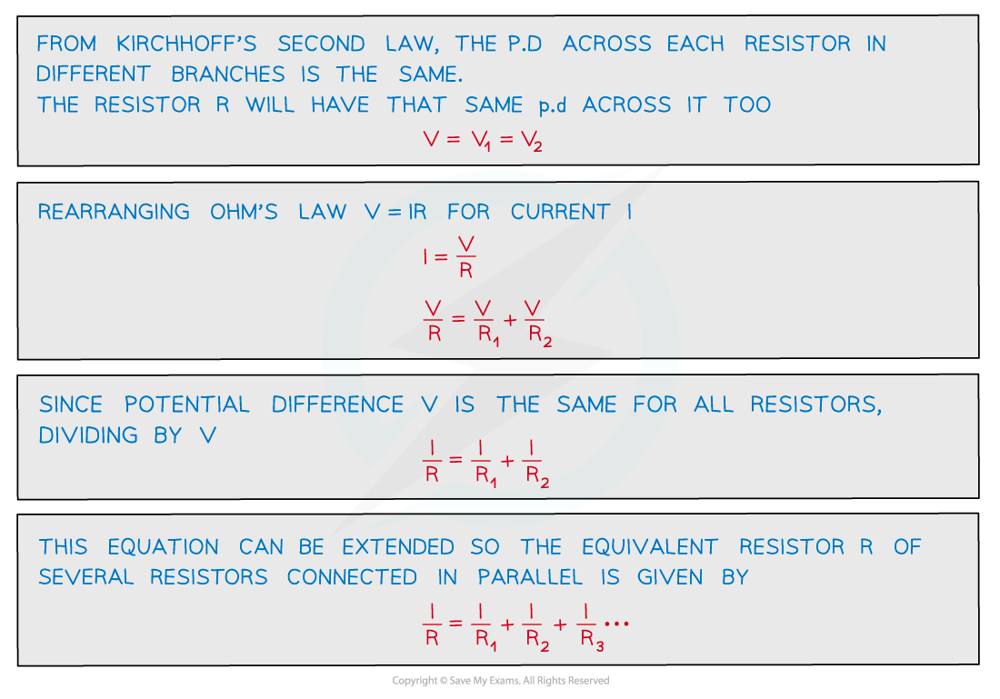
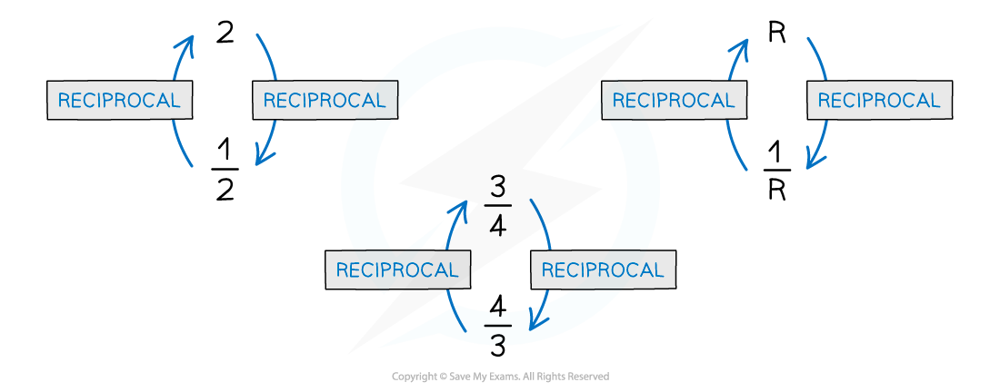

# Resistors in Parallel

## Deriving the Equation for Resistors in Parallel

> **Spec point** — `spcpt_9jsfFCnBWCnx7QCp`

## Deriving the equation for resistors in parallel

- In a **parallel **circuit, the **reciprocal **of the **combined resistance** of two or more resistors is the **sum **of the **reciprocal **of the **individual resistances**
- In a parallel circuit:

  - The **current **is **split **at the junction (and therefore between resistors)
  - The **potential difference** is the **same **through all resistors
- The equation for combined resistors in parallel is derived using Kirchhoff’s laws:

## Resistors in Parallel

> **Spec point** — `spcpt_3FdkPXGJ3SjWhMDH`

## Resistors in parallel

- When two or components are connected in parallel: **The reciprocal of the combined resistance is the sum of the reciprocals of the individual resistances**

#### Resistors in parallel

***Resistors connected in parallel have the same voltage***

- The equation for the combined resistance, *R*  of resistors in parallel is:

$\frac{1}{R}=\frac{1}{R_{1}}+\frac{1}{R_{2}}+\frac{1}{R_{3}}...$

- This means the combined resistance decreases and is less than the resistance of any of the individual components
- For example, If two resistors of equal resistance are connected in parallel, then the combined resistance will halve

### Maths tip

- The reciprocal of a value is $\frac{1}{value}$
- For example, the reciprocal of a whole number such as 2 equals $\frac{1}{2}$

  - The reciprocal of $\frac{1}{2}$ is 2
- If the number is already a fraction, the numerator and denominator are ‘flipped’ round

#### Reciprocals

***The reciprocal of a number is 1 ÷ number***

- In the case for the resistance R, this becomes $\frac{1}{R}$. To get the value of R from $\frac{1}{R}$, you must calculate $\frac{1}{youranswer}$
- You can also use the reciprocal button on your calculator (labelled either x-1 or $\frac{1}{x}$, depending on your calculator

> **Worked Example**
> The circuit below shows 3 resistors connected in parallel.
> 
> Which value gives the combined resistance of all the resistors in this circuit?
> 
> **A. **$\frac{5R}{2}$**      **
> 
> **B.** $\frac{2}{5R}$
> 
> **C. **$\frac{5}{2R}$**      **
> 
> **D.** $\frac{2R}{5}$
> 
> 
> 
> **Answer:**** ****D**
> 
> **Step 1: Resistors in parallel equation**
> 
> $\frac{1}{R}=\frac{1}{R_{1}}+\frac{1}{R_{2}}+....=\frac{1}{R_{1}}+\frac{1}{R_{2}}+\frac{1}{R_{3}}$
> 
> **Step 2: Substitute in the values given from the equation**
> 
> `1 over R subscript T space equals fraction numerator space 1 over denominator R end fraction space plus thin space fraction numerator 1 over denominator 2 R end fraction space plus fraction numerator space 1 over denominator R end fraction space equals space open parentheses 1 space plus thin space 1 half space plus thin space 1 close parentheses space 1 over R space equals space fraction numerator 5 over denominator 2 R end fraction`
> 
> **Step 3: Calculate the total resistance**
> 
> $\frac{1}{R_{T}}=\frac{5}{2R}$
> 
> $R_{T}=\frac{2R}{5}$

> **Exam Hint**
> The most common mistake is to leave the answer as 1/RT. Remember to calculate $\frac{1}{answer}$ to get the value of RT.
