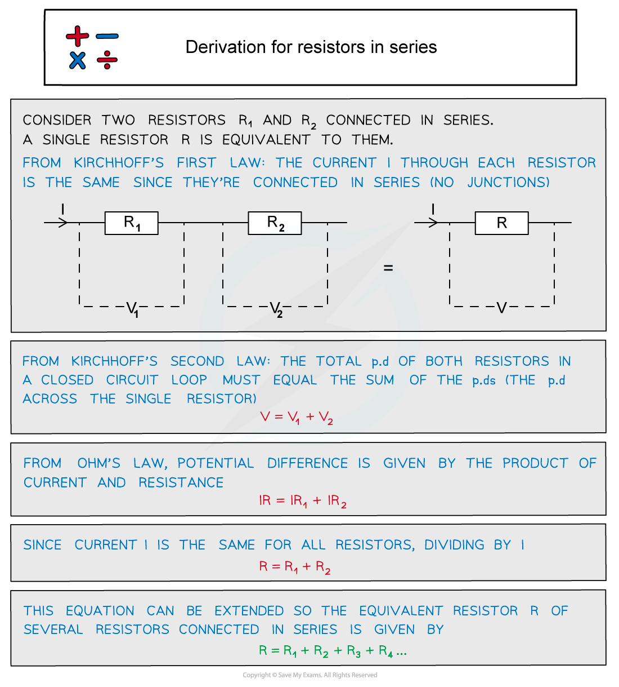

# Resistors in Series

## Deriving the Equation for Resistors in Series

> **Spec point** — `spcpt_3cgkc28nr2qVsFrY`

## Deriving the equation for resistors in series

- In a **series **circuit, the **combined resistance** of two or more resistors is the **sum **of the **individual resistances**
- In a series circuit:

  - The **current **is the **same** through all resistors
  - The **potential difference **is **shared **between all the resistors
- The equation for combined resistors in series is derived using Kirchhoff’s laws:

## Resistors in Series

> **Spec point** — `spcpt_bSgwKCG9dmvYKsqt`

## Resistors in series

- When two or more components are connected in series: **The combined resistance of the components is equal to the sum of the individual resistances**

#### Resistors in series

***Resistors connected in series each have their own separate potential difference***

- The equation for the combined resistance, *R*  of resistors in series is:

$R=R_{1}+R_{2}+...$

> **Worked Example**
> The combined resistance *R* in the following series circuit is 60 Ω.
> 
> What is the resistance value of R2?
> 
> 
> 
> **A. **100 Ω
> 
> **B.** 30 Ω
> 
> **C.** 20 Ω
> 
> **D.** 40 Ω
> 
> **Answer:**** ****C**
> 
> **Step 1: State the equation for the combined resistance for resistors in series**
> 
> $R=R_{1}+R_{2}+...=R_{1}+R_{2}+R_{3}$
> 
> **Step 2: Rearrange for resistance *****R*****2**
> 
> `R subscript 2 space equals space R space minus space open parentheses R subscript 1 space plus space R subscript 3 close parentheses`
> 
> **Step 3: Substitute the values**
> 
> `R subscript 2 space equals space 60 space minus space open parentheses 30 space plus thin space 10 close parentheses space equals space 20 space straight capital omega`
