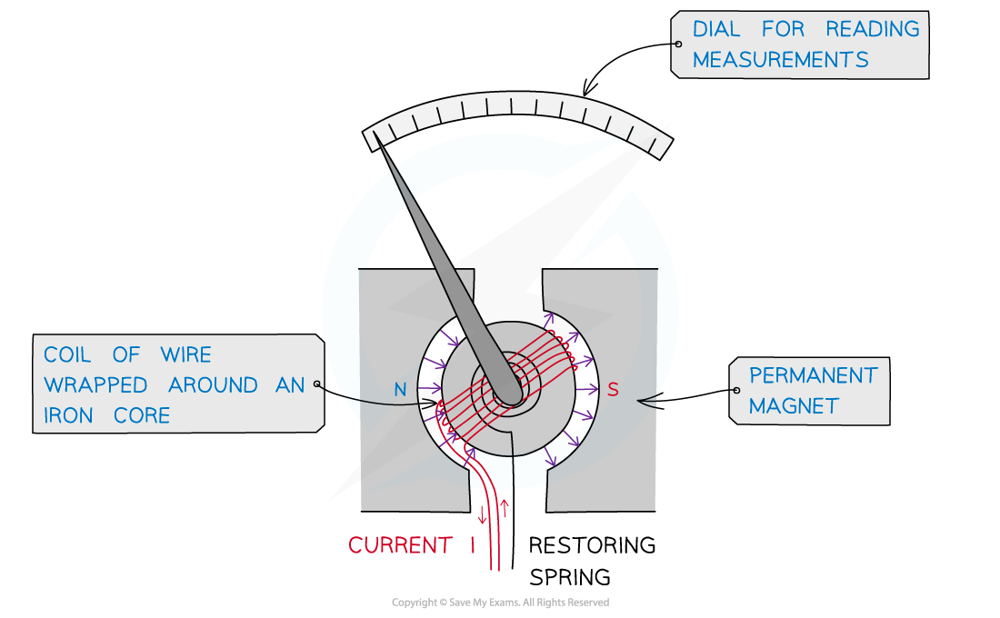
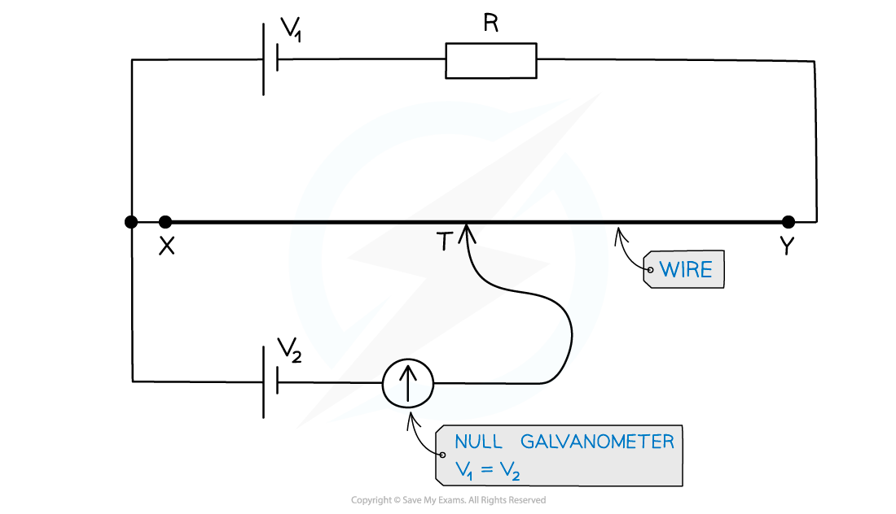

# Galvanometer

## The Galvanometer

> **Spec point** — `spcpt_5hrMqSQDrV95Z89Q`

## The galvanometer

- A galvanometer is a type of sensitive ammeter used to detect electric current
- It is used in a potentiometer to measure e.m.f between two points in a circuit
- The circuit symbol is recognised by an arrow in a circle:

#### Galvanometer circuit symbol

***The galvanometer circuit symbol is a circle with an arrow which deflects***

- A galvanometer is made from a coil of wire wrapped around an iron core that rotates inside a magnetic field:

#### A galvanometer

***A galvanometer contains a coil of wire wrapped around an iron core between magnets***

- The arrow represents a needle which deflects depending on the amount of current passing through

  - When the arrow is facing directly upward, there is no current
  - This is called **null **deflection
- Ohm’s law tells us that the current through a conductor (wire) is directly proportional to the potential difference through it i.e. **no p.d means no current **flows through the galvanometer
- A galvanometer has a p.d of zero when the potential on one side equals the potential on the other side
- This is at the** position at which it is connected on the wire (which varies with the sliding contact) gives a p.d equal to the EMF of the cell connected to the galvanometer**
- The cell should be connected such that its potential** opposes** the potential on the wire i.e. the positive terminal of the power supply faces the positive terminal of the cell:

#### A null galvanometer

***A circuit diagram showing a null galvanometer. The voltage V*****1**** = *****V*****2**

** **

- When the sliding contact moves along the potentiometer wire, you add or remove resistance from/to the external circuit. This changes the potential drop across X and Y
- The location of the sliding point is adjusted until the galvanometer reads zero. This is until the potential difference equals E2
- The direction of the two e.m.fs oppose each other and there is no current

> **Exam Hint**
> If you’re unsure as to whether the p.d will increase as the contact slider is moved along the wire, remember **p.d is proportional to the length of the wire** (from Ohm’s law and the resistivity equation). The longer the length of a wire, the higher the p.d.
