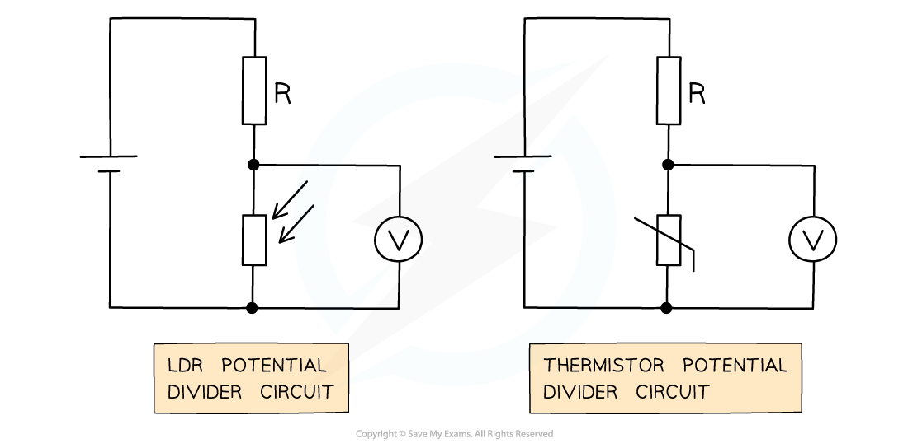

# Potential Divider Components

## Variable Resistance Components

> **Spec point** — `spcpt_ZHGNdF5Z2WphFQt7`

## Variable resistance components

- Variable and sensory resistors are used in potential dividers to vary the output voltage

  - This could cause an external component to switch on or off e.g. a heater switching off automatically when its surroundings are at room temperature
- Sensory resistors used are **Light Dependent Resistors (LDRs)** and **thermistors**

#### LDR and thermistors in a circuit

***LDR and thermistor in a potential divider circuit with a fixed resistor R***

- The voltmeter in both circuits is measuring *V*out
- Recall that the resistance of an LDR varies with light intensity

  - The higher the light intensity, the lower the resistance and vice versa
- An LDR circuit is often used for street and security lights
- The resistance of a thermistor varies with temperature

  - The hotter the thermistor, the lower the resistance and vice versa
- A thermistor circuit is used in fire alarms, ovens and digital thermometers
- From Ohm’s law ***V = IR***, the potential difference *V*out from a resistor in a potential divider circuit is **proportional** to its resistance

  - If an LDR or thermistor's resistance **decreases**, the potential difference through it also **decreases**
  - If an LDR or thermistor's resistance **increases**, the potential difference through it also **increases**
- Since the total p.d of the components must be equal to *V*in, if the p.d of the sensory resistor **decreases** then the p.d of the other resistor in the circuit must **increase** and vice versa

> **Worked Example**
> A potential divider consists of a fixed resistor R and a thermistor.
> 
> 
> 
> What happens to the p.d through resistor R and the thermistor when the temperature of the thermistor decreases?
> 
> |   | **P.d of thermistor / V** | **P.d of resistor / V** |
> |---|---|---|
> | **A.** | Increases | Increases |
> | **B.** | Decreases | Increases |
> | **C.** | Decreases | Decreases |
> | **D.** | Increases | Decreases |
> 
> **Answer: D**
> 
> - Due to Ohm’s Law (*V = IR*), both the resistor and thermistor are connected in series and have the same current *I*
> - In a thermistor, if the temperature **decreases**, its resistance **increases**
> - This means the potential difference across the thermistor also **increases**
> - As the resistance *R* **increases**, the potential difference across the thermistor also **increases**
> - In series, the potential difference is shared equally amongst the components. Their sum equals the e.m.f of the supply (Kirchhoff’s second law)
> - This means the potential difference across the resistance R must **decrease**, to keep the same overall total e.m.f
