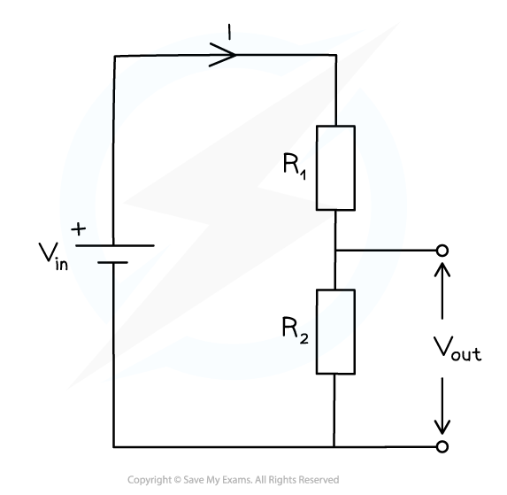

# Potential Dividers

## Potential Divider Circuit

> **Spec point** — `spcpt_dDmr9tnpch9tKKF7`

## Potential divider circuit

- When two resistors are connected in series, through Kirchhoff’s Second Law, the potential difference across the power source is divided between them
- Potential dividers are circuits which produce an output voltage as a **fraction** of its input voltage
- Potential dividers have three main purposes:

  - To provide a variable potential difference
  - To enable a specific potential difference to be chosen
  - To split the potential difference of a power source between two or more components
- Potential dividers are used widely in volume controls and sensory circuits using LDRs and thermistors
- Potential divider circuits are based on the ratio of voltage between components. This is equal to the ratio of the resistances of the resistors in the diagram below, giving the following equation:

$V_{out}=\frac{R_{2}}{R_{1}+R_{2}}V_{in}$

- The resistance *R*2 on the numerator of the fraction is always the resistance of the component that *V*out is connected to

#### Potential divider circuit diagram

***A potential divider circuit is a combination of resistors, voltage in from a source and voltage out***

- The input voltage Vin is applied to the top and bottom of the series resistors
- The output voltage Vout is measured from the centre to the bottom of resistor *R*2
- The potential difference *V* across each resistor depends upon its resistance *R*:

  - The resistor with the** largest resistance** will have a **greater potential difference** than the other one from *V* = *IR*
  - If the resistance of one of the resistors is increased, it will get a greater share of the potential difference, whilst the other resistor will get a smaller share
- In potential divider circuits, the p.d across a component is proportional to its resistance from *V* = *IR*

> **Worked Example**
> The circuit is designed to light up a lamp when the input voltage exceed a preset value.
> 
> It does this by comparing Vout with a fixed reference voltage of 5.3 V.
> 
> 
> 
> Vout is equal to 5.3
> 
> Calculate the input voltage Vin.
> 
> **Answer:**
> 
> **Step 1: List the known quantities**
> 
> - Resistance of first resistor, *R*1 = 20 kΩ
> - Resistance of the second resistor, *R*2 = 12 kΩ
> - *V*out = 5.3 V
> 
> **Step 2: State the potential divider equation**
> 
> - The *R*1 is on the numerator as this is the resistor that *V*out is from
> 
> $V_{o u t} = ( \frac{R_{1}{R_{1} + R_{2} } ) V_{i} n}$
> 
> **Step 3: Rearrange for the input voltage, *****V*****in**
> 
> $V_{i n} = \frac{V_{o u t} }{( \frac{R_{1}{R_{1} + R_{2} } )} = ( \frac{R_{1} + R_{2} }{R_{1} } ) V_{o} u t}$
> 
> **Step 4: Substitute in values**
> 
> $V_{i n} = ( \frac{12 + 20}{20} ) \times 5.3 = 8.5 \mathrm{V} ( 2 \mathrm{s} . \mathrm{f} . )$

> **Exam Hint**
> Always make sure the correct resistance is in the numerator of the potential divider equation. This will be the resistance of the component you want to find the output voltage of.
