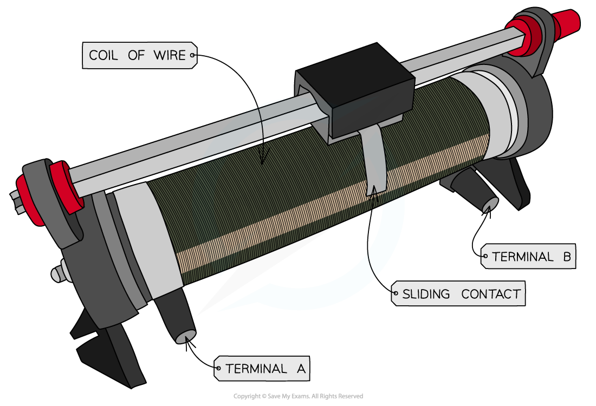

# Potentiometer

## The Potentiometer

> **Spec point** — `spcpt_rv42sKpNftQRYwJQ`

## The potentiometer

- A potentiometer is similar to a variable resistor connected as a potential divider to give a continuously variable output voltage
- It can be used as a means of comparing potential differences in different parts of the circuit
- The circuit symbol is recognised by an arrow next to the resistor

#### Potentiometer circuit symbol

***A potentiometer circuit symbol looks like a resistor with an arrow towards it***

- A potentiometer is a single component that (in its simplest form) consists of a coil of wire with a sliding contact, midway along it

#### A potentiometer

***A potentiometer is a type of variable resistor***

- It is recognised on a circuit diagram with a resistor fitted with a sliding contact
- The sliding contact has the effect of separating the potentiometer into two parts (an upper part and a lower part), both of which have different resistances

#### Potentiometer circuit diagram

***Moving the slider (the arrow in the diagram) changes the resistance (and hence potential difference) of the upper and lower parts of the potentiometer***

- If the slider in the above diagram is moved upwards, the resistance of the lower part will increase and so the potential difference across it will also increase
- Therefore, the variable resistor obtains a maximum or minimum value for the output voltage
- If the resistance is 3 Ω:

  - Maximum voltage is when the resistance is 3 Ω
  - Minimum voltage is when the resistance is 0 Ω

> **Worked Example**
> A potential divider circuit consists of fixed resistors of resistance 5.0 Ω and 7.0 Ω connected in series with a 6.0 Ω resistor fitted with a sliding contact. These are connected across a battery of e.m.f 12 V and zero internal resistance, as shown.
> 
> 
> 
> What are the maximum and minimum output voltages of the circuit with the sliding contact?
> 
> |   | **Maximum voltage / V** | **Minimum voltage / V** |
> |---|---|---|
> | **A.** | 8.7 | 4.7 |
> | **B.** | 6 | 0 |
> | **C.** | 12 | 6.5 |
> | **D.** | 12.5 | 4.7 |
> 
> **Answer: A**
> 
> **Step 1: List the known quantities:**
> 
> - Input voltage, *V*in = 12 V
> - First resistor, *R*1 = 5.0 Ω
> - Second resistor, *R*2 = 6.0 Ω
> - Third resistor, *R*3 = 7.0 Ω
> 
> **Step 2: Determine the maximum and minimum resistance with the sliding contact**
> 
> - When the sliding contact is at the top of the 6.0 Ω resistor, the output voltage takes into account the 6.0 Ω and 7.0 Ω resistor
> - When the sliding contact is at the bottom of the 6.0 Ω resistor, the output voltage only takes into account the 7.0 Ω
> 
> **Step 3: State the potential divider equation for the three resistors**
> 
> - This time, *R*2  and *R*3 are on the numerator as they are where *V*out is from
> 
> `V subscript o u t end subscript space equals space open parentheses fraction numerator R subscript 2 plus thin space R subscript 3 over denominator R subscript 1 space plus space R subscript 2 space plus thin space R subscript 3 end fraction close parentheses V subscript i n end subscript`
> 
> **Step 4: Calculate the maximum output voltage**
> 
> - This is when the sliding contact is at the top of the 6.0 Ω resistor
> 
> `V subscript o u t end subscript space equals space open parentheses fraction numerator 6.0 space plus thin space 7.0 space over denominator 5.0 space plus space 6.0 space plus thin space 7.0 end fraction close parentheses space cross times 12.0 space equals space 8.7 space straight V`
> 
> **Step 5: Calculate the minimum output voltage**
> 
> - This is when the sliding contact only covers the 7.0 Ω resistor
> 
> `V subscript o u t end subscript space equals space open parentheses fraction numerator thin space 7.0 space over denominator 5.0 space plus space 6.0 space plus thin space 7.0 end fraction close parentheses space cross times 12.0 space equals space 4.7 space straight V`
