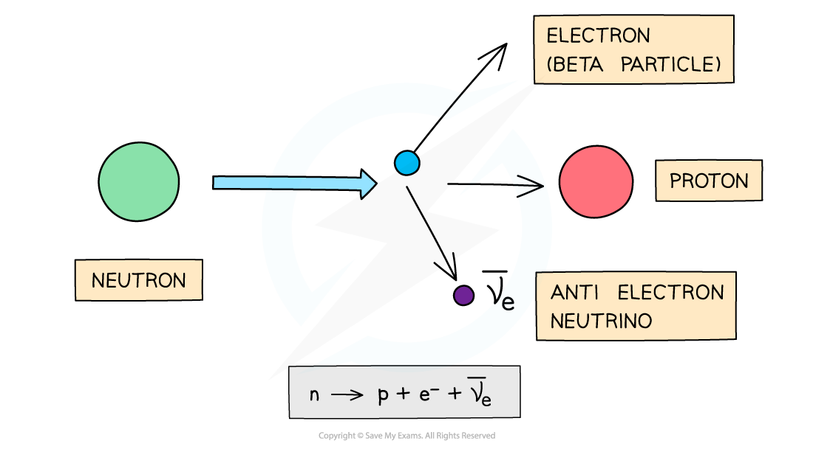
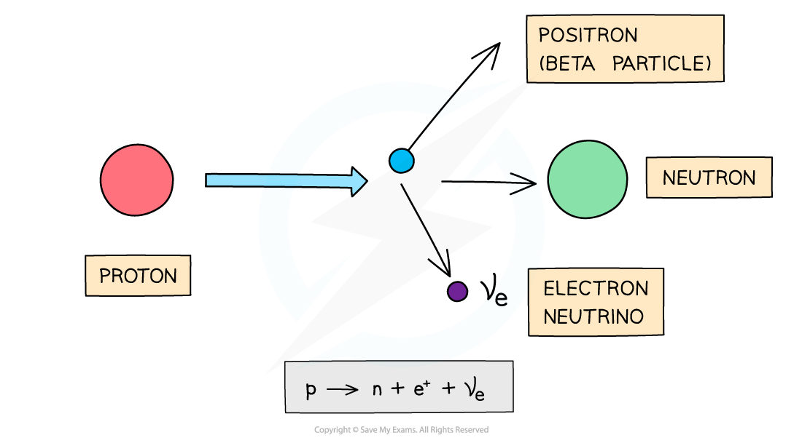
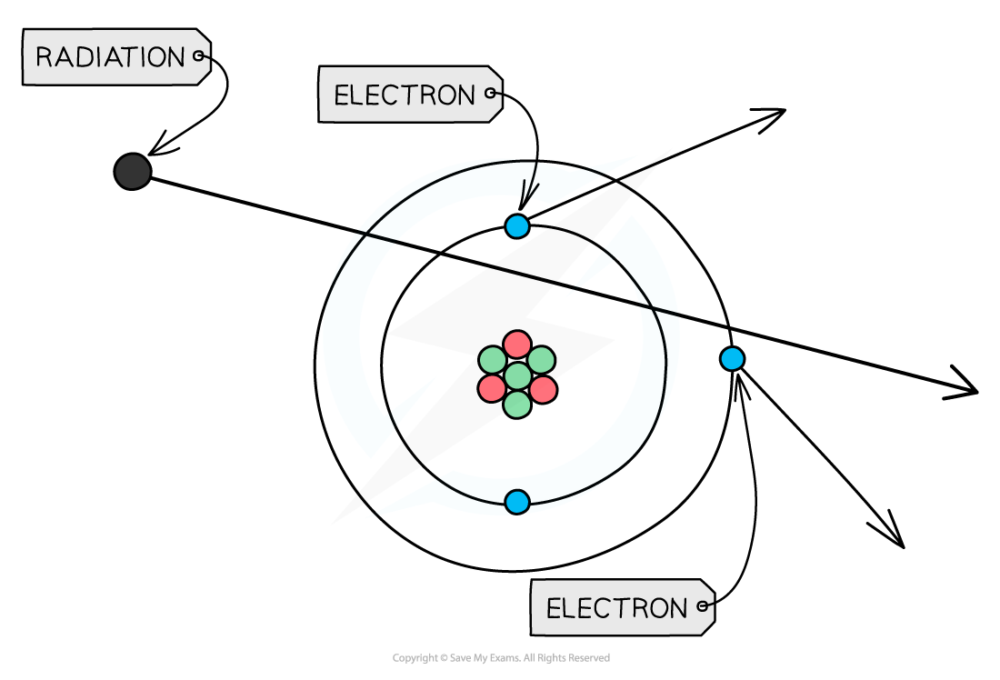

# Alpha, Beta & Gamma Particles

## Conservation of Nucleon Number & Charge

> **Spec point** — `spcpt_ZzSDSvvX8P9K4vPX`

## Conservation of nucleon number & charge

- Nuclear processes such as fission and fusion are represented using nuclear equations (similar to chemical reactions in chemistry)
- The number of protons and neutrons in atom is known as its **constituents**
- For example:

`U _ 92 ^ 235 + n _ 0 ^ 1 -> Sr _ 38 ^ 90 + Xe _ 54 ^ 144 + 2 n _ 0 ^ 1`

- The above equation represents a fission reaction in which a uranium nucleus is hit with a neutron and splits into two smaller nuclei – a Strontium nucleus and Xenon nucleus, releasing two neutrons in the process
- In nuclear equations, the nucleon number and charge are always **conserved**
- This means that:

  - the sum of the **nucleons **on the **left** hand side must **equal **the sum of the **nucleons **on the **right **hand side
  - the sum of the **charge **on the **left **hand side must **equal **the sum of the **charge **on the **right **hand side
- In the above equation, the sum of the nucleon (top) numbers on both sides are equal

$235 + 1 = 90 + 144 + ( 2 \times 1 )$

$236=236$

- The same is true for the proton (bottom) numbers

$92 + 0 = 38 + 54 + ( 2 \times 0 )$

$92=92$

- By balancing equations in this way, you can determine the nucleon number, proton number or the number of missing elements

- Let's consider another example:

`U _ 92 ^ 235 + n _ 0 ^ 1 -> Rb _ 37 ^ 96 + Cs _ 55 ^ 137 + N n _ 0 ^ 1`

- Determine the total nucleon number

  - This is determined from the side of the equation where all the values are known
  - In this example, from the reactants `U _ 92 ^ 235 + n _ 0 ^ 1`
  - The total nucleon number = 235 + 1 = 236
- Equate the total nucleon number to the total nucleon number of the products including the unknown N `Rb _ 37 ^ 96 + Cs _ 55 ^ 137 + N n _ 0 ^ 1`

  - Total nucleon number of reactants = 96 + 137 + (N ×1) = 236
- Rearrange to solve for N

$N=\frac{236-96-137}{1}$

$N=3$

- Balancing the equation shows that 3 neutrons must be released in the reaction

> **Worked Example**
> When a californium atom reacts with an unknown element X, the following reaction occurs.
> 
> `Cf _ 98 ^ 252 + X _ Y ^ 10 -> 3 n _ 0 ^ 1 + Lr _ 103 ^ Z`
> 
> Determine the missing values of Y and Z.
> 
> **Answer: **
> 
> **Step 1: Identify what the value of Y represents**
> 
> - Y is the proton number of element X
> 
> **Step 2: Determine the value of Y**
> 
> - Determine the number of protons on both sides of the equation
> 
> $98 + \mathrm{Y} = ( 3 \times 0 ) + 103$
> 
> $Y=0+103-98$
> 
> $Y=5$
> 
> **Step 3: Identify what the value of Z represents**
> 
> - Z is the nucleon number of the element Lr
> 
> **Step 4: Determine the value of Z**
> 
> - Determine the total nucleon numbers on both sides of the equation
> 
> $252 + 10 = ( 3 \times 1 ) + \mathrm{Z}$
> 
> $Z=252+10-3$
> 
> $Z=259$

## Alpha, Beta & Gamma Particles

> **Spec point** — `spcpt_hqmJY4MT3zxKmGNj`

## Alpha, beta & gamma particles

- Some elements have nuclei that are unstable

  - This tends to be when the number of nucleons does not balance

- In order to become more stable, they emit particles and/or electromagnetic radiation

  - These nuclei are said to be **radioactive**

- There are three main types of radioactive emission: alpha, beta and gamma

### Alpha particles

- **Alpha (α) particles** are high energy particles made up of **2 protons and 2 neutrons** (the same as a helium nucleus)
- They are usually emitted from nuclei that are too large

***During alpha decay, a parent nucleus becomes a daughter nucleus by emitting an alpha particle (helium nucleus)***

- The nuclide notion for an alpha particle is:

$\ \\alpha pre_{2} pre^{4}$ or `He presubscript 2 presuperscript 4`

- Alpha is a **highly** ionising form of radiation

  - It has a large charge of +2*e*
- Alpha is a **weakly** penetrating form of radiation

  - This is because it is so ionising, it readily interacts with any object instead of passing through it
  - Alpha particles have a range of a few cm in air
- Alpha particles can be blocked by skin or a piece of paper

### Beta particles

- **Beta (β****−****) particles are high energy electrons** emitted from the nucleus

  - β− particles are emitted by nuclei that have too many **neutrons**

***During beta-minus decay, a neutron in a parent nucleus becomes a proton in a daughter nucleus by emitting a beta-minus particle (an electron) and an anti-electron neutrino***

- The nuclide notion for a beta minus particle is:

`beta _ - 1 ^ 0`

- **Beta (β****+****) particles are high energy positrons **emitted from the nucleus

  - β+ particles are emitted by nuclei that have too many **protons**

***During beta-plus decay, a proton in a parent nucleus becomes a neutron in a daughter nucleus by emitting a beta-plus particle (a positron) and an electron neutrino***

- The nuclide notion for a beta plus particle is:

`beta _ + 1 ^ 0`

- Beta is a **moderately** ionising type of radiation

  - This is due to it having a charge of ±1*e*
  - This means it is able to do some slight damage to cells (less than alpha but more than gamma)
- Beta is a **moderately** penetrating type of radiation

  - Beta particles have a range of around 20 cm - 3 m in air, depending on their energy
- Beta particles can be stopped by a few millimetres of** aluminium **foil

### Gamma rays

- **Gamma (γ) rays are high energy electromagnetic waves**
- They are emitted by nuclei that need to lose some energy

- The nuclide notation for a gamma particle is:

$\ \\gamma pre_{0} pre^{0}$

- If these particles hit other atoms, they can knock out electrons, **ionising the atom**
- This can cause chemical changes in materials and can damage or kill living cells

#### Ionisation by radiation

***When radiation passes close to atoms, it can knock out electrons, ionising the atom***

- The properties of the different types of radiation are summarised in the table below

#### Properties of types of radiation

| **Particle** | **Composition** | **Mass / u** | **Charge / e** | **Speed / c** |
|---|---|---|---|---|
| Alpha (α) | 2 protons + 2 neutrons | 4 | +2 | 0.05 |
| Beta minus (β−) | Electron (e−) | 0.0005 | −1 | >0.99 |
| Beta plus (β+) | Positron (e+) | 0.0005 | +1 | >0.99 |
| Gamma (γ) | Electromagnetic wave | 0 | 0 | 1 |

- *u* is the atomic mass unit (see “Atomic Mass Unit (u)”)
- *e* is the charge of the electron: 1.60 × 10-19 C
- *c* is the speed of light: 3 × 108 m s-1

> **Worked Example**
> Three successive radioactive decays are shown in the diagram below. Each one results in a particle being emitted.
> 
> The first decay results in the emission of a β-particle.
> 
> The second decay results in the emission of an α-particle.
> 
> The third decay results in the emission of another β-particle.
> 
> 
> 
> Nuclides W and Z are compared.
> 
> Which nuclide of Z is formed at the end of this decay?
> 
> **A. **`Z _ 90 ^ 237`**      **
> 
> **B. **`Z _ 92 ^ 233`**      **
> 
> **C. **`Z _ 89 ^ 237`**      **
> 
> **D. **`Z _ 90 ^ 233`
> 
> **Answer: D**
> 
> **Step 1: Write the equation for the β− decay**
> 
> - A β− particle is an electron
> - The nucleon number stays the same
> - The proton number increases by 1
> 
> `W _ 92 ^ 237 -> X _ 93 ^ 237 + beta _ 1 ^ 0`
> 
> **Step 2: Write the equation for the α decay**
> 
> - An α particle is a helium nucleus
> - The nucleon number reduces by 4
> - The proton number reduces by 2
> 
> `X _ 93 ^ 237 -> Y _ 91 ^ 233 + alpha _ 2 ^ 4`
> 
> **Step 3: Write the equation for the β+ decay**
> 
> - A β+ particle is a positron
> - The nucleon number stays the same
> - The proton number reduces by 1
> 
> `Y _ 91 ^ 233 -> Z _ 90 ^ 233 + beta _ + 1 ^ 0`
> 
> **Step 4: Determine the final nucleon Z**
> 
> - The final nucleon, Z will be:
> 
> `Z _ 90 ^ 233`

> **Exam Hint**
> It is important to be familiar the properties of each type of radiation and their symbols.
