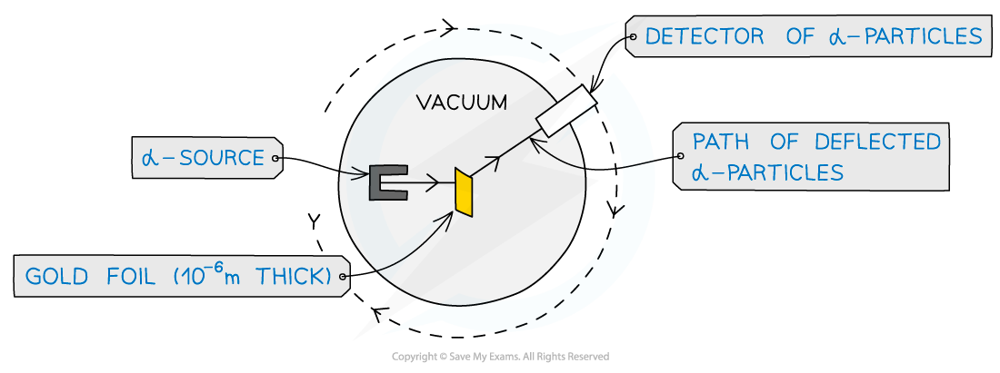
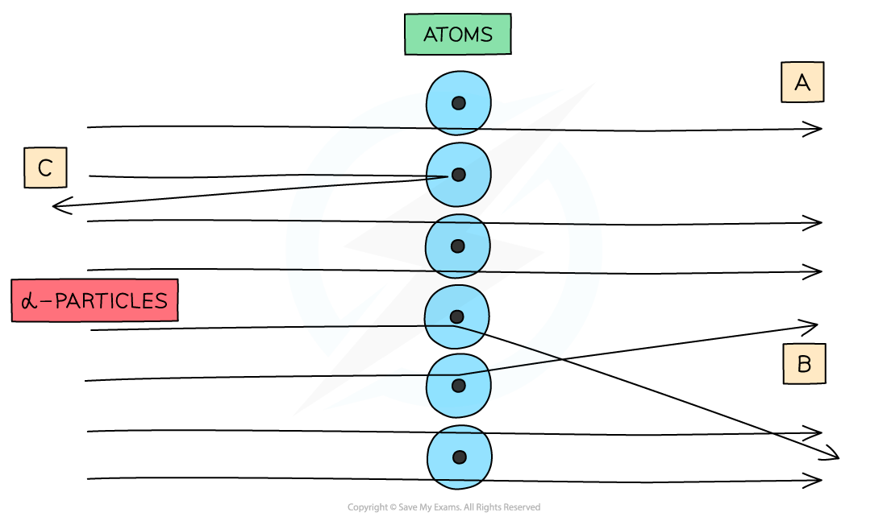
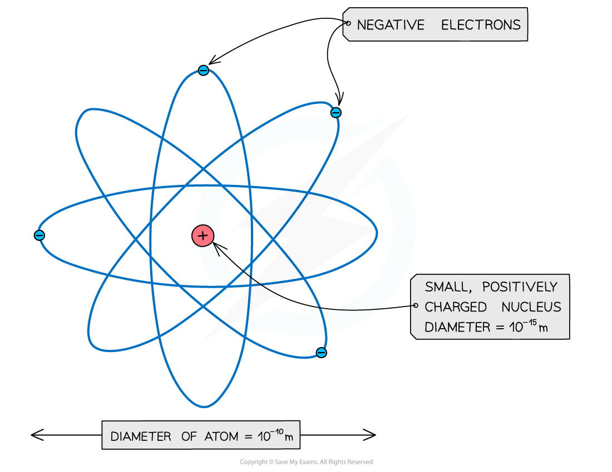

# Alpha-particle Scattering Experiment

## Alpha-particle Scattering Experiment

> **Spec point** — `spcpt_YyH4BMjdZ3FmSSDm`

## Alpha-particle scattering experiment

- Evidence for the structure of the atom was discovered by Ernest Rutherford in the beginning of the 20th century from the study of **α-particle scattering**
- The experimental setup consists of alpha particles fired at thin gold foil and a detector on the other side to detect how many particles deflected at different angles

#### Alpha particle scattering experiment

***α-particles are fired at a thin gold foil and a detector records the deflection of the particles***

- α-particles are the nucleus of a helium atom and are positively charged

#### Deflection patterns of the alpha particles

***When α-particles are fired at thin gold foil, most of them go straight through but a small number bounce straight back***

- From this experiment, Rutherford results were:
- **The majority of α-particles went straight through **

  - This is shown by process **A** in the image above
  - This suggested the atom is mainly **empty space**
- **Some α-particles deflected through small angles of < 10****o**

  - This is shown by process **B** in the image above
  - This suggested there is a **positive nucleus** at the centre (since two positive charges would repel)
- **Only a small number of α-particles deflected straight back at angles of > 90****o**** **

  - This is shown by process **C** in the image above
  - This suggested the **nucleus **is extremely **small **and this is where the **mass **and **charge **of the atom is **concentrated**
  - It was therefore concluded that atoms consist of small dense positively charged nuclei, surrounded by negatively charged electrons

#### Structure of an atom as determined by the alpha particle experiment

***An atom: a small positive nucleus, surrounded by negative electrons***

- (Note: The atom is around 100,000 times larger than the nucleus!)

> **Worked Example**
> In an α-particle scattering experiment, a student set up the apparatus below to determine the number n of α-particle incident per unit time on a detector held at various angles θ.
> 
> 
> 
> Which of the following graphs best represents the variation of n with θ from 0 to 90°?
> 
> 
> 
> **Answer: A**
> 
> - The Rutherford scattering experience directed parallel beams of α-particles at gold foil
> - The observations were:
> 
>   - Most of the α-particles went straight through the foil
>   - The largest value of n will therefore be at small angles
>   - Some of the α-particles were deflected through small angles
>   - n drops quickly with increasing angle of deflection θ
> - These observations fit with graph A
