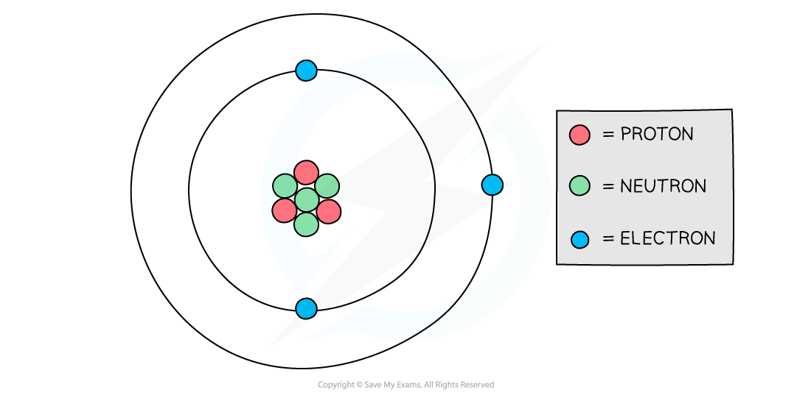

# Atomic Structure

## Atomic Structure

> **Spec point** — `spcpt_3c3Gm5f29KyYm8F9`

## Atomic structure

- The atoms of all elements are made up of three types of particles: protons, neutrons and electrons.

#### Structure of an atom

***Protons and neutrons are found in the nucleus of an atom while electrons orbit the nucleus***

#### Table of properties of subatomic particles

| **Particle** | **Relative charge** | **Relative mass** |
|---|---|---|
| Proton | +1 | 1 |
| Neutron | 0 | 1 |
| Electron | -1 | 1/2000 (negligible) |

- *** ***A stable atom is **neutral** (it has no charge)
- Since protons and electrons have the same charge, but opposite signs, a stable atom has an equal number of both for the overall charge to remain neutral

> **Exam Hint**
> Remember not to mix up the ‘atom’ and the ‘nucleus’. The ‘atom’ consists of the nucleus and electrons. The ‘nucleus’ just consists of the protons and neutrons in the middle of the atom, not the electrons.

## Antimatter

> **Spec point** — `spcpt_zCTzXqTt6Q6hpT8N`

## Antimatter

- We live in a universe made up of **matter** particles (protons, neutrons, electrons etc.)
- All matter particles have antimatter counterparts

  - **Antimatter particles are identical to their matter counterpart but with the opposite charge**
- This means if a particle is positive, its antimatter particle is negative and vice versa
- Common matter-antimatter pairs are shown in the table below:

#### Charges of matter and antimatter particles

| **Matter** | **Charge** | **Antimatter** | **Charge** |
|---|---|---|---|
| Electron, $e^{-}$ | -1 | Positron, $e^{+}$ | +1 |
| Proton, $p$ | +1 | Anti-proton, $\overline{p}$ | -1 |
| Neutron, $n$ | 0 | Anti-neutron, $\overline{n}$ | 0 |

- Apart from electrons, the corresponding antiparticle pair has:

  - the same name with the prefix **‘anti-’**
  - a line above the corresponding matter particle symbol

## Atomic Mass Unit (u)

> **Spec point** — `spcpt_kCXjsDSBkhz9D5fM`

## Atomic mass unit (u)

- The unified atomic mass unit **(*****u*****)** is roughly equal to the mass of one proton or neutron:

  - **1 u = 1.66 × 10****−27**** kg**
- The atomic mass unit is sometimes abbreviated to **a.m.u**
- This value will be given on your data sheet in the exam
- The a.m.u is commonly used in nuclear physics to express the mass of subatomic particles. It is equal to 1/12 of the mass of the carbon-12 atom

#### Table of common particles with mass in a.m.u

| **Particle** | **Mass / u** |
|---|---|
| Proton | 1 |
| Neutron | 1 |
| Electron | 0.0005 |
| Alpha (α) | 4 |

- The mass of an atom in a.m.u is roughly equal to the sum of its protons and neutrons (nucleon number)

  - For example, the mass of Uranium-235 is roughly 235u

> **Worked Example**
> Estimate the mass of the nucleus of element Copernicium-285 in kg.
> 
> Give your answer to 2 decimal places.
> 
> **Answer:**
> 
> **Step 1: Determine the mass in a.m.u.**
> 
> - The mass of an atom in a.m.u. is roughly equal to its nucleon number
> - Therefore, the mass of copernicum-285 in a.m.u. is
> 
> $285u$
> 
> **Step 2: Convert to kg**
> 
> $1u=1.66\times10^{-27}\mathrm{kg}$
> 
> $285 \mathrm{u} = 285 \times ( 1.66 \times 10^{- 27} ) \text{kg}$
> 
> $285 \mathrm{u} = 4.73 \times 10^{- 25} \text{kg} ( 3 \mathrm{s} . \mathrm{f} . )$
