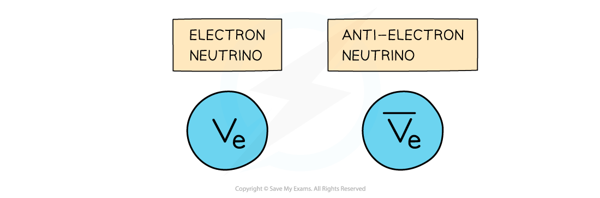
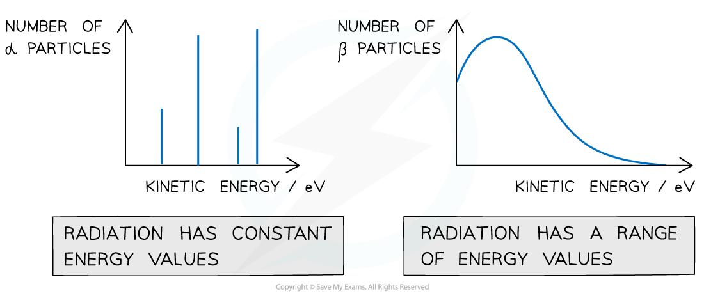

# Decay Equations

## Neutrino Emission

> **Spec point** — `spcpt_fJbXNPMKqF3x4sk5`

## Neutrino emission

- An **electron neutrino** is a type of subatomic particle with **no charge** and **negligible mass** which is emitted from the nucleus
- The electron **anti-neutrino** is the antiparticle of an electron **neutrino**

  - Electron **anti-neutrinos** are produced during **β– decay**
  - Electron **neutrinos** are produced during **β+ decay**

#### Electron neutrino and anti-electron neutrino

***The anti neutrino is denoted by a line above the symbol***

> **Exam Hint**
> One way to remember which particle decays into which depends on the type of beta emission, think of beta ‘**p**lus’ as the ‘**p**roton’ that turns into the neutron (plus an electron neutrino)

## α & β Decay Equations

> **Spec point** — `spcpt_Prtmyd7yKn2Vg43f`

## α & β decay equations

### Alpha decay

- **Alpha decay** is common in large, unstable nuclei with too many **protons**
- The decay involves a nucleus emitting an alpha particle and decaying into a different nucleus
- An alpha particle consists of **2 protons and 2 neutrons** (the nucleus of a Helium atom)

#### Alpha decay

***Alpha decay produces a daughter nucleus and an alpha particle (helium nucleus)***

- When an unstable nucleus (the parent nucleus) emits radiation, the constitution of its nucleus changes
- As a result, the isotope will change into a** different element** (the daughter nucleus)
- Alpha decay can be represented by the following radioactive decay equation:

`X _ Z ^ A -> Y _ Z - 2 ^ A - 4 + alpha _ 2 ^ 4`

- An example would be:

$Po_{84}^{212} \rightarrow Pb_{82}^{208} + \ \\alpha pre_{2} pre^{4}$

- When an alpha particle is emitted from a nucleus:

  - The nucleus loses 2 protons:** proton number decreases by 2**
  - The nucleus loses 4 nucleons: **nucleon number decreases by 4**

> **Worked Example**
> The radioactive nucleus $Rn_{86}^{222}$ undergoes alpha decay into a daughter nucleus Po.
> 
> 
> 
> (a) Which letter in the diagram represents the daughter product?
> 
> (b) Which is the nucleon and proton number of the final nucleus Po?
> 
> **Answer: **
> 
> **(a)**
> 
> **Step 1: Determine the number of neutrons**
> 
> - This is alpha decay
> - The nucleon number of the parent nucleus decreases by 4
> - The proton number of the parent nucleus decreases by 2
> - Therefore, the number of neutrons is:
> 
> $222-86=136$
> 
> **Step 2: Determine the change in the proton and neutrons**
> 
> - A helium nucleus has 2 protons and 2 neutrons
> - The proton and neutron numbers will decrease by 2
> - This reaches the point of the diagram marked **C**
> 
> **(b)**
> 
> **Step 1: Write the equation for the alpha decay**
> 
> 
> 
> `X _ Z ^ A -> alpha _ 2 ^ 4 + Y _ Z - 2 ^ A - 4`
> 
> $Rn_{86}^{222} \rightarrow \ \\alpha pre_{2} pre^{4} + Po_{84}^{218}$
> 
> **Step 2: Determine the nucleon and proton numbers of Po**
> 
> - Nucleon number = 218
> - Proton number = 84

### β- decay

- A β- particle is a high energy electron emitted from the nucleus
- β- decay is when a **neutron turns into a proton emitting an electron and an anti-electron neutrino**

#### Beta decay

***In beta-minus decay, a neutron decays into a proton, an electron and an anti-electron neutrino***

- When a β- is emitted from a nucleus:

  - The number of protons increases by 1: **proton number increases by 1**
  - The total number of nucleons stays the same: **nucleon number remains the same**
- The decay equation for beta-minus decay is:

`X _ Z ^ A -> Y _ Z + 1 ^ A + beta _ - 1 ^ 0 + v -bar _ 0 ^ 0 _ e`

- An example would be:

`C _ 6 ^ 14 -> N _ 7 ^ 14 + beta _ - 1 ^ 0 + v _ e -bar _ 0 ^ 0`

- The new nucleus formed from the decay is called the “daughter” nucleus (nitrogen in the example above)

### β+ decay

- A β+ particle is a high energy positron emitted from the nucleus
- β+ decay is when a **proton turns into a neutron emitting a positron (anti-electron) and an electron neutrino**

#### Beta-plus decay

***In beta plus decay, a proton decays into a neutron, a positron and an electron neutrino***

- When a β+ is emitted from a nucleus:

  - The number of protons decreases by 1: **proton number decreases by 1**
  - The total number of nucleons stays the same: **nucleon number remains the same**
- The decay equation for beta-plus decay is:

`X _ Z ^ A -> Y _ Z - 1 ^ A + beta _ + 1 ^ 0 + v _ 0 ^ 0 _ e`

- An example of this would be:

`C _ 6 ^ 11 -> B _ 5 ^ 11 + beta _ + 1 ^ 0 + v _ 0 ^ 0 _ e`

> **Worked Example**
> A radioactive substance with a nucleon number of 212 and a proton number of 82 decays by β-plus emission into a daughter product which in turn decays by further β-plus emission into a granddaughter product.
> 
> 
> 
> State the letter in the diagram that represents the granddaughter product.
> 
> **Answer: A**
> 
> - In β+ decay, a proton decays into a neutron, a positron, and an electron neutrino
> - The number of neutrons is:
> 
> $212-82=130$
> 
> - The proton number decreases by one and the number of neutrons increases by one
> 
>   - This happens twice, so it reaches point **A **on the diagram
> 
> 

> **Exam Hint**
> Remember to avoid the common mistake of confusing the number of neutrons with nucleon number. In alpha decay, the nucleon (protons and neutrons) number decreases by 4 but the number of neutrons only decreases by 2.

## Energy of Alpha & Beta Decay

> **Spec point** — `spcpt_hrbzWr899PZXT5mW`

## Energy of alpha & beta decay

- When the number of α particles is plotted against kinetic energy, there are clear spikes that appear on the graph
- This demonstrates that **α-particles have discrete energies **(only certain values)

#### Graphs showing energy of alpha and beta particles

***Alpha particles have discrete energy levels whilst beta particles have a continuous range of energies***

- When the number of β particles is plotted against kinetic energy, the graph shows a curve
- This demonstrates that **beta particles (electrons or positrons) have a continuous range of energies**
- This is because the energy released in beta decay is shared between the** beta particles **(electrons or positrons) and** neutrinos **(or anti-neutrinos)
- This was one of the first clues of the neutrino’s existence
- The principle of conservation of momentum and energy applies in both alpha and beta emission
