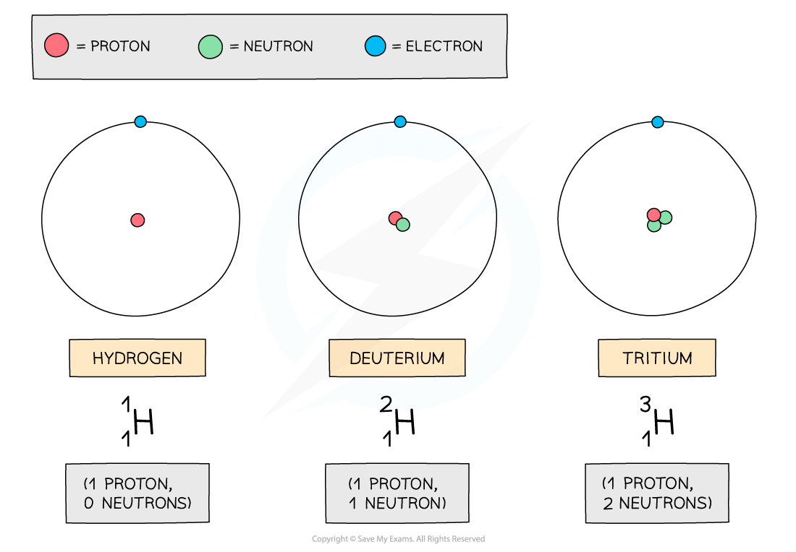

# Nucleon & Proton Number

## Nucleon & Proton Number

> **Spec point** — `spcpt_NBcCzVYBtX7P2Gsx`

## Nucleon & proton number

- The nuclide notation of an element is used to describe the constituents of the nuclei
- An example of this notation for Lithium is:

`Li presubscript 3 presuperscript 7`

- Where:

  - Li = lithium
  - 7 = mass number or nucleon number
  - 3 = atomic number or proton number
- The **mass number** is the number of **particles **in the **nucleus**

  - The nucleus contains **protons plus neutrons**
- The **atomic number** is the number of **protons **in the atom

  - Since atoms are neutral, this is also **equal **to the number of **electrons **in the atom

- When given an atomic symbol, you can therefore figure out the number of protons, neutrons and electrons in the atom:

  - **Protons**: The atomic number
  - **Electrons**: Atoms are neutrals, so the number of negative electrons is equal to the number of positive protons. Therefore, this is also the atomic number
  - **Neutrons**: Subtract the proton number from the nucleon number
- For the lithium atom, these numbers would be:

  - Protons: 3
  - Electrons: 3
  - Neutrons: 7 − 3 = 4
- The term **nucleon** is the used to mean a particle in the nucleus – i.e. a proton or neutron
- The term **nuclide** is used to refer to a nucleus with a specific combination of protons and neutrons

> **Worked Example**
> The atom `Ir presubscript 77 presuperscript 192` is a neutral atom.
> 
> State the number of protons, neutrons and electrons in this atom.
> 
> |   | **Protons** | **Neutrons** | **Electrons** |
> |---|---|---|---|
> | **A** | 77 | 192 | 77 |
> | **B** | 155 | 77 | 77 |
> | **C** | 192 | 77 | 192 |
> | **D** | 77 | 115 | 77 |
> 
> **Answer: D**
> 
> **Step 1: Determine the nucleon and atomic numbers**
> 
> - Nucleon number = 192
> - Atomic number = 77
> 
> **Step 2: Determine the number of protons**
> 
> - Number of protons = atomic number
> - Number of protons = 77
> 
> **Step 3: Determine the number of neutrons**
> 
> - Number of neutrons = nucleon number − atomic number
> - Number of neutrons = 192 − 77
> - Number of neutrons = 115
> 
> **Step 4: Determine the number of electrons**
> 
> - Number of electrons = number of protons
> - Number of electrons = 77

## Isotopes

> **Spec point** — `spcpt_PTqmWN7z5p48x5D4`

## Isotopes

- Although all atoms of the same element always have the same number of protons (and hence electrons), the number of neutrons can vary
- **An isotope is an atom (of the same element) that has an equal number of protons but different number of neutrons**
- The isotopes of hydrogen are deuterium and tritium:

#### Isotopes of hydrogen

***The three atoms shown above are all forms of hydrogen, but they each have different numbers of neutrons***

- Remember, the neutron number of an atom is found by subtracting the proton number from the nucleon number
- Since nucleon number includes the number of neutrons, an isotope of an element will also have a** different nucleon number**
- Since isotopes have an imbalance of neutrons and protons, they are **unstable**. This means they constantly decay and emit radiation to achieve a more stable form
- This can happen from anywhere between a few nanoseconds to 100,000 years

> **Worked Example**
> One of the rows in the table shows a pair of nuclei that are isotopes of one another.
> 
> Which row shows the correct isotopes?
> 
> |   | **Nucleon number** | **Number of neutrons** |
> |---|---|---|
> | **A** | 39  35 | 19  22 |
> | **B** | 37  35 | 20  18 |
> | **C** | 37  35 | 18  20 |
> | **D** | 35  35 | 20  18 |
> 
> **Answer: B**
> 
> **Step 1: Recall the properties of isotopes**
> 
> - Isotopes are nuclei with the same number of protons but a different number of neutrons
> - The nucleon number (mass number) is the total number of particles in the nucleus (protons + neutrons)
> - Therefore, isotopes have a different nucleon number too
> 
> **Step 2: Calculate the number of protons in the first nucleus**
> 
> - Nucleon number = 37
> - Neutrons = 20
> - Protons = nucleon number − neutrons
> - Protons = 37 − 20 = 17
> 
> **Step 3: Calculate the number of protons in the second nucleus**
> 
> - Nucleon number = 35
> - Neutrons = 18
> - Protons = 35 − 18 = 17
> 
> **Step 4: Conclusion**
> 
> - The nuclei in answer **B** have the same number of protons and different numbers of neutrons, therefore these nuclei are isotopes of one another

## AZX Notation

> **Spec point** — `spcpt_z5rp3M9cKRm7sTZm`

## AZX notation

- Atomic symbols are written in a specific notation called **AZX notation**

`straight X presubscript straight Z presuperscript straight A`

- Where:

  - X = chemical symbol of the element
  - A = nucleon (mass) number
  - Z = proton (atomic) number

- The number **A** represents the **nucleon **number or the **mass** number

  - **Nucleon number (A)** = total number of **protons and neutrons** in the nucleus
- The lower number **Z** represents the **proton** or **atomic** number

  - **Proton number (Z) **= total number of **protons** in the nucleus
