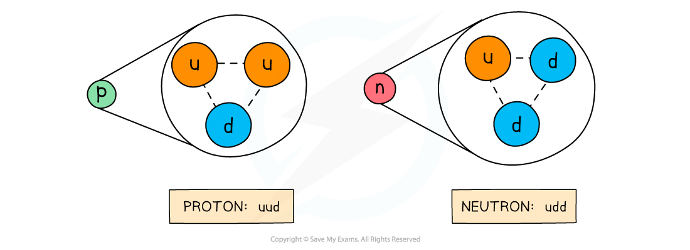
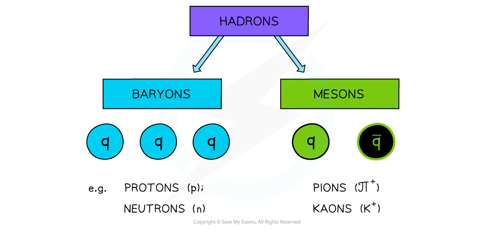
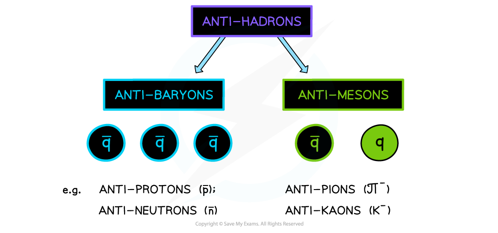

# Quark Composition

## Protons & Neutrons

> **Spec point** — `spcpt_6fVMdVc2kKCpMRbW`

## Protons & neutrons

- Protons and neutrons are **not** fundamental particles
- They are each made up of **three quarks**
- **Protons** are made up of **two up quarks and a down quark**
- **Neutrons** are made up of **two down quarks and an up quark**

#### Composition of protons & neutrons

***Protons and neutrons are made up of three quarks***

- You will be expected to remember these quark combinations for exam questions

> **Worked Example**
> State how many 'up' quarks there are in the nucleus of iron, $Fe_{26}^{56}$.
> 
> **Answer: **
> 
> **Step 1: Calculate number of protons**
> 
> - The number of protons is from the proton number = 26 protons
> 
> **Step 2: Calculate number of neutrons**
> 
> - The number of neutrons = nucleon number - proton number = 56 - 26 = 30 neutrons
> 
> **Step 3: Up quarks in a proton**
> 
> - Protons are made up of **uud** quarks = 2 up quarks
> 
> **Step 4: Up quarks in a neutron**
> 
> - Neutrons are made up of **udd** quarks = 1 up quark
> 
> **Step 5: Total number of up quarks**
> 
> - 26 protons x 2 up quarks = 52 up quarks
> - 30 neutrons x 1 up quark = 30 up quarks
> - 52 + 30 = 82 up quarks

## Baryons & Mesons

> **Spec point** — `spcpt_2C6m4RkrKJ5kky72`

## Baryons & mesons

- **Hadrons** are the group of subatomic particles that are made up of quarks
- Hadrons can be either:

  - **Baryons**
  
    - Made up of 3 quarks
  - **Mesons**
  
    - Made up of a quark and anti-quark pair

#### Hadrons

***Hadrons may be either a baryon or a meson***

- Anti-hadrons can be either:

  - **Anti-baryons**
  
    - Made up of 3 anti-quarks
  - **Anti-mesons**
  
    - Made up of a quark and anti-quark pair

#### Anti-hadrons

***Anti-hadrons may be either an anti-baryon or an anti-meson***

- Note that **all** baryons or mesons have **integer **(whole number) charges eg. +1e, -2e etc.
- This means quarks in a **baryon **are either **all quarks** or **all anti-quarks**

  - Combinations of quarks and anti-quarks do not exist in a baryon

$\overline{u}\mathrm{ud}$ would **not** be a quark combination that exists

- The anti-particle of a meson is still a quark-antiquark pair
- However, the quark becomes the anti-quark and vice versa

> **Worked Example**
> The baryon Δ++ was discovered in a particle accelerator using accelerated positive pions on hydrogen targets.
> 
> Which of the following is the quark combination of this particle?
> 
> **A. **$\mathrm{uuu}$**      **
> 
> **B. **$\mathrm{cd}\overline{s}$**      **
> 
> **C. **$\overline{u}d$**      **
> 
> **D. **$\overline{c}\overline{c}\overline{c}$
> 
> **Answer: A**
> 
> - Since it is a baryon, its made up of three quarks
> 
>   - This rules out option **C**
> - Baryons are made up of 3 quarks
> - Anti-baryons are made up of 3 anti-quarks
> 
>   - This rules out option **B**
>   - There cannot be a combination of quarks and anti-quarks
> - The baryon Δ++ has a charge of 2+
> - Adding up the charges of quarks
> 
>   - **A:  **$\mathrm{uuu}=+\frac{2}{3}+\frac{2}{3}+\frac{2}{3}=+2$
>   - **D:**   $\overline{c}\overline{c}\overline{c}=-\frac{2}{3}-\frac{2}{3}-\frac{2}{3}=-2$
> - Therefore, the correct combination is option **A**

> **Exam Hint**
> Remembering quark combinations is useful for the exam. However, as long as you can remember the charges for each quark, it is possible to figure out the combination by making sure the combination of quarks add up to the charge of the particle (just like in the worked example)
