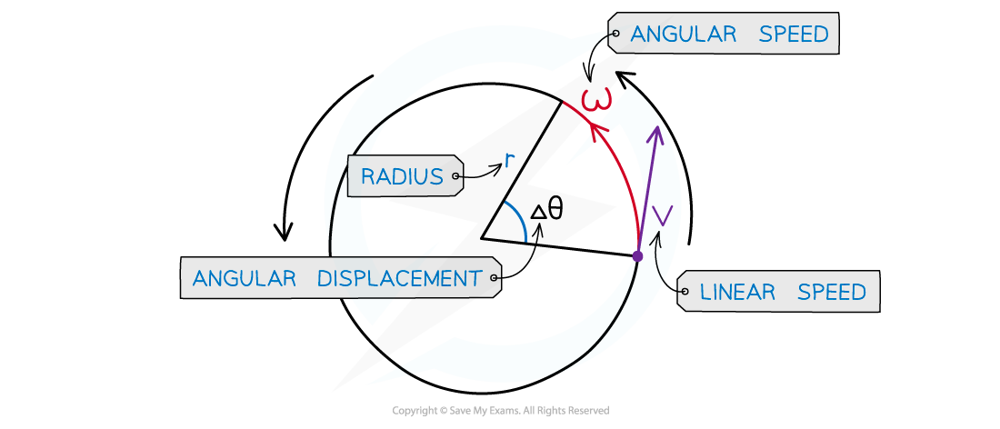

# Angular Speed

## Angular Speed

> **Spec point** — `spcpt_MvgcdtvT5Bq4HwGw`

## Angular speed

- The angular speed (⍵) of a body in circular motion is defined as:

**The rate of change in angular displacement with respect to time**

- Angular speed is a scalar quantity, and is measured in rad s-1
- Any object travelling in a uniform circular motion at the same speed travels with a **constantly changing velocity**
- This is because it is** constantly changing direction**, and is therefore accelerating

#### Angular speed in circular motion

***When an object is in uniform circular motion, velocity constantly changes direction, but the speed stays the same***

## Calculating Angular Speed

> **Spec point** — `spcpt_hYfnxNjDxXkVbBGg`

## Calculating angular speed

- Taking the angular displacement of a complete cycle as 2π, the angular speed *⍵* can be calculated using the equation:

$ω=\frac{\Deltaθ}{\Deltat}=\frac{2π}{T}=2πf$

- Where:

  - Δ*θ = *change in ***angular displacement*** (***radians***)
  - Δ*t = *time interval (s)
  - *T = *the ***time period*** (s)
  - *f *= ***frequency*** (Hz)
- Angular velocity is the same as angular speed, but it is a vector quantity
- When an object travels at constant linear speed *v* in a circle of radius *r*, the angular velocity is equal to:

$ω=\frac{\Deltaθ}{\Deltat}=\frac{v}{r}$

- Where:

  - *v* is the ***linear*** speed (m s-1)
  - *r* is the radius of orbit (m)
- This equation tells us:

  - The greater the rotation angle *θ* in a given amount of time, the greater the angular velocity *⍵*
  - An object rotating further from the centre of the circle (larger *r*) moves with a smaller angular velocity (smaller *⍵*)

> **Worked Example**
> A bird flies in a horizontal circle with an angular speed of 5.25 rad s-1 of radius 650 m.
> 
> Calculate:
> 
> a) The linear speed of the bird
> 
> b) The frequency of the bird flying in a complete circle
> 
> **Answer:**
> 
> **Part (a)**
> 
> **Step 1: List the known quantities**
> 
> - Angular speed, *ω* = 5.25 rad s-1
> - Radius, *r* = 650 m
> 
> **Step 2: State the linear speed equation**
> 
> $v=rω$
> 
> **Step 3: Calculate linear speed**
> 
> $v = 650 \times 5.25 = 3410 \mathrm{m} \mathrm{s}^{- 1} ( 3 \mathrm{s} . \mathrm{f} . )$
> 
> **Part (b)**
> 
> **Step 1: Equate angular speed with the frequency equation**
> 
> $ω=2πf$
> 
> **Step 2: Rearrange to make frequency the subject**
> 
> $f=\frac{ω}{2π}$
> 
> **Step 3: Substitute the known values to calculate**
> 
> $f = \frac{5.25}{2 \mathrm{\pi } } = 0.836 \text{Hz} ( 3 \mathrm{s} . \mathrm{f} . )$
