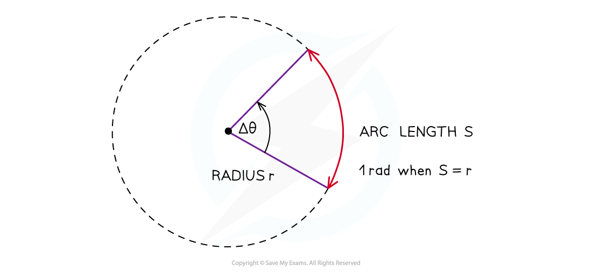
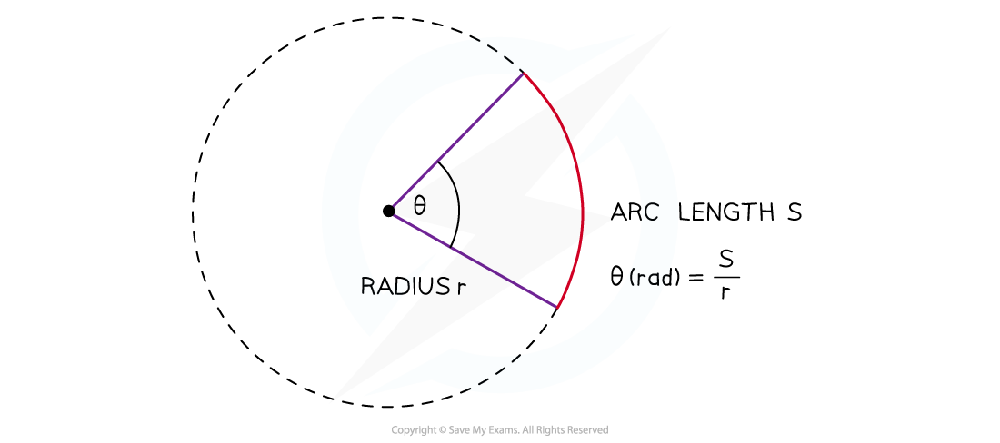

# Radians & Angular Displacement

## Radians & Angular Displacement

> **Spec point** — `spcpt_pDJzyPGWz2DfWTqZ`

## Radians & angular displacement

### Angles in radians

- A **radian** (rad) is defined as:

**The angle subtended at the centre of a circle by an arc equal in length to the radius of the circle**

#### Visual definition of radian

***When the angle is equal to one radian, the length of the arc (S) is equal to the radius (r) of the circle***

- Radians are commonly written in terms of π
- The angle in radians for a complete circle (360°) is equal to:

$\frac{\mathrm{circumference} \mathrm{of} \mathrm{circle}}{\mathrm{radius}}=\frac{2πr}{r}=2π$

- Use the following equation to convert from degrees to radians:

`theta degree space cross times space open parentheses straight pi over 180 close parentheses space equals space theta space rad`

**Table of common degrees to radians conversions**

| **Degrees (°)** | **Radians (rads)** |
|---|---|
| 360 | $2π$ |
| 270 | $\frac{3π}{2}$ |
| 180 | $π$ |
| 90 | $\frac{π}{2}$ |

### Angular displacement

- In circular motion, it is more convenient to measure angular displacement in units of radians rather than units of degrees
- Angular displacement is defined as: **The change in angle, in radians, of a body as it rotates around a circle**
- This can be summarised in equation form:

$\Deltaθ=\frac{\mathrm{distance} \mathrm{travelled} \mathrm{around} \mathrm{the} \mathrm{circle}}{\mathrm{radius} \mathrm{of} \mathrm{the} \mathrm{circle}}$

- Where:

  - Δ*θ* = angular displacement, or angle of rotation (radians)
  - *S* = length of the arc, or the distance travelled around the circle (m)
  - *r* = radius of the circle (m)

- **Note**: both distances must be measured in the same units, e.g. metres

#### Visual representation of angular displacement equation

***An angle in radians, subtended at the centre of a circle, is the arc length divided by the radius of the circle***

> **Worked Example**
> Convert the following angular displacement into degrees:
> 
> 
> 
> **Answer: **
> 
> **Step 1: Rearrange the degrees to radians conversion equation**
> 
> $\mathrm{degrees}\rightarrow\mathrm{radians}\Rightarrowθ^{\circ}\times\frac{π}{180}=θ\mathrm{rad}$
> 
> $\mathrm{radians}\rightarrow\mathrm{degrees}\Rightarrowθ\mathrm{rad}\times\frac{180}{π}=θ^{\circ}$
> 
> **Step 2: Substitute the values to calculate**
> 
> $\frac{π}{3}\mathrm{rad}\times\frac{180}{π}=\frac{180^{\circ}}{3}=60^{\circ}$

> **Exam Hint**
> - You will notice your calculator has a degree (Deg) and radians (Rad) mode
> - This is shown by the “D” or “R” highlighted at the top of the screen
> - Remember to make sure it’s in the right mode when using **trigonometric** functions (sin, cos, tan) depending on whether the answer is required in **degrees** or **radians**
> - It is extremely common for students to get the wrong answer (and lose marks) because their calculator is in the wrong mode - make sure this doesn’t happen to you!
> 
> 
