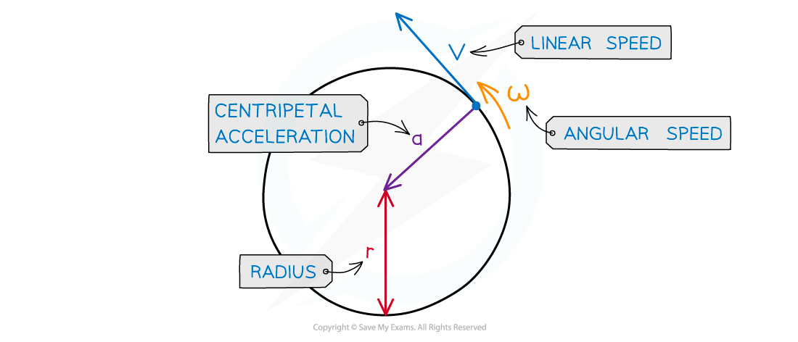

# Calculating Centripetal Acceleration

## Calculating Centripetal Acceleration

> **Spec point** — `spcpt_9TX8QcPF6tmYkr8p`

## Calculating centripetal acceleration

- Centripetal acceleration is defined as: **The acceleration of an object towards the centre of a circle when an object is in motion (rotating) around a circle at a constant speed**
- It can be defined using the radius *r *and linear speed *v*:

$a=\frac{v^{2}}{r}$

- Where:

  - *a* = centripetal acceleration (m s–2)
  - *v* = linear speed (m s–1)
  - *r* = radius of the circular orbit (m)
- Using the equation relating angular speed *ω* and linear speed *v*:

$v=rω$

- Where:

  - *ω* = angular speed (rad s–1)

- These equations can be combined to give another form of the centripetal acceleration equation:

`a space equals fraction numerator space open parentheses r omega close parentheses squared over denominator r end fraction`

$a=rω^{2}$

#### Centripetal acceleration

***Centripetal acceleration is always directed toward the centre of the circle, and is perpendicular to the object’s velocity***

*** ***

- Where:

  - *a* = centripetal acceleration (m s−2)
  - *v* = ***linear*** speed (m s−1)
  - *⍵* = angular speed (rad s−1)
  - *r* = radius of the orbit (m)

> **Worked Example**
> A ball tied to a string is rotating in a horizontal circle with a radius of 1.5 m and an angular speed of 3.5 rad s−1.
> 
> Calculate its centripetal acceleration if the radius was twice as large and angular speed was twice as fast.
> 
> **Answer:**
> 
> **Step 1: State acceleration in terms of angular speed**
> 
> $a=rω^{2}$
> 
> **Step 2: Increase angular acceleration with twice the radius and twice the angular speed**
> 
> `a space equals space open parentheses 2 r close parentheses space cross times space open parentheses 2 omega close parentheses squared space equals space 2 r space cross times space 4 space omega squared space equals space 8 r omega squared`
> 
> - The centripetal acceleration will be 8× bigger
> 
> **Step 3: Substitute in the known values to calculate**
> 
> $a=8rω^{2}=8\times1.5\times3.5^{2}=147ms^{-2}$
