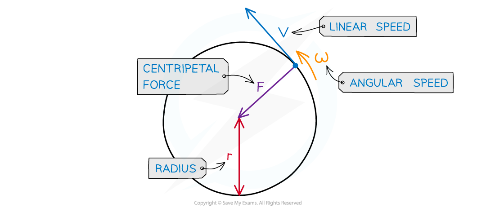

# Calculating Centripetal Force

## Calculating Centripetal Force

> **Spec point** — `spcpt_GYXV7cTNpCQYPJWy`

## Calculating centripetal force

- [Centripetal force](https://www.savemyexams.com/a-level/physics/cie/25/revision-notes/12-motion-in-a-circle/12-2-centripetal-acceleration/centripetal-acceleration/) can be calculated using the equation:

$F=\frac{mv^{2}}{r}$

- Where:

  - $F$ = magnitude of the centripetal force, measured in newtons (N)
  - $m$ = mass of object, measured in kilograms (kg)
  - $v$ = velocity, measured in meters per second (m s-1)
  - $r$ = radius of circular path, measured in metres (m)
- Another form of the equation can be written using the equation linking linear and angular velocity:

$v=rω$

- Where

  - $ω$ = angular velocity measured in radians per second (rad s-1)
- Substituting into the first centripetal force equation

`F space equals space fraction numerator m open parentheses r omega close parentheses squared over denominator r end fraction`

- Simplify the equation

$F=\frac{mr^{2}ω^{2}}{r}=mrω^{2}$

#### Centripetal force in circular motion

***Centripetal force is always perpendicular to the direction of travel***

> **Worked Example**
> A bucket of mass 8.0 kg is filled with water is attached to a string of length 0.5 m.
> 
> What is the minimum speed the bucket must have at the top of the circle so no water spills out?
> 
> 
> 
> **Answer:**
> 
> **Step 1: Draw the forces on the bucket at the top**
> 
> 
> 
> **Step 2: Calculate the centripetal force**
> 
> - The weight of the bucket = mg
> - This is equal to the centripetal force since it is directed towards the centre of the circle
> 
> $mg=\frac{mv^{2}}{r}$
> 
> **Step 3: Rearrange for velocity *****v***
> 
> - *m* cancels from both sides
> 
> $v=\sqrt{gr}$
> 
> **Step 4: Substitute in values**
> 
> $v=\sqrt{9.81\times0.5}=2.21ms^{-1}$
