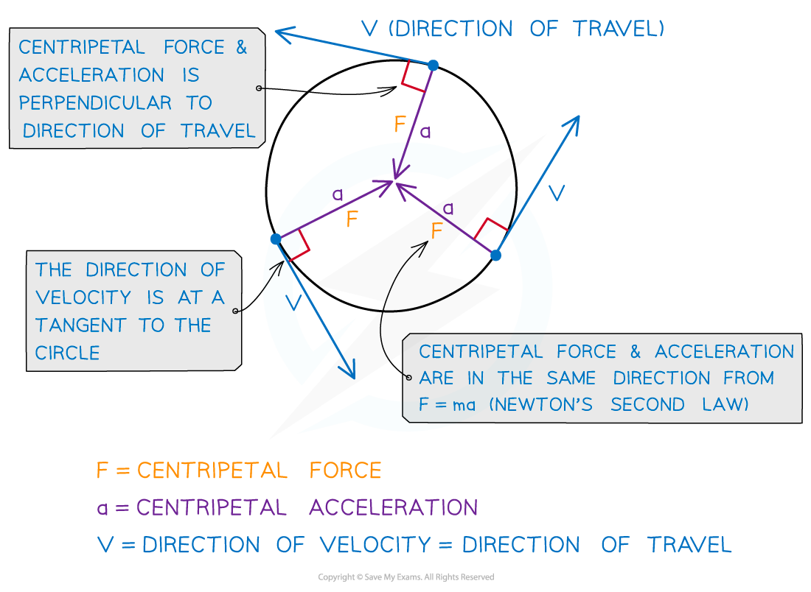

# Centripetal Acceleration

## What Causes Centripetal Acceleration?

> **Spec point** — `spcpt_MNRBpB8kWZkgs4Zt`

## What causes centripetal acceleration?

### Centripetal force

- A **centripetal force** of constant magnitude always acts perpendicular to the direction of motion and causes **centripetal acceleration**

- Centripetal force is defined as:

**The resultant force towards the centre of the circle required to keep a body in uniform circular motion**

- Centripetal force is not a separate force of its own
- It can be created by different forces depending on the situation, such as the examples in the table:

#### Examples of centripetal force

| **Situation** | **Centripetal Force** |
|---|---|
| A car travelling around a roundabout | Friction |
| A ball attached to a rope moving in a circle | Tension |
| The Earth orbiting the Sun | Gravitational attraction |

- Centripetal force and centripetal acceleration both act:

  - in the **same direction** (towards the centre of the circle)
  - **perpendicular **to the direction of the linear speed
- An object in ***uniform circular motion*** is constantly **accelerating**

  - This is because ***velocity*** and ***acceleration*** are both ***vector*** quantities
  - Therefore, as the object's **direction** constantly changes, this means its **velocity** constantly changes

#### Centripetal force and acceleration

***Centripetal force and acceleration are always directed towards the centre of the circle***

> **Exam Hint**
> - The linear speed is sometimes referred to as the ‘tangential’ speed
> - A tangent is a straight line which touches a circle or curve at exactly one point
> - The key feature of a tangent to a circle is that it **always acts perpendicular** to its radius
> - You can find out more in the A Level Maths revision notes on Tangents

## Relating Centripetal Acceleration & Angular Speed

> **Spec point** — `spcpt_VYNV7DZpK99xG8v6`

## Relating centripetal acceleration & angular speed

- An object travelling in uniform circular motion has ***centripetal acceleration***, yet its angular speed (*ω*) is constant

  - This is because speed is a ***scalar*** quantity, whilst velocity is a vector quantity
  - Therefore, angular speed is the **magnitude** (size) component of angular velocity
- Key ideas to remember:

  - Angular speed (**magnitude**) stays constant, angular velocity (**direction**) is constantly changing
  - Angular speed does not change with radius, but linear speed does
  - The object’s centripetal acceleration is always directed **toward the centre** of the circle, and is perpendicular to the object’s velocity at any one time
  - Velocity and acceleration are both defined by a **change in direction**, not just a change in the magnitude

> **Exam Hint**
> We are used to the idea of acceleration meaning something is speeding up. So, it might sound counterintuitive to say an object travelling in a circle is accelerating, yet it also has constant speed. This is where the idea of scalars and vectors would be useful to revisit if you are not confident with this concept.
