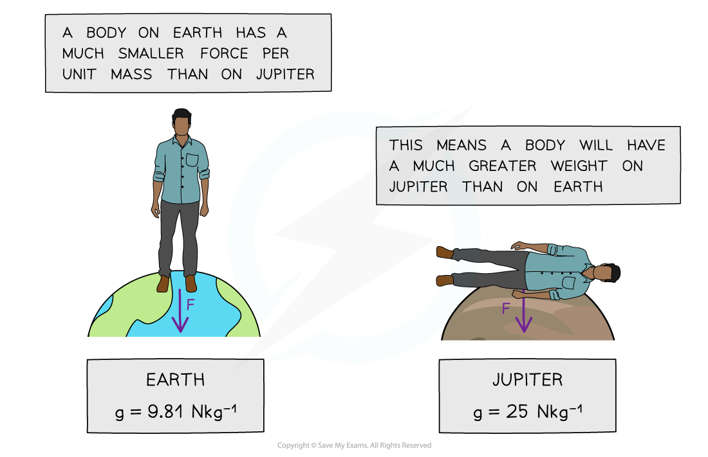
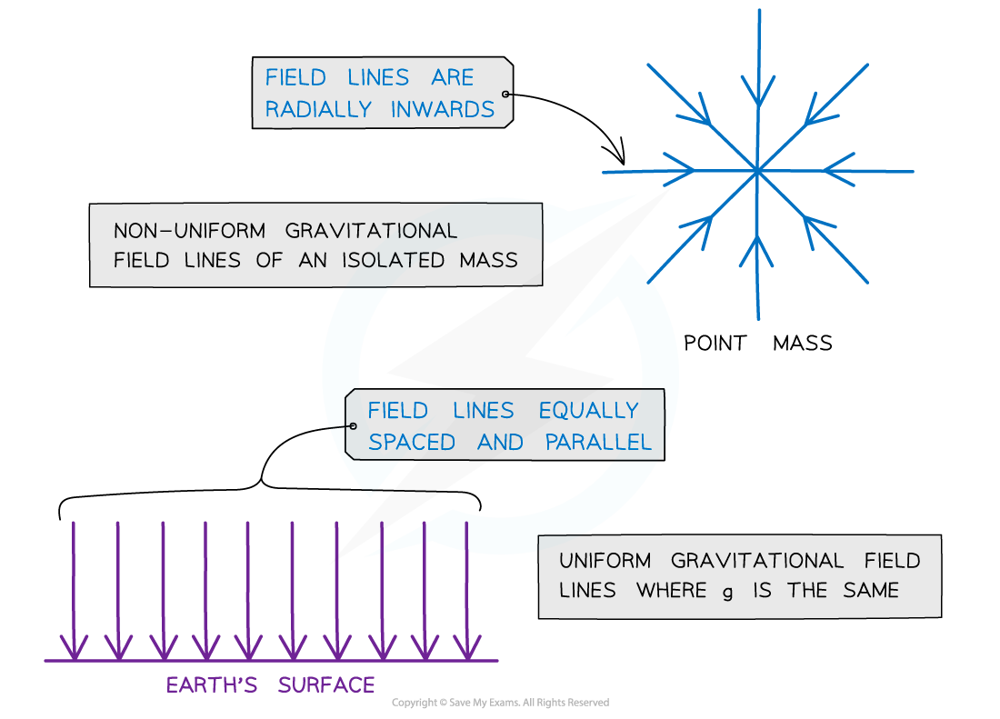

# Gravitational Fields

## Defining Gravitational Field

> **Spec point** — `spcpt_CcR7jMs57rgCvTQZ`

## Defining gravitational field

- There is a force of attraction between **all** masses

  - This force is known as the ‘**force due to gravity**’ or the weight
- The Earth’s gravitational field is responsible for the weight of all objects on Earth
- A gravitational field is an example of a **field of force** and is defined as:

**A region of space where a mass experiences a force**

- The direction of the gravitational field is always towards the centre of the mass

  - Gravitational forces are always **attractive**, and **never** repulsive

### Gravitational field strength

- The gravitational field strength at a point is defined as:

**The force per unit mass acting on a small mass at that point**

- The strength of a gravitational field at a point can be calculated using:

$g=\frac{F_{g}}{m}$

- Where:

  - *g* = gravitational field strength (N kg-1)
  - *F**g* = force due to gravity, or weight (N)
  - *m* = mass (kg)
- This equation tells us:

  - On planets with a large value of *g*, the gravitational force per unit mass is greater than on planets with a smaller value of *g*
  - This means objects will have a larger weight with a larger value of *g*

#### Weight of a person on Earth and Jupiter

***A person’s weight on Jupiter would be so large a human would be unable to fully stand up***

> **Worked Example**
> Calculate the mass of an object with a weight of 10 N on Earth.
> 
> **Answer:**
> 
> **Step 1: State the gravitational field strength equation**
> 
> $g=\frac{F_{g}}{m}$
> 
> **Step 2: Rearrange to make mass the subject**
> 
> $m=\frac{F_{g}}{g}$
> 
> **Step 3: Substitute in the known values to calculate**
> 
> $m=\frac{10}{9.81}=1.0\mathrm{kg}$

> **Exam Hint**
> There is a big difference between g and G (sometimes referred to as ‘little g’ and ‘big G’ respectively), g is the gravitational field strength and G is Newton’s gravitational constant. Make sure not to use these interchangeably!

## Representing Gravitational Fields

> **Spec point** — `spcpt_9NYQdm95YB89MTQP`

## Representing gravitational fields

- The direction and magnitude of a gravitational field is represented by **gravitational field lines**

  - Gravitational fields can be uniform or non-uniform

- **Radial fields** are **non-uniform fields**

  - The ***gravitational field strength*** *g* decreases with distance from the centre of the object
  - The gravitational field lines around a **point mass** are directed **radially inwards**
- **Parallel field lines** represent a **uniform field**

  - The gravitational field strength *g* is the same throughout the field
  - The gravitational field lines of a uniform field, where the field strength is the same at all points, is represented by **equally spaced parallel lines**
  - The Earth's gravitational field near the surface is **almost **uniform; therefore, it can be **approximated **as uniform

#### Gravitational field lines for a point mass and for a uniform gravitational field

***Gravitational field lines for a point mass are radial and, for a uniform gravitational field, are parallel***

> **Exam Hint**
> Always add the arrows on the field lines! Gravitational forces are **attractive only**. Remember:
> 
> - For a **radial field**: it is towards the centre of the sphere or point charge
> - For a **uniform field**: towards the surface of the object e.g. Earth
