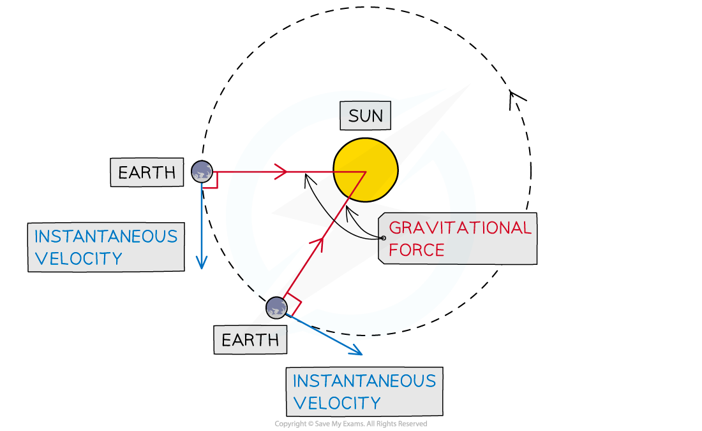

# Circular Orbits in Gravitational Fields

## Circular Orbits in Gravitational Fields

> **Spec point** — `spcpt_znqr7HXNffGBbDK8`

## Circular orbits in gravitational fields

- The orbits of most planets and satellites in the Solar System are **nearly circular**
- The **gravitational force **between two bodies provides the ***centripetal force*** required to maintain a circular orbit
- Consider a satellite with mass *m* orbiting Earth with mass *M* at a distance *r* from the centre, travelling with linear speed *v*

$F_{G}=F_{circ}$

- Equating the gravitational force to the centripetal force for a planet or satellite in orbit gives:

$\frac{GMm}{r^{2}}=\frac{mv^{2}}{r}$

- The mass of the satellite *m* will cancel out on both sides to give:

$v^{2}=\frac{GM}{r}\Rightarrowv=\sqrt{\frac{GM}{r}}$

- Where:

  - $v$ = orbital speed of the smaller mass (m s−1)
  - *G* = ***Newton's Gravitational Constant***
  - *M* = mass of the larger mass being orbited (kg)
  - *r* = orbital radius (m)
- This equation shows that all satellites moving in a circular orbit of fixed radius $r$ will travel at a **constant speed**
- The direction of a satellite orbiting in circular motion is constantly changing, which means that the satellite has

  - a **velocity **which is constantly changing
  - a** centripetal acceleration** that acts towards the satellite
  - a **centripetal force**, provided by the gravitational force, which causes the satellite to accelerate

#### Gravitational force and instantaneous velocity

***The direction of the instantaneous velocity and the gravitational force at different points of the Earth’s orbit around the sun***

> **Worked Example**
> A binary star system consists of two stars orbiting about a fixed point **B**. The star of mass *M**1* has a circular orbit of radius *R**1* and mass *M**2* has a radius of *R**2*. Both have an angular speed ⍵ about **B**.
> 
> 
> 
> State the following formula, in terms of *G*, *M**2*, *R**1* and *R**2*
> 
> (a) The angular speed ⍵ of *M**1*
> 
> (b) The time period *T* for each star in terms of angular speed ⍵
> 
> **Answer:**
> 
> **(a) **
> 
> **Step 1: Equating the centripetal force of mass M****1**** to the gravitational force between M****1**** and M****2**
> 
> $M_{1} R_{1} \\omega ^{2} = \frac{G M_{1} M_{2} }{( R_{1} + R_{2} )^{2}}$
> 
> **Step 2: M****1**** cancels on both sides**
> 
> $R_{1} \\omega ^{2} = \frac{ G M_{2} }{( R_{1} + R_{2} )^{2}}$
> 
> **Step 3: Rearrange for angular velocity ⍵**
> 
> $\\omega ^{2} = \frac{ G M_{2} }{R_{1} ( R_{1} + R_{2} )^{2}}$
> 
> **Step 4: Square root both sides**
> 
> $\\omega = \sqrt{ \frac{G M_{2} }{R_{1} ( R_{1} + R_{2} )^{2}} }$
> 
> **(b) **
> 
> **Step 1: Angular speed equation with time period T**
> 
> $ω=\frac{2π}{T}$
> 
> **Step 2:** **Rearrange for T**
> 
> $T=\frac{2π}{ω}$
> 
> **Step 3: Substitute in ⍵**
> 
> $T = 2 \mathrm{\pi } \div \sqrt{ \frac{G M_{2} }{R_{1} ( R_{1} + R_{2} )^{2}} } = 2 \mathrm{\pi } \sqrt{ \frac{R_{1} ( R_{1} + R_{2} )^{2}}{G M_{2} } }$

> **Exam Hint**
> Many of the calculations in the Gravitation questions depend on the equations for [Circular motion](https://www.savemyexams.com/a-level/physics/cie/25/revision-notes/12-motion-in-a-circle/12-2-centripetal-acceleration/centripetal-acceleration/). Be sure to revisit these and understand how to use them!
