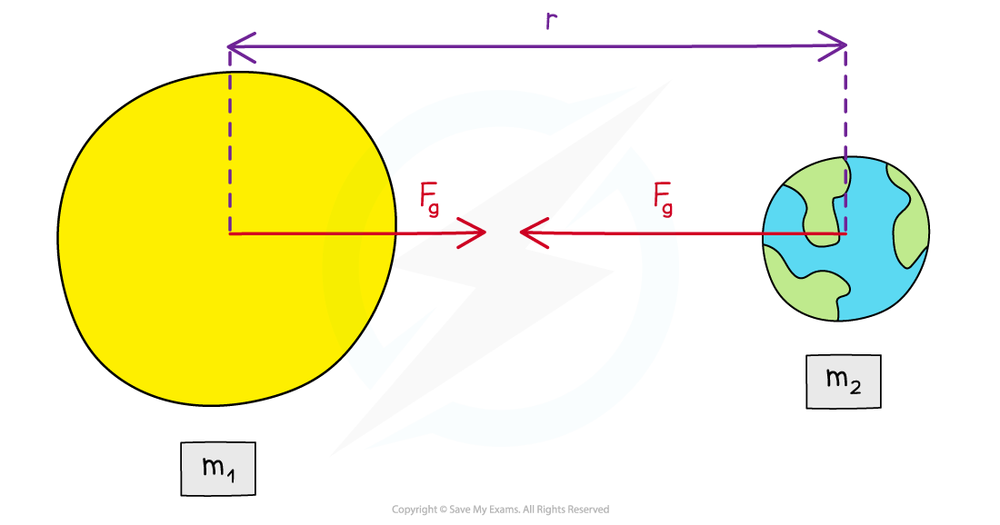

# Gravitational Force Between Point Masses

## Newton's Law of Gravitation

> **Spec point** — `spcpt_CyZwmbvdfxMh6RBT`

## Newton's law of gravitation

- The gravitational force between two bodies outside a uniform field, e.g. between the Earth and the Sun, is defined by **Newton’s law of gravitation**
- Newton’s law of gravitation states that:

**The gravitational force between two point masses is proportional to the product of the masses and inversely proportional to the square of their separation**

- In equation form, this can be written as:

$F_{G}=\frac{Gm_{1}m_{2}}{r^{2}}$

- Where:

  - *F**G* = gravitational force between two masses (N)
  - *G* = *Newton’s gravitational constant*
  - *m**1* and *m**2* = two points masses (kg)
  - *r* = distance between the centre of the two masses (m)

#### Gravitational force between two point masses

***The gravitational force between two point masses outside a uniform field is defined by Newton’s law of gravitation***

- Newton’s law of gravitation applies to orbiting bodies, e.g. planets orbiting the Sun
- Although stars and planets are very large, they can be considered to be point masses as:

  - they are approximately uniform spheres
  - their separation is much larger than their radii

- The $\frac{1}{r^{2}}$ relation is called the **inverse square law**
- This means that when a mass is twice as far away from another, the gravitational force reduces by a quarter, i.e. $( 1 \frac{1}{2} )^{2} = 1 \frac{1}{4}$

> **Worked Example**
> A satellite of mass 6500 kg is orbiting the Earth at 2000 km above the Earth's surface.
> 
> The gravitational force between them is 37 kN. The radius of the Earth is 6400 km.
> 
> Calculate the mass of the Earth.
> 
> **Answer:**
> 
> **Step 1: List the known quantities**
> 
> - Mass of satellite, *m*1 = 6500 kg
> 
>   - *m*1 and *m*2 can be either way around
> - Distance of satellite above Earth's surface = 2000 km
> - Gravitational force, *F*G = 37 kN
> - Radius of Earth = 6400 km
> 
> **Step 2: State the equation for Newton's Law of Gravitation and rearrange for the mass of the Earth**
> 
> $F_{G}=\frac{Gm_{1}m_{2}}{r^{2}}$
> 
> $m_{2}=\frac{r^{2}F_{G}}{Gm_{1}}$
> 
> **Step 3: Calculate the distance, *****r***
> 
> - *r* is the distance between the centre of the Earth and the satellite
> - *r* = distance of satellite above Earth's surface + radius of Earth
> 
> 
> 
> $r=2000+6400=8400\times10^{3}m$
> 
> **Step 4: Substitute the known values into Newton's Law of Gravitation to calculate the mass of the Earth**
> 
> $m_{2} = \frac{( 8400 \times 10^{3} )^{2} \times ( 37 \times 10^{3} )}{( 6.67 \times 10^{- 11} ) \times 6500}$
> 
> $m_{2} = 6.0 \times 10^{24 } \text{kg} ( 2 \mathrm{s} . \mathrm{f} . )$

> **Exam Hint**
> A common mistake in exams is to forget to **add together** the distance from the surface of the planet and its radius to obtain the value of *r*. The distance *r* is measured from the **centre** of the mass, which is from the **centre** of the planet.
