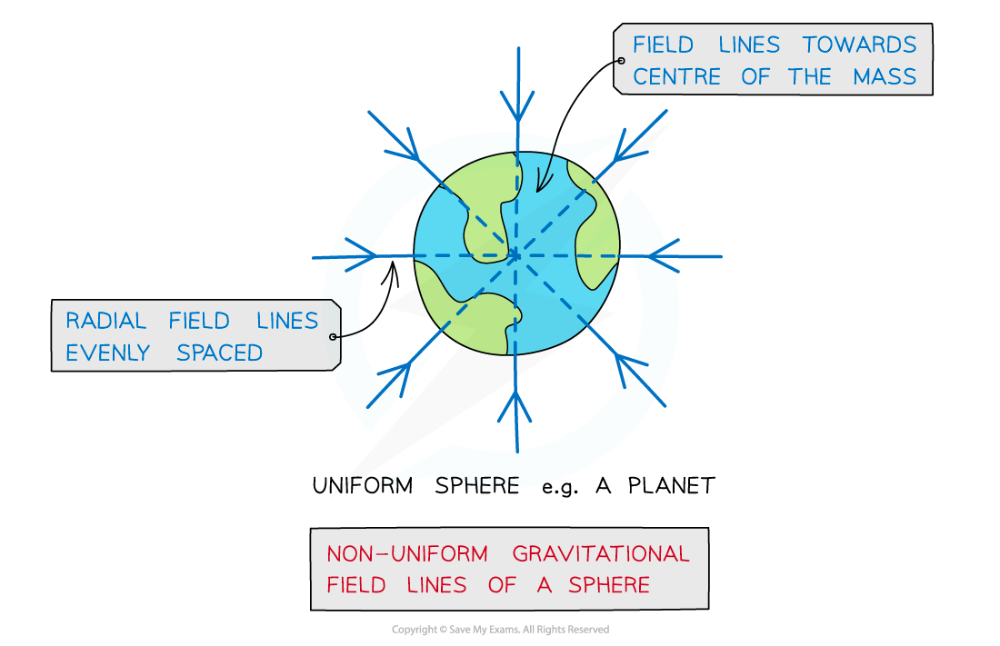

# Point Mass Approximation

## Point Mass Approximation

> **Spec point** — `spcpt_7jk4hhdrSFc3DDFj`

## Point mass approximation

- For a point outside a uniform sphere, the mass of the sphere can be considered to be concentrated at a **single point **at its centre of mass

  - A uniform sphere is one where its mass is **distributed evenly**
- The gravitational field lines around a uniform sphere are therefore **identical to those around a point mass**
- An object can be regarded as a point mass when:

**It has an even mass distribution and the distance being considered is larger than its size**

- This applies to field lines around planets

#### Gravitational field lines around a planet

***Gravitational field lines around a uniform sphere are identical to those on a point mass***
