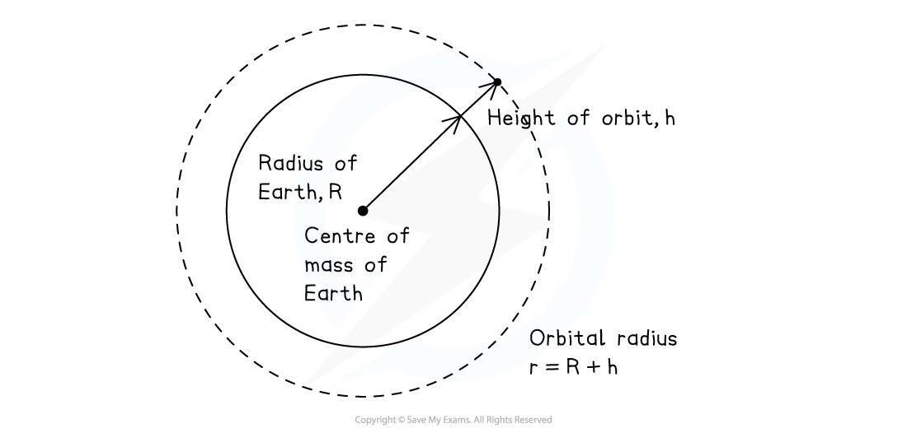

# The Value of g on Earth

## The Value of g on Earth

> **Spec point** — `spcpt_tJsYjx6p34r7Q7WH`

## The value of g on earth

- *Gravitational field strength** g* is **approximately **constant for relatively small changes in height near the Earth’s surface

  - Close to the Earth's surface, within the Earth's atmosphere, *g =* 9.81 N kg−1
- *g* can be approximated as constant because the Earth's radius, *R* is much larger than the distance between the Earth's surface and the position of an object in the Earth's atmosphere, *h*

$R \text{much} greater-than h$

- Where small changes in height do not affect the total height of an object, *h*

  - Consider an object orbiting at a height, *h* of 150 km (1.5 × 105 m) above the Earth's surface
  - The radius of the Earth, *R* is 6400 km = 6.4 × 106 m
  - So the total orbital radius, *r* is (6.4 × 106) + (1.5 × 105) = 6.55 × 106 m
  - Hence 6.4 × 106 ≅ 6.55 × 106

#### Diagram of orbital height

***Orbital radius, r is roughly equal to the Earth's radius for an object within the Earth's atmosphere***

- From the equation for [Gravitational field strength](https://www.savemyexams.com/a-level/physics/cie/25/revision-notes/13-gravitational-fields/13-3-gravitational-field-of-a-point-mass/gravitational-field-strength/) due to a point mass:

$g=\frac{GM}{r^{2}}$

- Gravitational field strength, *g*, and orbital radius, *r*, have an inverse square law relationship:

$g\propto\frac{1}{r^{2}}$

- Therefore, small changes in *r* result in small changes in *g*

$g = \frac{ G M}{( R + h )^{2}} \text{asymptotically} \text{equal} \text{to} \frac{G M}{R^{2}}$

> **Worked Example**
> The highest point above the Earth's surface is at the peak of Mount Everest, a distance of 8850 m above the Earth's surface.
> 
> Show that the value of *g* at the top of Everest is about 0.3% less than the value of *g* at the Earth's surface.
> 
> Mass of the Earth = 5.97 × 1024 kg
> 
> Radius of the Earth = 6370 km
> 
> **Answer: **
> 
> **Step 1: Gravitational field strength equation**
> 
> $g=\frac{GM}{r^{2}}$
> 
> **Step 2: Determine the value of r**
> 
> $r=\mathrm{radius} \mathrm{of} \mathrm{Earth}+\mathrm{height} \mathrm{of} \mathrm{Mount} \mathrm{Everest}$
> 
> $r=6370+8.85=6378.85\mathrm{km}=6378.85\times10^{3}m$
> 
> **Step 3: Substitute the known values to calculate**
> 
> - At the Earth's surface:
> 
> $g_{0} = \frac{( 6.67 \times 10^{- 11} ) \times ( 5.97 \times 10^{24 )}{( 6370 \times 10^{3} )^{2}} = 9.8134 \mathrm{N} kg^{-1} }$
> 
> - At the height of Mt Everest:
> 
> $g ' = \frac{( 6.67 \times 10^{- 11} ) \times ( 5.97 \times 10^{24 )}{( 6378.85 \times 10^{3} )^{2}} = 9.7862 \mathrm{N} kg^{-1} }$
> 
> **Step 4: Calculate the percentage decrease**
> 
> $\% g = \frac{g_{0} - g '}{g_{0} } \times 100 \%$
> 
> $\% g = \frac{9.8134 - 9.7862}{9.8134} \times 100 = 0.28 \% \approx 0.3 \%$
