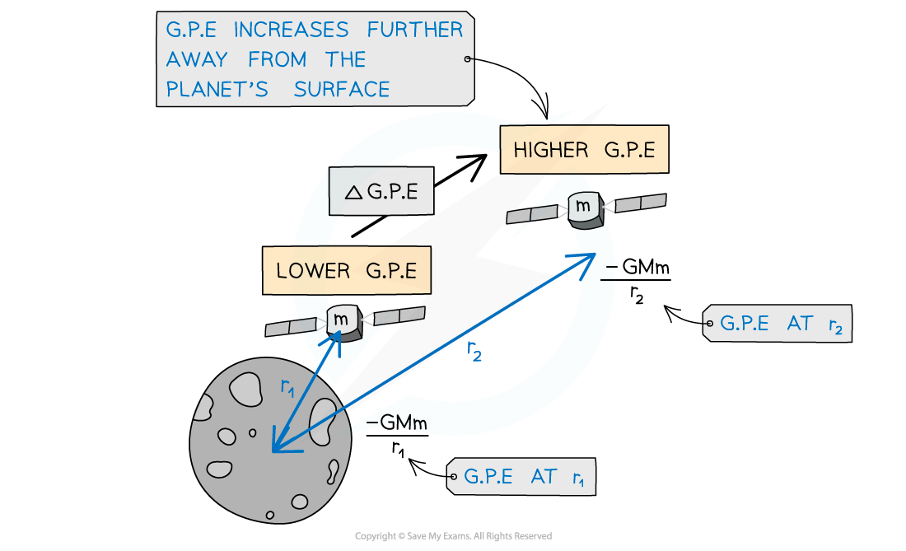

# Gravitational Potential

## Gravitational Potential

> **Spec point** — `spcpt_nxmYY2CNyTPjyjJY`

## Gravitational potential

- Gravitational potential, *φ,* at a point is defined as:

**The work done per unit mass in bringing a small test mass from infinity to the point**

- Gravitational potential always has a **negative** value because:

  - It is defined as having a value of **zero** at **infinity**
  - Since the gravitational force is **attractive**, work must be done **on** a mass to reach infinity

- On the surface of a mass (such as a planet), gravitational potential also has a negative value

  - The value becomes less negative, i.e. it increases, with distance from that mass

- Work has to be done **against** the gravitational pull of the planet to take a unit mass away from the planet
- The gravitational potential at a point depends on:

  - The **mass** of the object
  - The **distance** from the centre of mass of the object to the point

#### Changing gravitational potential

***Gravitational potential decreases as the satellite moves closer to the Earth***

## Calculating Gravitational Potential

> **Spec point** — `spcpt_fjQY6bGnfyqb5zZF`

## Calculating gravitational potential

- The gravitational potential $ϕ$ in a field due to a point mass, *M *is given by the equation:

$ϕ=-\frac{GM}{r}$

- Where:

  - $ϕ$ = gravitational potential (J kg-1)
  - *G* = *Newton’s gravitational constant*
  - *M* = mass of the body producing the gravitational field (kg)
  - *r* = distance from the centre of the mass to the *point mass* (m)

### Change in gravitational potential

- Two points at different distances from a mass will have **different **gravitational potentials

  - This is because the gravitational potential **increases** with distance from a mass
- Therefore, there will be a **gravitational potential difference **$\Deltaϕ$* *between the two points

$\Deltaϕ=ϕ_{f}-ϕ_{i}$

- Where:

  - $ϕ_{i}$ = initial gravitational potential (J kg–1)
  - $ϕ_{f}$ = final gravitational potential (J kg–1)

- The change in gravitational potential $\Deltaϕ$ is calculated using the equation:

`increment ϕ space equals space minus fraction numerator G M over denominator r subscript 2 end fraction space minus space open parentheses negative fraction numerator G M over denominator r subscript 1 end fraction close parentheses`

`increment ϕ space equals space space G M open parentheses 1 over r subscript 1 space minus space 1 over r subscript 2 close parentheses`

- Where:

  - *r*1 = initial distance from the centre of mass to the point mass (m)
  - *r*2 = final distance from the centre of mass to the point mass (m)

> **Worked Example**
> A planet has a diameter of 7600 km and a mass of 3.5 × 1023 kg. A rock of mass 528 kg accelerates towards the planet from infinity.
> 
> At a distance of 400 km above the planet’s surface, calculate the gravitational potential of the rock.
> 
> **Answer:**
> 
> **Step 1:** **Write the gravitational potential equation**
> 
> $ϕ=-\frac{GM}{r}$
> 
> **Step 2:** **Determine the value of r**
> 
> - r is the distance from the centre of the planet
> - Radius of the planet = planet diameter ÷ 2 = 7600 ÷ 2  = 3800 km
> 
> r = 3800 + 400 = 4200 km = 4.2 × 106 m
> 
> **Step 3:  Substitute in values**
> 
> `ϕ space equals space minus fraction numerator open parentheses 6.67 cross times 10 to the power of negative 11 end exponent close parentheses space cross times space open parentheses 3.5 cross times 10 to the power of 23 close parentheses over denominator 4.2 cross times 10 to the power of 6 end fraction space equals space minus 5.6 cross times 10 to the power of 6 space straight J space kg to the power of negative 1 end exponent`

> **Exam Hint**
> Remember to keep the negative sign in your solution for gravitational potential. However, if you’re asked for the ‘change in’ gravitational potential, no negative sign should be included since you are finding a difference in values (between 0 at infinity and the gravitational potential from your calculation).

## Gravitational Potential Energy Between Two Point Masses

> **Spec point** — `spcpt_9GWSJpB2gJGXbz3T`

## Gravitational potential energy between two point masses

### Work done on a mass

- When a small mass is moved away from a larger mass, work is done by the gravitational field

  - This is because the gravitational force is always **attractive**, so energy is needed to work against this attractive force
  - For example, an input of work is required to lift a satellite from the Earth’s surface into space

- The work done in moving a mass $m$ in a gravitational field is given by:

$W=m\Deltaϕ$

- Where:

  - $W$ = work done (J)
  - $m$ = mass (kg)
  - $\Deltaϕ$ = change in gravitational potential (J kg−1)

### Gravitational potential energy

- In a [Radial field](https://www.savemyexams.com/a-level/physics/cie/25/revision-notes/13-gravitational-fields/13-1-gravitational-field/gravitational-fields/), gravitational potential energy (GPE) describes the energy an object possesses due to its **position **in a gravitational field

- The gravitational potential energy of a system is defined as:

**The work done to assemble the system from infinite separation of the components of the system**

- The equation for GPE between **two point masses** *m**1* and *m**2* at a distance *r* is:

$E_{p}=-\frac{Gm_{1}m_{2}}{r}$

- Where:

  - *G* = universal gravitational constant (N m2 kg–2)
  - *m*1 = larger mass producing the field (kg)
  - *m*2 = mass moving within the field of *m**1* (kg)
  - *r* = distance between the centre of *m**1* and *m**2* (m)

#### Gravitational potential energy vs distance

***Gravitational potential energy increases as a satellite leaves the surface of the Moon (of mass M)***

### Change in gravitational potential energy

- Two points at different distances from a mass will have **different **gravitational potentials

  - This is because the gravitational potential **increases **with distance from a mass
- Therefore, there will be a **gravitational potential difference** $\Deltaϕ$ between the two points

$\Deltaϕ=ϕ_{f}-ϕ_{i}$

- Where:

  - $ϕ_{i}$ = initial gravitational potential (J kg–1)
  - $ϕ_{f}$ = final gravitational potential (J kg–1)
- The work done against a gravitational field is equal to the **change **in gravitational potential energy
- The change in GPE when a small mass *m**2* moves towards, or away from, another larger mass *m**1* is given by:

`increment E subscript p space equals space minus fraction numerator G m subscript 1 m subscript 2 over denominator r subscript 2 end fraction space minus space open parentheses negative fraction numerator G m subscript 1 m subscript 2 over denominator r subscript 1 end fraction close parentheses`

`increment E subscript p space equals space G m subscript 1 m subscript 2 open parentheses 1 over r subscript 1 space minus space 1 over r subscript 2 close parentheses`

- Where:

  - *m*1 = mass that is producing the gravitational field (e.g. a planet) (kg)
  - *m*2 = mass that is moving in the gravitational field (e.g. a satellite) (kg)
  - *r*1 *= *first distance of *m**2* from the centre of *m**1* (m)
  - *r*2 = second distance of *m**2* from the centre of *m**1** *(m)

> **Exam Hint**
> Make sure to not confuse the ∆G.P.E equation with
> 
> **∆G.P.E = mg∆h**
> 
> The above equation is only relevant for an object lifted in a uniform gravitational field (close to the Earth’s surface). The new equation for G.P.E will not include g, because this varies for different planets and is no longer a constant (decreases by 1/r2) outside the surface of a planet.
> 
> Remember, multiplying two negative numbers equals a positive number, for example:
> 
> `negative open parentheses negative fraction numerator G M over denominator r end fraction close parentheses space equals space plus fraction numerator G M over denominator r end fraction`
