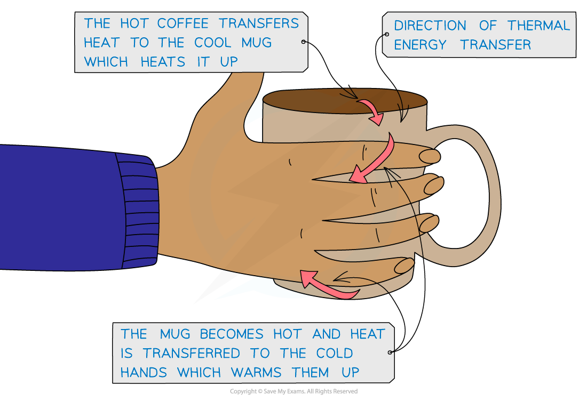

# Thermal Energy Transfer

## Thermal Energy Transfer

> **Spec point** — `spcpt_qbSxCTCZwg5Z7xMY`

## Thermal energy transfer

- **Thermal energy** is **transferred** from a region of **higher temperature** to a region of **lower temperature**

  - The conservation of energy states that energy is never created or destroyed, only transferred from one form to another
  - Temperature tells us the **direction of energy flow** when two regions are in contact (from hotter to cooler)
- When a thermometer is placed in a beaker of boiling water

  - The thermometer reading increases because the thermometer is a lot cooler than the water
  - The thermometer gradually becomes hotter from the thermal energy (or heat) transferring from the water to the thermometer

- Thermal energy is defined as: **The energy possessed by an object due to its temperature.**
- Energy will continue to be transferred until both the thermometer and the water are the **same temperature**

#### Thermal energy transfer from hot coffee in a mug

***Thermal energy is transferred from the hot coffee to the mug and to the cold hands***

- Thermal energy is transferred by either conduction, convection or radiation

> **Exam Hint**
> Sometimes the direction of heat transfer might seem counterintuitive to what we observe in everyday life. When ice is placed in room temperature water, it melts. This is because the water transfers heat energy to the ice (not the ice giving it’s ‘cold’ to the water).
