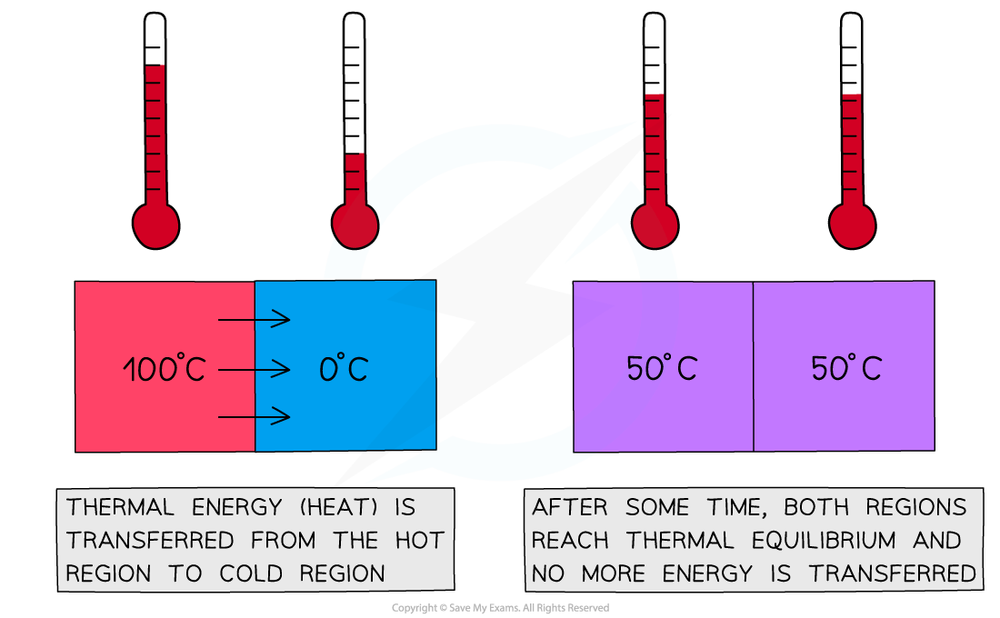

# Thermal Equilibrium

## Defining Thermal Equilibrium

> **Spec point** — `spcpt_NGptPMhcKFRjJnMw`

## Defining thermal equilibrium

- Objects or regions at the **same temperature** are said to be in **thermal equilibrium** with each other
- For two objects in physical contact, thermal equilibrium occurs:

**When there is no net transfer of thermal energy between regions, and both regions reach an equal temperature**

#### Illustrating thermal equilibrium

***Two regions of different temperatures reach thermal equilibrium after some time***

- The hotter region will cool down, and the cooler region will heat up until they reach **thermal equilibrium**
- The final temperature of a system depends on the initial** temperature difference** between the two regions

- For example, ice cubes placed in a glass of room-temperature water

  - The ice cubes **heat up** as energy is transferred from the water
  - The water **cools down**, due to the energy transferred away, until they both reach the same temperature
  - Thermal equilibrium is achieved when the ice has** melted** and the water reaches a temperature somewhere between the initial temperatures of the ice and room-temperature water
