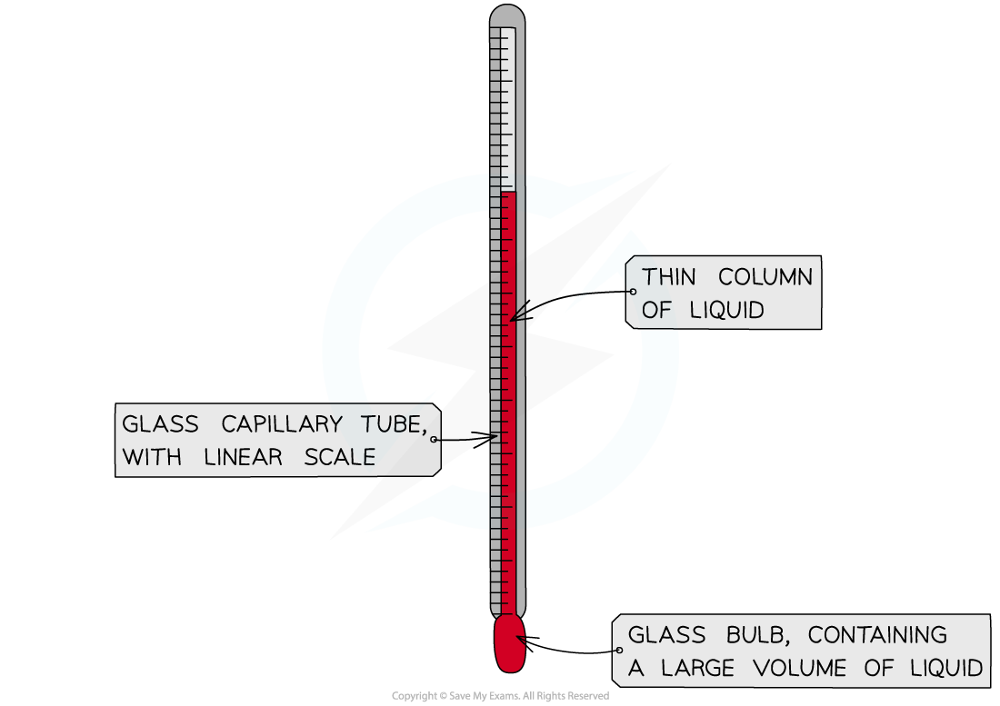
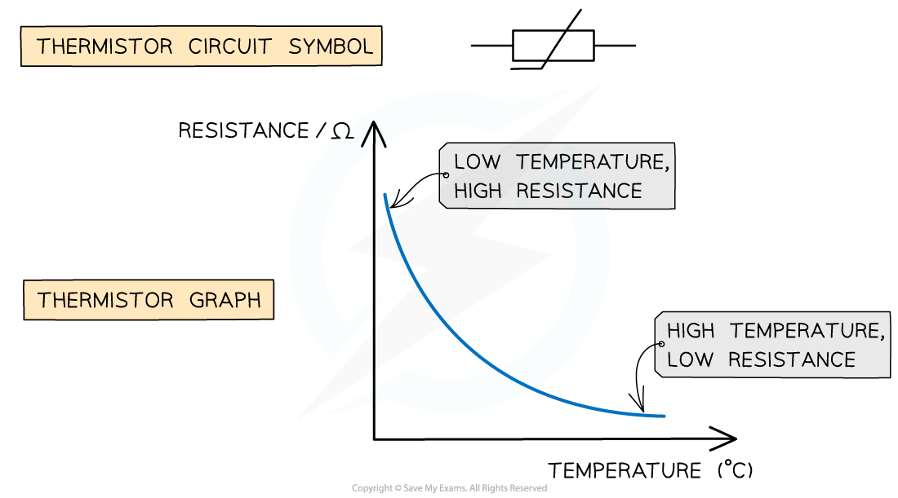
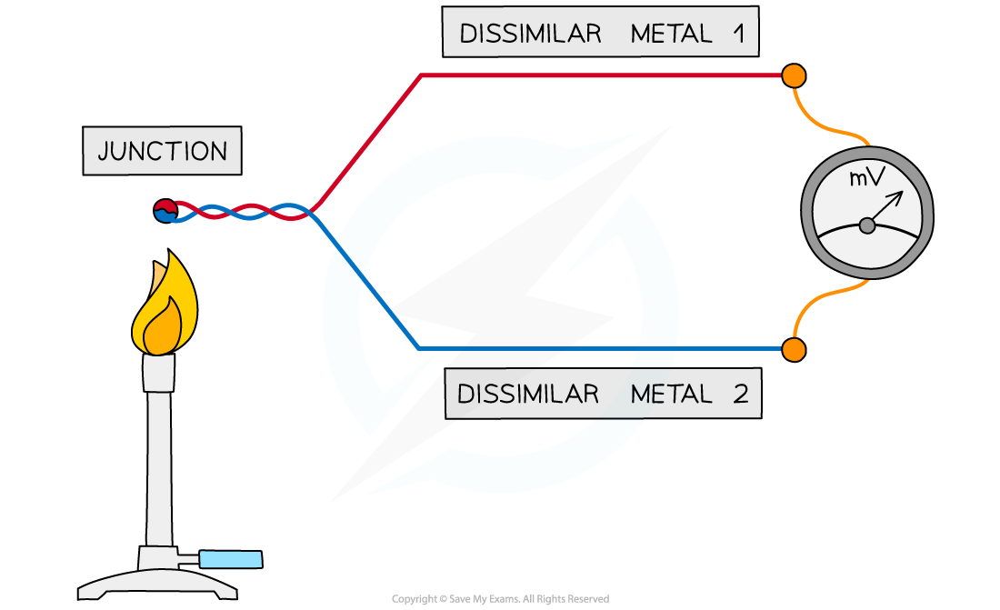

# Measurement of Temperature

## Measurement of Temperature

> **Spec point** — `spcpt_BRvrxwS9P7VjpYk7`

## Measurement of temperature

- **Temperature** is measured using a **physical property** that **varies with temperature**

  - A **thermometer** is any device used to **measure temperature**
- Each type of thermometer uses the physical property of a material that varies with temperature, for example:

  - the density of a liquid
  - the volume of a gas at constant pressure
  - the resistance of a metal
  - the e.m.f. of a thermocouple
- Each type of thermometer is calibrated at two or more known temperatures (commonly the boiling and melting points of water, 0 oC and 100 oC respectively) and the scale is divided into equal divisions

### The density of a liquid

- A liquid-in-glass thermometer depends on the **density change of a liquid** (commonly mercury)

  - The thin glass capillary tube contains a liquid that **expands** with temperature
  - The scale on the side of the tube is measured based on the **length of liquid** within the tube

#### A liquid-in-glass thermometer

***As the bulb is heated, the liquid expands and moves along the capillary tube***

### Volume of a gas at constant pressure

- The **volume** of an ideal gas is **directly proportional** to its **temperature** when at constant pressure (Charles’s law)

**V ∝ T**

- As the **temperature** of the gas **increases**, its **volume increases** and vice versa
- A gas thermometer must be calibrated when the temperature of a gas at a certain volume is known

  - A temperature scale can be determined depending on how quickly the gas expands with temperature

### Resistance of a metal

- Recall that **electrical resistance changes with temperature** e.g. the resistance of a filament lamp increases when the current passing through it also increases

  - For metals: resistance increases with temperature at a steady rate
  - For *thermistors*: resistance changes rapidly over a narrow range of temperatures
- As a **thermistor** gets **hotter**, its **resistance decreases**

  - A thermistor can be used to measure a range of temperatures
- The relationship between the resistance and temperature of a thermistor is **non-linear**

  - The graph of temperature against resistance is a **curved line**, so the thermistor has to be calibrated

#### Graph of resistance against temperature

***As the temperature of a thermistor increases, its resistance decreases.***

### E.m.f. of a thermocouple

- A** thermocouple** is an electrical device used as the **sensor** of a thermometer
- A thermocouple has **two wires** of different, or dissimilar, metals** **attached to each other to create two** junctions**

  - The other ends of the wires are connected to a voltmeter
- When there is a **temperature difference** between the junctions, an **e.m.f.** is **produced** between the two free ends of the wires and measured by the voltmeter

  - The greater the difference in temperature between the wires, the greater the e.m.f

#### Diagram showing a thermocouple

***A thermocouple consists of two dissimilar wires connected together***

- A thermocouple requires calibration since the e.m.f. does not vary linearly with temperature
- The graph against e.m.f. and temperature is a positive, curved line

#### Graph showing e.m.f against temperature

***The e.m.f. and temperature are not directly proportional in a thermocouple.***

> **Exam Hint**
> Remember to relate how the temperature is measured for different types of thermometer back to the scenario in the question. For example, make sure you say: the temperature increases as the **volume of gas increases** or the temperature increases as the **e.m.f. between the two wires increases**.
