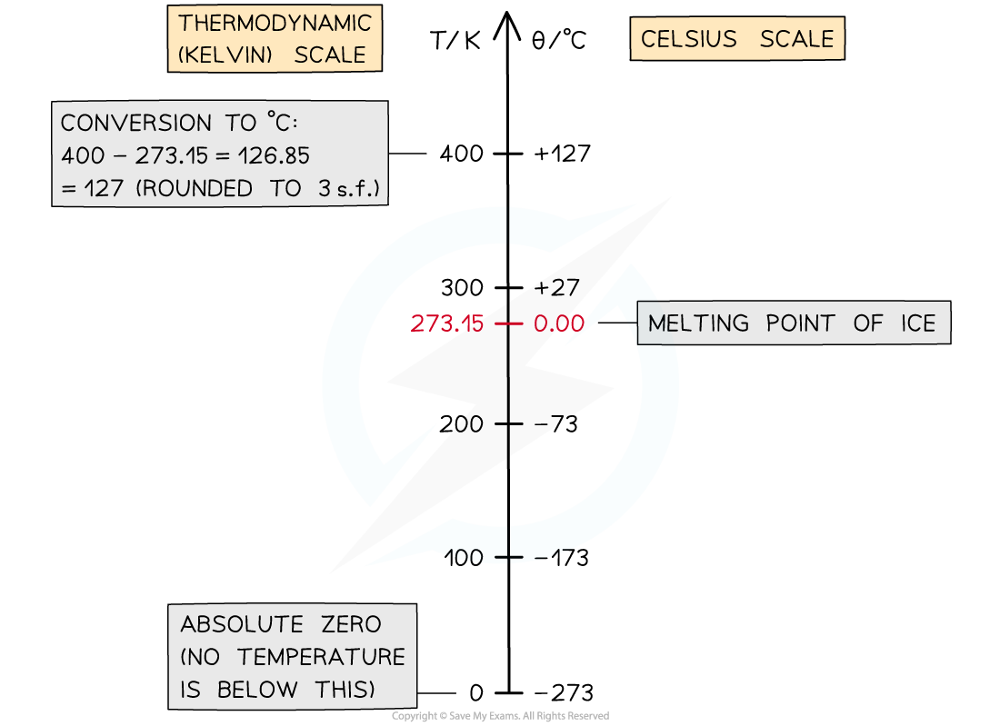
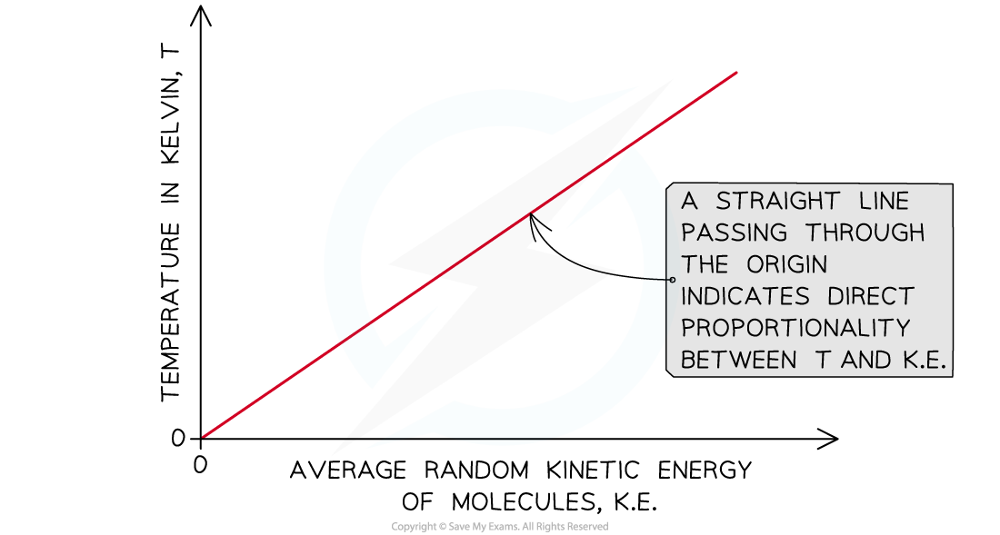

# The Kelvin Scale

## Scale of Thermodynamic Temperature

> **Spec point** — `spcpt_jWzszMnDcxj4TDMg`

## Scale of thermodynamic temperature

- Temperature is a ***scalar*** quantity measured in **degrees Celsius** (**°C**) or **kelvin** (**K**)

  - Kelvin is the **SI base unit** for temperature

### The Kelvin scale

- The **scale of thermodynamic temperature** does **not depend** on the **property** of any particular substance

  - The **thermodynamic temperature scale **is also known as the ***Kelvin***** scale**
- The thermodynamic scale is an **absolute scale** because it is not defined in terms of the properties of any particular substances

  - This is unlike the **degrees Celsius (****o****C) **temperature scale which is based on the **properties of water**

### The degrees Celsius scale

- When the **degrees Celsius (****o****C) **temperature scale was created

  - The freezing point of water was taken as 0 oC
  - The boiling point was taken as 100 oC
- The Celsius scale measures the temperature in a **liquid-in-glass thermometer**

  - The expansion of the liquid is not always linear

## Using the Kelvin Scale

> **Spec point** — `spcpt_ZhxkRcD33k6mN7Hs`

## Using the kelvin scale

- Temperatures in the Celsius scale, *θ*, and temperatures in the Kelvin scale, *T*,  can be converted using the equation:

***θ *****/ ****o****C = T / K − 273.15**

**T / K = *****θ *****/ ****o****C + 273.15**

#### Conversion chart for Kelvin and Celsius

***Conversion chart relating the temperature on the Kelvin and Celsius scales.***

- The **divisions** on both scales are **equal** which means that:

**A change in a temperature of 1 K is equal to a change in temperature of 1 ****o****C**

> **Worked Example**
> In many ideal gas problems, room temperature is considered to be 300 K.
> 
> What is this temperature in Celsius?
> 
> **Answer**
> 
> **Step 1:** **Kelvin to Celsius equation**
> 
> *θ */ oC = T / K − 273.15
> 
> **Step 2:** **Substitute in value of 300 K**
> 
> 300 K − 273.15 = 26.85 oC

> **Exam Hint**
> If you forget in the exam whether it’s +273.15 or −273.15, just remember that 0 oC = 273.15 K. This way, when you know that you need to +273.15 to a temperature in degrees to get a temperature in Kelvin. For example:  0 oC + 273.15 = 273.15 K.

## Absolute Zero

> **Spec point** — `spcpt_4KP56nqT7HK27MKb`

## Absolute zero

- The **lowest possible temperature** on the thermodynamic temperature scale, known as **absolute zero**, is **zero Kelvin **

  - It is not possible to have a temperature lower than 0 K
  - So a temperature in Kelvin will **never** be a negative value
- **Absolute zero** corresponds to the temperature at which the **average** ***kinetic energy*** **of the molecules** is at its **minimum**

  - It is not possible to remove any more energy from a system with a temperature of 0 K
  - Even in space, the temperature is roughly 2.7 K, just above absolute zero
- The **absolute temperature** of a body is** directly proportional to the average kinetic energy of the molecules** within the body

#### Temperature-kinetic energy graph

***At absolute zero, the temperature is zero Kelvin and the kinetic energy of the molecules is zero***
