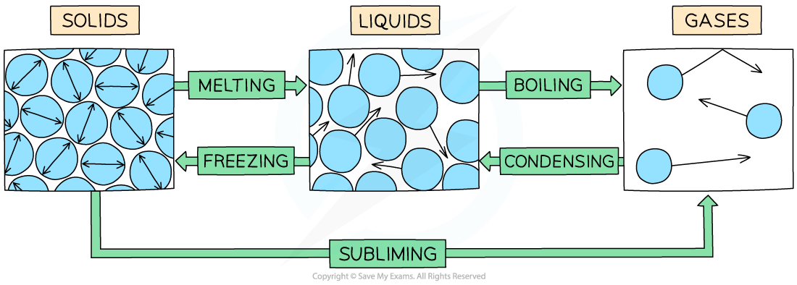
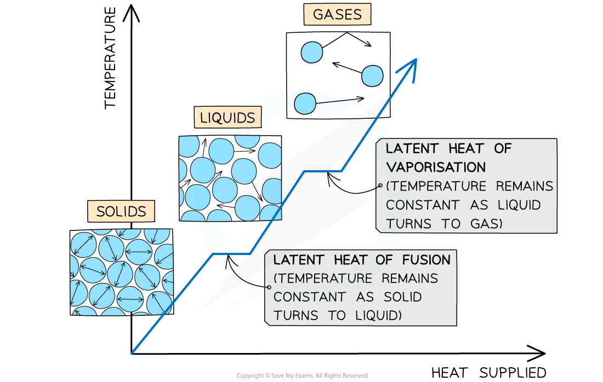

# Specific Latent Heat Capacity

## Defining Latent Heat Capacity

> **Spec point** — `spcpt_Dc7HkD4FwZjjv62d`

## Defining latent heat capacity

- Energy is required to change the **state** of a substance
- Examples of changes of state are:

  - Melting = solid to liquid
  - Evaporation/vaporisation/boiling = liquid to gas
  - Sublimation = solid to gas
  - Freezing = liquid to solid
  - Condensation = gas to liquid

#### Changes of state

***The example of changes of state between solids, liquids and gases***

- When a substance changes state, there is **no temperature change**
- The energy supplied to change the state is called the** specific latent heat **and is defined as: **The thermal energy required to change the state of 1 kg of mass of a substance without any change of temperature**
- There are two types of latent heat:

  - Specific latent heat of **fusion** (melting)
  - Specific latent heat of **vaporisation** (boiling)
- It is important to recognise the difference between **latent heat** and **specific latent heat**

  - **latent heat **is the energy required to change a **materials state**
  - **specific latent heat** is the energy required to **change the state of 1 kg** of a material

#### Types of latent heat

***The changes of state with heat supplied against temperature. There is no change in temperature during changes of state. ***

- The specific latent heat of **fusion** is defined as: *** *****The thermal energy required to convert 1 kg of solid to liquid with no change in temperature**
- This is used when melting a solid or freezing a liquid
- The specific latent heat of **vaporisation** is defined as: *** *****The thermal energy required to convert 1 kg of liquid to gas with no change in temperature**
- This is used when vaporising a liquid or condensing a gas

### Calculating specific latent heat

- The amount of energy *Q* required to melt or vaporise a mass of *m* with latent heat *L* is:

** **$Q=Lm$

- Where:

  - Q = amount of thermal energy to change the state (J)
  - L = latent heat of fusion or vaporisation (J kg-1)
  - m = mass of the substance changing state (kg)
- The values of latent heat for water are:

  - Specific latent heat of fusion = 330 kJ kg-1
  - Specific latent heat of vaporisation = 2.26 MJ kg-1
- Therefore, evaporating 1 kg of water requires roughly **seven times** more energy than melting the same amount of ice to form water
- The reason for this is to do with intermolecular forces:

  - **When ice melts**: energy is required to just increase the molecular separation until they can flow freely over each other
  - **When water boils**: energy is required to completely separate the molecules until there are no longer forces of attraction between the molecules, hence this requires much more energy

> **Worked Example**
> The energy needed to boil a mass of 530 g of a liquid is 0.6 MJ.
> 
> Calculate the specific latent heat of the liquid and state whether it is the latent heat of vaporisation or fusion.
> 
> **Step 1: Write the thermal energy required to change state equation**
> 
> $Q=Lm$** **
> 
> **Step 2: Rearrange for latent heat**
> 
> $L=\frac{Q}{m}$
> 
> **Step 3: Substitute in the values**
> 
> m = 530 g = 530 × 10-3 kg
> 
> Q = 0.6 MJ = 0.6 × 106 J
> 
> $L=\frac{0.6\times10^{6}}{530\times10^{-3}}=1.132\times10^{6}Jkg^{-1}=1.1MJkg^{-1}(2s.f.)$
> 
> **L is the latent heat of vaporisation** because the change in state is from liquid to gas (boiling)

> **Exam Hint**
> Use these reminders to help you remember which type of latent heat is being referred to:
> 
> - Latent heat of fusion = imagine ‘fusing’ the liquid molecules together to become a solid
> - Latent heat of vaporisation = “water vapour” is steam, so imagine vaporising the liquid molecules into a gas
