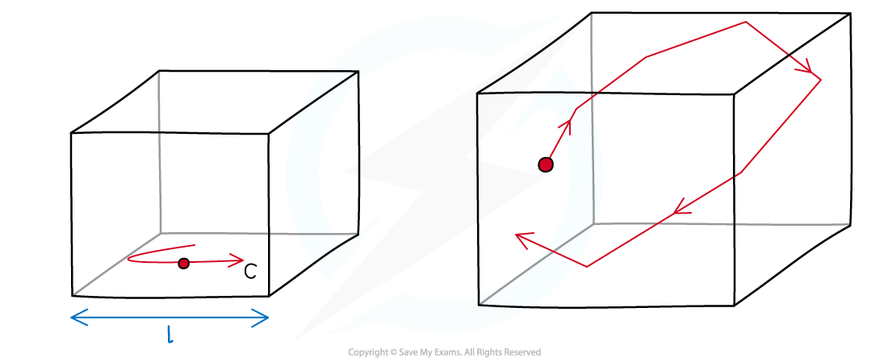

# Derivation of the Kinetic Theory of Gases Equation

## Derivation of the Kinetic Theory of Gases Equation

> **Spec point** — `spcpt_XrS6py9275ZQvvDf`

## Derivation of the kinetic theory of gases equation

- **Molecular movement** causes the **pressure** exerted by a gas

  - When molecules rebound from their container wall, the **change in momentum** gives rise to a **force** exerted by the particles on the wall
  - Many molecules moving in random motion exert forces on the walls, which creates an average overall **pressure** (since pressure is the force per unit area)

### Setting up the model

- Take a **single molecule** in a cube-shaped box with **sides** of equal **length **$L$
- The molecule has **mass **$m$ and moves with **speed **$c$ parallel to one side of the box
- It collides at regular intervals with the sides of the box, exerting a force and contributing to the pressure of the gas
- By calculating the pressure this **one molecule** exerts on **one end** of the box, the total pressure produced by a total of $N$ molecules can be deduced

#### Modelling a gas molecule in a container

***A single molecule in a box collides with the walls and exerts a pressure***

### Deriving the equation step-by-step

**     1. Find the change in momentum as a single molecule hits a wall perpendicularly**

- One assumption of the kinetic theory is that molecules **rebound elastically**

  - This means there is no kinetic energy lost in the collision
- If a molecule rebounds in the opposite direction to its initial velocity $c$, its final velocity will be $-c$
- The change in momentum is therefore:

$\Deltap=p_{f}-p_{i}$

`increment p space equals space minus m c space minus space open parentheses plus m c close parentheses space equals space minus m c space minus space m c space equals space minus 2 m c`

**     2. Calculate the number of collisions per second by the molecule on a wall**

- The time between collisions of the molecule travelling to one wall and back is calculated by travelling a distance of $2l$ with speed $c$:

Time between collisions = $\frac{\mathrm{distance}}{\mathrm{speed}}=\frac{2l}{c}$

- **Note:** $c$ is **not **taken as the speed of light in this scenario

**     3. Find the change in momentum per second**

- The average force the molecule exerts on one wall is found using Newton’s second law of motion:

$F=\frac{\Deltap}{\Deltat}$

$F=\frac{2mc}{\frac{2l}{c}}=\frac{mc^{2}}{l}$

- The change in momentum is $+2mc$ since the force on the molecule from the wall is in the opposite direction to its change in momentum

**     4. Calculate the total pressure from N molecules**

- The area $A$ of one wall is $l^{2}$
- The pressure $p$ is defined as the force per unit area:

$p=\frac{F}{A}$

$p=\frac{\frac{mc^{2}}{l}}{l^{2}}=\frac{mc^{2}}{l^{3}}$

- This is the pressure exerted on the container wall by **one molecule**
- To account for the large number of *N* molecules, the pressure can now be written as:

$p=\frac{Nmc^{2}}{l^{3}}$

- Each molecule has a different velocity and they all contribute to the pressure
- The mean square speed $c^{2}$ is written with left and right-angled brackets `open angle brackets c squared close angle brackets`
- The pressure is now defined as:

`space p space equals space fraction numerator N m open angle brackets c squared close angle brackets space over denominator l cubed end fraction`

**     5. Consider the effect of the molecule moving in 3D space**

- The pressure equation still assumes all the molecules are travelling in the **same direction** and colliding with the same pair of opposite faces of the cube
- In reality, all molecules will be moving in three dimensions equally and randomly, with different velocities $c$:

$c^{2}=c_{x}^{2}+c_{y}^{2}+c_{z}^{2}$

- Where $c_{x}$, $c_{y}$, and $c_{z}$ are the $x$-, $y$-, and $z$- components of the velocity

  - This equation is a result of Pythagoras' theorem in 3D
- Since pressure is due to the force exerted on one face of the cube, only the component of velocity **perpendicular **to that face (e.g. the $x$-direction) matters
- For a gas with molecules moving randomly in all directions, the mean square speed is evenly distributed among all three directions:

`open angle brackets c subscript x superscript 2 close angle brackets space equals space open angle brackets c subscript y superscript 2 close angle brackets space equals space open angle brackets c subscript z superscript 2 close angle brackets`

- Therefore, the mean square speed in the $x$-direction `open angle brackets c subscript x superscript 2 close angle brackets` accounts for a third of the total mean square speed `open angle brackets c squared close angle brackets`

`open angle brackets c subscript x superscript 2 close angle brackets space equals 1 third open angle brackets c squared close angle brackets`

- This is why only one-third of the total mean square speed contributes to the pressure on one wall

**     6. Re-write the pressure equation**

- The box is a cube, and all the sides are of length $l$

  - This means the volume $V$ of the cube is equal to $l^{3}$
- Substituting the new values for `open angle brackets c squared close angle brackets`  and $l^{3}$ back into the pressure equation obtains the final equation:

`space p V space space equals space 1 third N m open angle brackets c squared close angle brackets`

- Where:

  - $p$ = pressure (Pa)
  - $V$ = volume (m3)
  - $N$ = number of molecules
  - $m$ = mass of one molecule (kg)
  - `open angle brackets c squared close angle brackets` = mean square speed of the molecules (m2 s–2)

- This can also be written using the density *ρ *of the gas:

$ρ=\frac{\mathrm{mass}}{\mathrm{volume}}=\frac{Nm}{V}$

- Rearranging the pressure equation for $p$ and substituting the density $ρ$:

`space p space equals space 1 third rho open angle brackets c squared close angle brackets`

> **Worked Example**
> An ideal gas has a density of 4.5 kg m-3 at a pressure of 9.3 × 105 Pa and a temperature of 504 K.
> 
> Determine the root-mean-square (r.m.s.) speed of the gas atoms at 504 K.
> 
> **Answer:**
> 
> **Step 1: Write out the equation for the pressure of an ideal gas with density**
> 
> $p=\frac{1}{3}ρ<c^{2}>$
> 
> **Step 2: Rearrange for mean square speed**
> 
> $<c^{2}>=\frac{3p}{ρ}$
> 
> **Step 3: Substitute in values**
> 
> `less than c squared greater than space equals space fraction numerator 3 space cross times open parentheses 9.3 space cross times space 10 to the power of 5 close parentheses space over denominator 4.5 end fraction space equals space 6.2 space cross times space 10 to the power of 5 space straight m squared space straight s to the power of negative 2 end exponent`
> 
> **Step 4: To find the r.m.s value, take the square root of the mean square speed**
> 
> `c subscript r. m. s end subscript space equals space square root of less than c squared greater than end root space equals space square root of 6.2 space cross times space 10 to the power of 5 end root space equals space 787.4 space equals space 790 space straight m space straight s to the power of negative 1 end exponent space open parentheses 2 space straight s. straight f. close parentheses`

## Root-Mean-Square Speed

> **Spec point** — `spcpt_kNySbncfcZKPxpKJ`

## Root-mean-square speed

- The equation for the kinetic theory of ideal gases contains the **mean square speed** of the molecules:

`open angle brackets c squared close angle brackets`

- Where

  - $c$ = velocity of **one **gas molecule (m s-1)
  - `open angle brackets c close angle brackets` = **average **velocity of the molecules in a gas (m s-1)
  - `open angle brackets c squared close angle brackets` = **average **of the **square **of the** **speeds of the molecules in a gas (m2 s-2)
- Since there are a large number of molecules in a gas, travelling in all directions in 3D space, this results in a large range of values of $c$
- The average velocity `open angle brackets c close angle brackets` of all the molecules in a gas gives a net zero value overall

  - This is because velocity is a vector, so some molecules will have a negative direction and others a positive direction
- Squaring the velocities gives positive values only
- Averaging the values of $c^{2}$ gives `open angle brackets c squared close angle brackets`, the **mean square speed**
- Then, taking the square root of the mean square speed gives:

`c subscript r. m. s end subscript space equals space square root of open angle brackets c squared close angle brackets end root`

- $c_{r.m.s}$ is known as the** root-mean-square** speed and has units of **m s****-1**

  - The root-mean-square speed $c_{r.m.s}$ is **not** the same as the mean speed `open angle brackets c close angle brackets`
