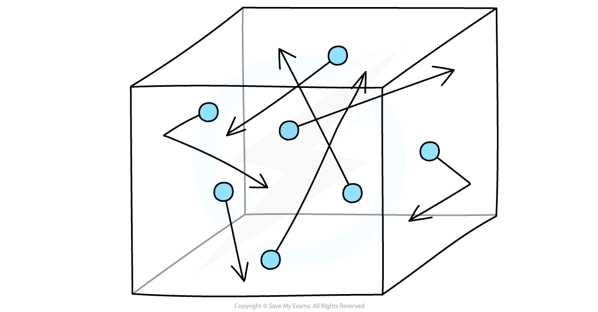

# Kinetic Theory of Gases

## Assumptions of the Kinetic Theory of Gases

> **Spec point** — `spcpt_sy9G2hxBcwsP7brS`

## Assumptions of the kinetic theory of gases

- The **kinetic theory of gases** is based on the following **assumptions**:

  - Molecules of a gas behave as **identical** (or all have the same mass)
  - Molecules of gas are hard, **perfectly elastic** spheres
  - The molecules are in **continuous random motion**
  - There are **no forces** of attraction or repulsion **between the molecules**
  - External forces (e.g. gravity) are ignored
  - **Newton's** laws apply
  - The **volume** of the molecules is **negligible** compared to the **volume** of the **container**
  - The molecules collide **perfectly elastically** with the walls of the container exerting a **pressure upon them**
  - The **time of a collision** is **negligible** compared to the time between collisions
  - There are a **very** large number of molecules

#### Gas molecules in a box

***Gas molecules move about randomly at high speeds***

> **Exam Hint**
> Make sure to memorise **all **the assumptions for your exams, as it is a common exam question to be asked to recall them.
