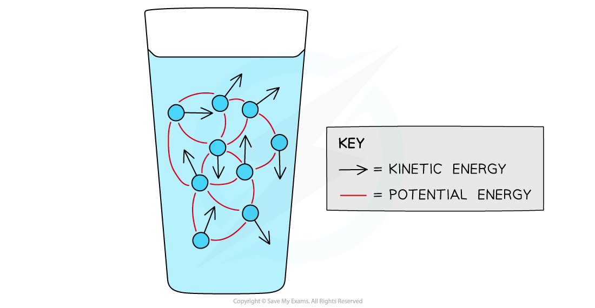

# Internal energy

## Defining Internal Energy

> **Spec point** — `spcpt_MySRd8FkjVpn7WHY`

## Defining internal energy

- The **internal energy** *U* of a system is determined by the **state** of the system

  - For a given mass of a substance at its melting or boiling point, the liquid has more internal energy than the solid, and the gas has more than the liquid

- The **molecules** of all substances have both **kinetic** and **potential **energies

  - Kinetic energy is due to the **speed **of the molecules
  - Potential energy is due to the **intermolecular forces** between the molecules and varies with the **separation **of particles

- The internal energy of a substance is defined as:

**The sum of the random distribution of kinetic and potential energies within a system of molecules**

#### Internal energy of water molecules

***All molecules in a substance possess both kinetic and potential energies***

- The internal energy of a system can increase by:

  - **doing work** on it
  - **adding thermal energy **to it (heating it)
- The internal energy of a system can decrease by:

  - **losing thermal energy **to its surroundings
  - **it doing work** on the surroundings (e.g. a gas pushing a piston)

> **Exam Hint**
> When an exam question asks you to define “internal energy”, you can lose a mark for not mentioning the “**random motion**” of the particles or the “**random distribution**” of the energies, so make sure you include one of these in your definition!

## Internal Energy & Temperature

> **Spec point** — `spcpt_SkCBvtWytQs2gbj9`

## Internal energy & temperature

- The **rise in temperature** of an object is related to an **increase in its internal energy**
- Molecules in solids and liquids are close together and bound by intermolecular forces, so they have **kinetic **and **potential energy**

  - Molecules in solids and liquids are tightly packed, so they begin to **vibrate** more when heated
- Molecules in a **real gas** also have intermolecular forces, so they have potential energy, as well as kinetic energy

  - When a gas is heated, the molecules begin to move around **faster**, increasing their kinetic energy
  - At a given temperature, the total potential energy of all of the molecules will remain constant
- The **change in internal energy** of an ideal gas is **proportional** to the **change in temperature**, and can be written as:

**Δ*****U***** ∝ Δ*****T***

- Where:

  - Δ*U* = change in internal energy (J)
  - Δ*T* = change in temperature (K)
- Since an ideal gas has zero potential energy, its internal energy is directly proportional to its thermodynamic temperature, U ∝ T, where T is in kelvin

#### Molecular movement at low and high temperatures

***As the container is heated up, the gas molecules move faster with higher kinetic energy and therefore higher internal energy***

> **Worked Example**
> A student suggests that, when an ideal gas is heated from 50 °C to 150 °C, the internal energy of the gas is tripled.
> 
> Explain whether the student’s suggestion is correct.
> 
> **Answer:**
> 
> **Step 1: Write down the relationship between internal energy and temperature**
> 
> - The internal energy of an ideal gas is directly proportional to its temperature
> 
> *U* ∝ *T*
> 
> **Step 2: Determine whether the thermodynamic temperature (in K) triples**
> 
> - The temperature must be the **thermodynamic** temperature, in kelvin
> - The Celsius temperature triples from 50 °C to 150 °C
> - In kelvin, the temperatures are:
> 
> 50 °C + 273.15 = 323.15 K
> 
> 150 °C + 273.15 = 423.15 K
> 
> $\frac{423.15}{323.15}=1.3$
> 
> - Therefore, the thermodynamic temperature increases by a factor of 1.3, not three
> 
> **Step 3: Write a concluding statement relating the temperature change to the internal energy**
> 
> The internal energy is directly proportional to the temperature. The thermodynamic temperature has not tripled; therefore, neither has the internal energy. **Therefore, the student is incorrect.**

> **Exam Hint**
> If an exam question about an ideal gas asks for the **total internal energy**, remember that this is equal to the **total kinetic energy** since an ideal gas has **zero potential energy**
